# ShipSim — 우주선 한 척을 지켜보는 시뮬레이션

## 📌 최신 업데이트 · 진행 상황 (2026-10-12)

**지금 하는 일: 연출 끝 ✔ (결산 카드 · 하루 주기 조명 · 창밖 풍경 · 오늘의 장면 사진첩) → 다음은 행성** (주컴퓨터 대개편도 끝 ✔)

> 진행 방식: 기능을 먼저 쭉 만들고, 각 기능은 빌드 + 그 기능 시험으로 확인해 올립니다. 전체 회귀는 맨 끝에 한 번만 돌립니다.

### 주컴퓨터 대개편 1단계 — 사고 지휘관 ✔ (`--commandertest` 통과 · `--cmdbench` 장면 6)

- **주컴퓨터가 전권 자동 제어** — 고정이라 바꿀 수 없습니다. 지휘 순서: **주컴퓨터 → 예비 코어 → 로봇 대장 → 사람**. 위가 고장 나거나 부서지면 다음이 이어받습니다.
- 불 · 파공 · 부상마다 **사건 하나에 지휘관 하나** — 가장 가까운 로봇이 먼저 뛰고, 도착한 뒤에 모자라면 더 부릅니다. 끝나면 로봇을 풀어 주고 기록을 남깁니다.
- 평소에는 위험한 방 근처에 로봇을 **대기 자리**에 세워 두고, 사고 때는 **전력 질주**(몸이 더 닳음).
- 오른쪽에 작은 **지휘 카드** — 누가 지휘하는지 · 사건마다 어디서 · 몇 대가 · 얼마나 걸렸는지.
- **방마다 천장 자동 소화 설비(물안개)** ✔ (`--nozzletest` 통과) — 주컴퓨터가 불을 알면 바로 열고, 컴퓨터가 멎었으면 천장 열 퓨즈가 녹을 만큼 뜨거워져야 저절로 열립니다.
  탱크는 12분치 · 정전이면 펌프가 안 돌고 · 밸브가 낡으면 안 열리고 · 불길 · 폭발에 분사구가 녹거나 터집니다. 망가지거나 비면 로봇이(못 하면 사람이) 퓨즈로 갈고 배의 물로 채웁니다.
  창고 불 4칸: 지휘 건이 열린 지 7분 만에 꺼짐 (증원 없이).
- **구역 중계기** ✔ (`--relaytest` 통과) — 배를 방 여럿씩 구역으로 나누고 구역마다 무전 중계기. 불 · 폭발에 부서지거나 정전에 전지(30분)가 닳으면 그 구역 무전이 끊깁니다:
  주컴퓨터는 그 구역 로봇의 눈 · 사람의 무전을 못 받고 그 구역 로봇을 부르지 못합니다(감지기는 데이터선이라 따로 읽힘). 끊긴 구역 로봇은 **스스로** 눈앞의 불 · 피 흘리는 사람부터 챙기고,
  1분 뒤 드론이 선체 밖 그 구역 곁에 떠서 임시로 잇고, 로봇(못 하면 사람)이 케이블로 고칩니다. 지휘 카드 맨 위에 끊긴 구역이 뜹니다.
- **눈의 그물** ✔ (`--eyetest` 통과) — 무전이 닿는 로봇은 지나가는 방을 늘 보고 주컴퓨터 장부에 '로봇이 봄'으로 올립니다(감지기가 멎은 방도 다시 앎).
  로봇이 본 것과 감지기 값이 계속 어긋나면(헛불 · 사람이 있는데 0명 · 값 멈춤) 감지기를 의심하고 그 로봇이 그 자리에서 다시 맞춥니다.
  20분 넘게 모르는 중요한 방(침실 · 의무실 · 함교 · 원자로 · 생명 유지 · 주방)엔 가까운 한가한 로봇을 정찰 보냅니다 — 평소 하루 2번쯤.
- **로봇 두뇌** ✔ (`--robotbraintest` 통과) — 지휘 건을 끝까지 함께하면 그 사건(불 · 파공 · 부상자)의 솜씨가 늡니다(불 다섯 번이면 거품 +30% · 파공 다섯 번이면 봉합 −25%).
  여러 번 같이 뛴 로봇끼리는 손발이 맞아 증원 때 먼저 불리고 같은 불에서 더 잘 끕니다. 다친 사람 곁에 간 적 있는 로봇은 그 사람이 다시 다치면 먼저 갑니다.
  낡고 덴 적 많은 로봇은 목숨이 걸리지 않은 큰 불엔 덜 불립니다(목숨이 걸리면 아끼지 않음). 말투는 평소엔 버릇대로(또박또박 · 수다 · 무뚝뚝 · 다정), 위급하면 "창고 불 5칸 · 진입 · 거품 100%"처럼 짧게.
  무전이 끊긴 구역에서 혼자 벅찬 불이면 가까운 동료를 직접 부릅니다. 로봇 카드에 '경험' 줄.
  - 고친 버그: 공기가 새는 방 문을 주컴퓨터가 봉합 로봇에게도 열어 주지 않아 로봇이 문 앞에서 기다리던 일 → 봉합하러 가는 지휘 건 로봇은 잠깐 열어 들여보냄 (봉합 시작 3분)
- **평소 수리 배치 · 복기** ✔ (`--learntest` 통과) — 30분 넘게 아무도 안 맡은 고장 · 파손 일은 주컴퓨터가 할 줄 아는 한가한 로봇을 직접 붙입니다.
  지휘 건이 닫히면 복기: 증원이 필요했으면 다음엔 처음부터 손을 더 보내고(불 4칸 3대 → 4대), 작은 불에 남아돌았으면 줄이고, 첫 손이 늦게 닿은 방은 거점을 더 챙깁니다.
  - 파공을 다시 봤더니: 바람이 센 방(15kPa 넘게 새는 방)에서 로봇이 휩쓸려 실링폼을 놓치고 다시 가져오길 되풀이했습니다 →
    로봇은 문 앞에서 기압이 떨어지길 기다리고, 그동안 외벽 구멍은 사람 몫을 거둬 **드론이 선체 밖에서** 막습니다. 정비대에 붙어 쉬던 지휘 건 로봇도 다시 부릅니다.

### 연출 ✔

- **사고 결산 카드** — 지휘 건이 닫히면 배 위 가운데에 크게(잃은 것 · 지킨 것 · 누가 · 로봇 · 주컴퓨터 판단), 7초 뒤 왼쪽 위 띠로 접힘. 연대기에도 남습니다. (`--summarytest`)
- **하루 주기 · 사고 조명** — 밤 22시엔 복도 야간등 · 자는 침실은 수면등 · 빈 휴게실은 어둡게, 아침 7시에 밝아짐. 경보 난 방은 늘 밝고 붉은 문 등, 어둡거나 연기 낀 곳엔 로봇 전조등.
- **창밖 풍경** — 항로 구간 20종마다 배 뒤 풍경(성운 · 오로라 · 가스 행성 · 얼음 고리 · 혜성 · 펄서 · 항구 …)과 창가 방에 드는 빛. 처음 보는 풍경은 연대기에 남고 사람들이 창가에 모여 구경합니다. (`--scenerytest`)
- **오늘의 장면 사진첩** ✔ (`--albumtest` 통과) — 연대기에 남는 일마다 그날의 장면 후보로 점수를 매깁니다(죽음 · 탄생 · 결혼 · 큰 사고와 대응 · 처음 본 풍경 · 함장 · 이정표 …).
  후보가 생기는 그 순간 그 자리를 따로 한 장 찍어 둡니다(배 그림만 · 글은 빼고 · 배 전체의 일이면 배 전체를 한 장에). 같은 방 30분 안의 일은 가장 큰 것 하나만.
  저녁 22시에 그날 장면 1~3장을 배 위에 크게 띄우고(10초 · 누르면 접힘) **기록 탭(F3) · 사진첩**에 날마다 모읍니다. 사고 대응 장면은 결산 카드의 말로 적힙니다("수경재배실 화재 — 불을 껐다 · 불 5칸까지 · 재배 로봇이 0분 만에 닿았다").

| 같은 장면 (시드 6개 평균) | 개편 전 | 개편 후 |
|---|---|---|
| 불 — 첫 도착 | 23분 | **0분** (대기 로봇이 바로) |
| 화재 감지기 고장 + 불 — 첫 도착 | 23분 | **1.8분** |
| 주컴퓨터 정지 + 불 — 첫 도착 / 꺼짐 | 8.7분 / 23분 | **2분 / 13분** (로봇 대장이 지휘) |
| 파공 — 첫 도착 / 봉합 / 못 막음 | 57분 / 108분 / 3·6 | **14분 / 37분 / 0·6** (1단계 18분 / 63분) |
| 부상 — 곁에 닿음 | 8분 | **1.7분** (로봇이 바로 지혈) |
| 불 · 파공 · 부상 동시 — 첫 도착 | 5 / 9.5 / 11분 | **2.6 / 5 / 3.3분** |

| 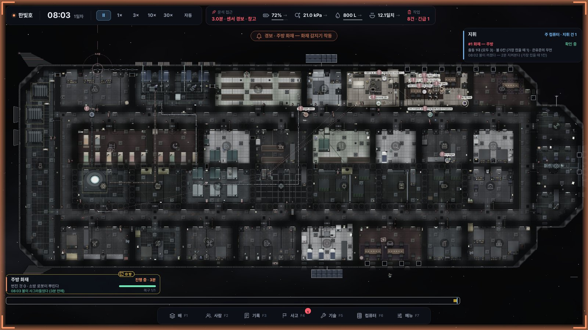 | 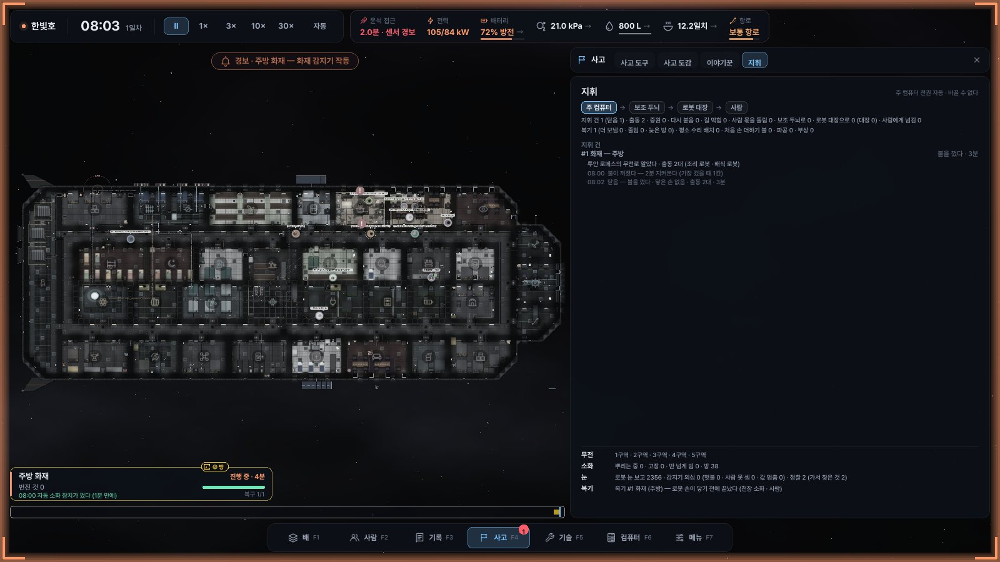 |
|---|---|
| **지휘 카드** — 오른쪽 위: 주방 불 지휘 건 · 출동 · 천장 소화 · 확인 중 | **사고 탭(F4) · 지휘** — 지휘 순서 · 지휘 건 타임라인 · 무전 · 소화 · 눈 · 복기 |
| 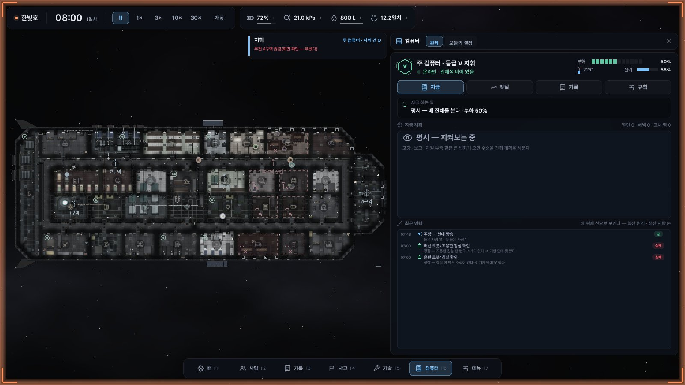 | 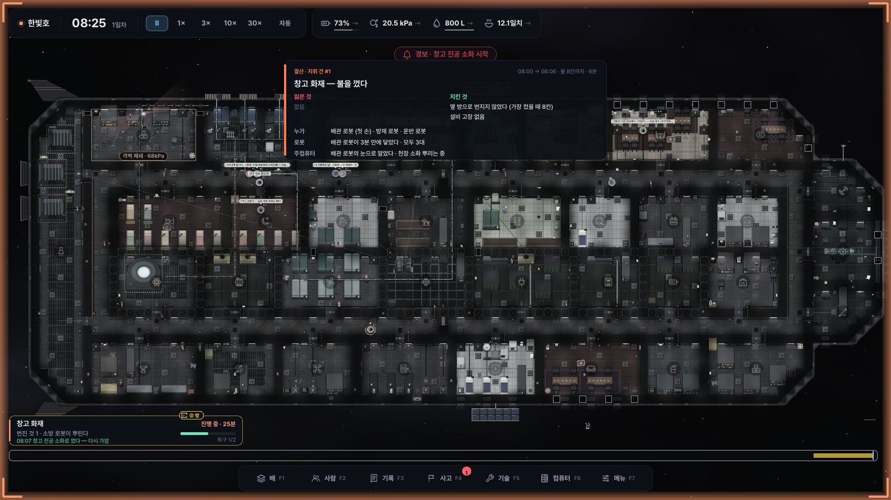 |
| **컴퓨터 탭(F6) 배 위** — 구역 중계기 · 끊긴 4구역(붉은 점선) · 로봇이 방금 본 방(초록 눈) | **사고 결산 카드** — 지휘 건이 닫히면 크게: 잃은 것 · 지킨 것 · 누가 · 로봇 · 주컴퓨터 판단 → 7초 뒤 접힘 |
| 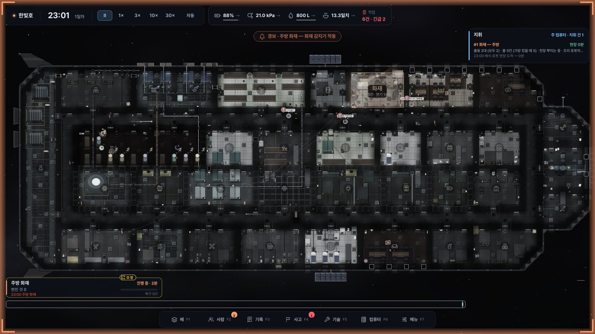 | 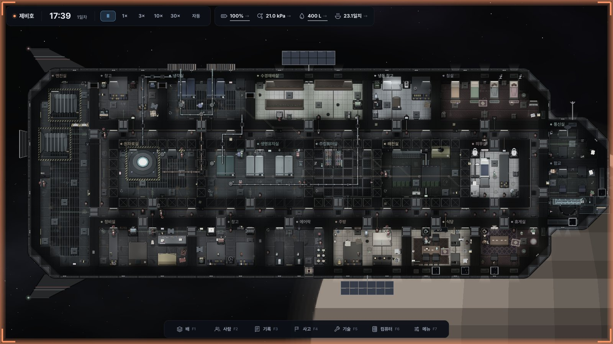 |
| **밤 23시 주방 화재** — 하루 주기 조명: 자는 침실(Z)은 수면등 · 복도는 야간등 · 불난 주방만 밝고 붉게 | **창밖 풍경 — 가스 행성 구간** (제비호): 띠구름 행성이 배 뒤로 · 창가 방에 주황빛 · 사람들이 창가에 모인다 |
| 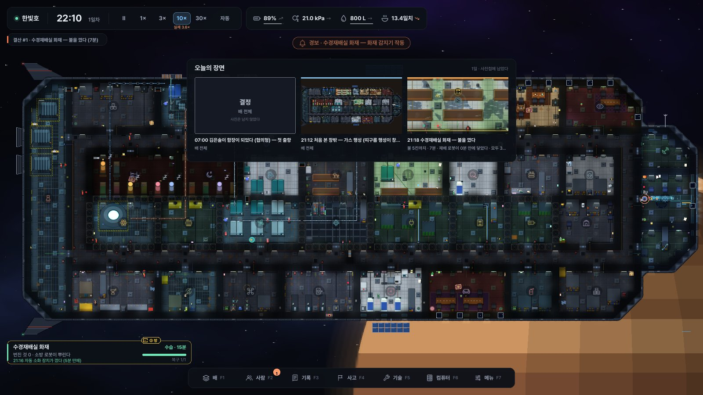 | 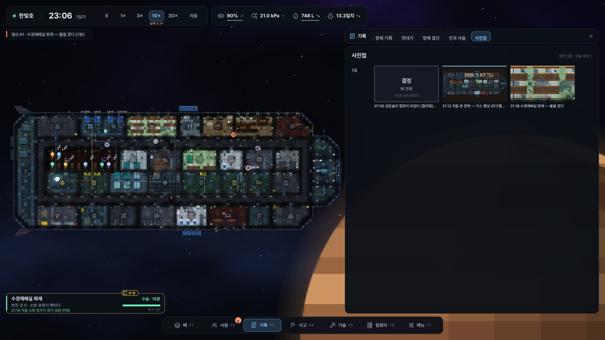 |
| **오늘의 장면 (22시)** — 처음 본 가스 행성(배 전체 한 장) · 수경재배실 불을 끈 그 순간 · 미리 돌린 시간의 일은 사진 없이 | **기록 탭(F3) · 사진첩** — 날마다 고른 장면이 모인다 (위에 올리면 그날 일 전부) |

| 순서 | 묶음 | 상태 |
|---|---|---|
| 0~1 | 로봇 · 드론 확장 · 이야기꾼 세분화 · 기계의 상처와 복구 | ✔ 끝 |
| 연출 일부 | 로봇이 몸으로 막아 주기 · 파괴 순간 카메라 · 로봇 개별 이력(흉터 · 덧댄 판) · 끊긴 일 이어받기 | ✔ 끝 |
| **★** | **주컴퓨터 대개편**: 사고 지휘관 ✔ → 방마다 자동 소화 ✔ → 구역 중계기 ✔ → 눈의 그물 ✔ → 로봇 두뇌 ✔ → 평소 수리 배치 · 복기 ✔ → 사고 탭 · 컴퓨터가 아는 것 겹쳐 보기 ✔ | ✔ 끝 |
| 2 | 연출 나머지: 사건 결산 카드 ✔ · 하루 주기 · 사고 조명 ✔ · 구간마다 창밖 풍경과 빛 ✔ · 오늘의 장면 사진첩 ✔ | ✔ 끝 |
| **3** | **행성: 원소 조합 절차 생성 + 이름 있는 특별 행성 · 지면 타일 · 날씨가 실제로 배 · 로봇 · 사람을 상하게 함 · 채굴 · 기지 · 탐사 · 생존 · 후보 고르기 · 불시착** | **다음** |
| 4 | 항해의 목적과 끝(배 종류별 임무 · 도착 장면 · 항해의 책) → 세대(나이 듦 · 출산 · 아이가 자람) → 지식 전수 · 외부 세계 기억 | 대기 |

- 남은 계획 기준 진행률: **약 45%** (행성이 가장 큰 묶음) · 처음부터 쌓아 온 전체로는 약 92%
- 설계 문서: [주컴퓨터 대개편](docs/design/computer_v23.md) · [남은 큰 묶음 결정](docs/design/roadmap_v23.md)


우주선 한 척에 탄 승무원들과 배의 주컴퓨터를 **처음부터 끝까지 지켜보는** 게임입니다.
사람들은 먹고 자고 일하고 다투고 화해하고, 설비는 닳고 고장 나고, 운석이 외벽을 뚫고, 불이 번지고, 누군가는 그걸 막으러 뛰어갑니다.
그리고 그 모든 일은 사람들의 기억과 배의 모습에 흔적으로 남습니다.

이 게임이 계속 묻는 것은 세 가지입니다.

> **누가 왜 행동했고, 무엇이 바뀌었으며, 누가 그것을 기억하는가.**

🎬 **[트레일러 (45초) · 포스터 · 소개 글](docs/trailer/README.md)**

Godot 4.7 .NET(C#)으로 만들었습니다. 시뮬레이션(`game/src/Core`)은 Godot을 전혀 모르는 순수 C#이라 화면 없이도 똑같이 돌아가고,
같은 시드면 같은 역사가 나옵니다(결정론). 화면은 그 상태를 그대로 그릴 뿐입니다.

---

## 이 게임은

- **완전 관전입니다.** 플레이어는 승무원에게 일을 시키지 않고, 주컴퓨터의 제안을 받거나 거절하는 단추도 없습니다.
  무엇을 할지는 **함장 · 회의 · 주컴퓨터**가 정하고, 각자는 자기가 보고 듣고 전해 들은 만큼만 압니다.
- 플레이어가 하는 일은 **보는 것**입니다 — 시간을 빠르게/느리게 돌리고, 사람이나 물건을 따라가고, 지나간 사고를 되짚고, 기록을 읽습니다.
  배가 어떻게 버티는지 보고 싶으면 운석 · 화재 · 고장 같은 **사고를 일으킬 수는 있습니다**(그 뒤의 대응은 전부 배 안 사람들 몫입니다).
- 끝없는 샌드박스가 기본이고, 항해를 마치면 결산 카드와 연대기가 남습니다.

---

## 화면

실제 게임을 돌려 찍은 화면입니다 (1600×900 · `--shot`).

| | |
|---|---|
| 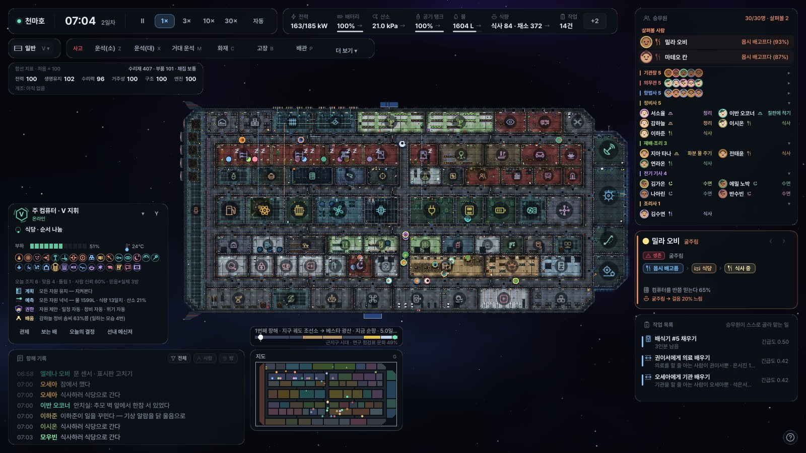 | 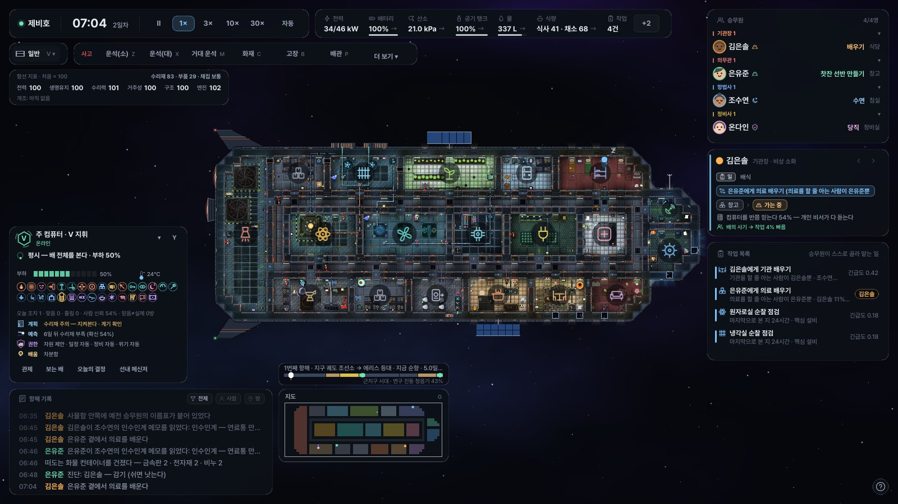 |
| **큰 배** — 30명이 사는 천마호의 아침. 오른쪽은 직책별 승무원 목록과 지금 눈여겨볼 한 사람 | **작은 배** — 4명이 사는 제비호. 왼쪽 아래가 늘 떠 있는 주컴퓨터 카드(지금 하는 일 · 계획 · 예측 · 권한) |
| 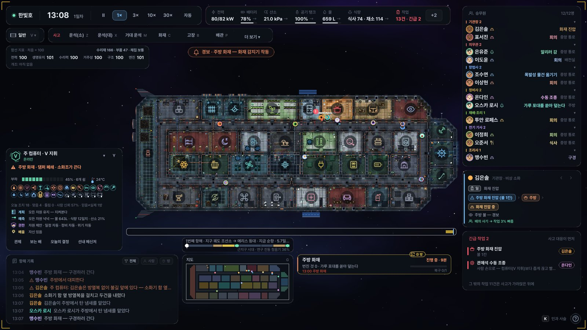 | 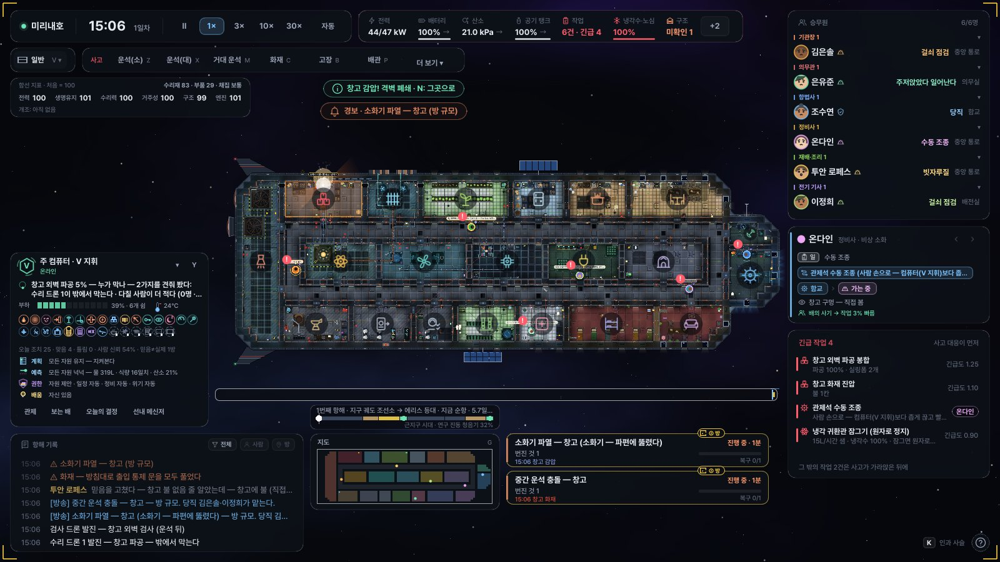 |
| **주방 화재** — 화재 감지기 경보, 컴퓨터가 댐퍼를 닫고 소화조를 부르고, 사람들은 방열복을 걸치고 들어간다 | **운석 충돌** — 창고 외벽이 뚫리고 소화기가 파편에 터진다. 컴퓨터가 수리 드론과 사람 중 누가 막을지 견줘 본다 |
| 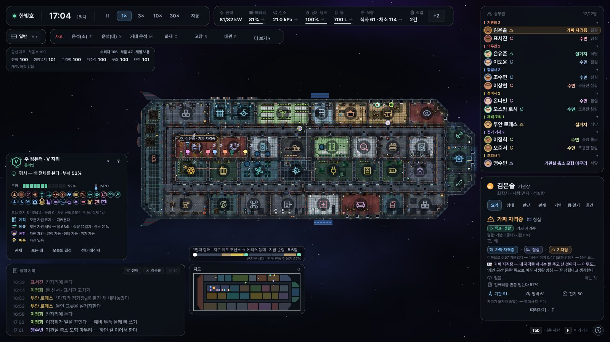 | 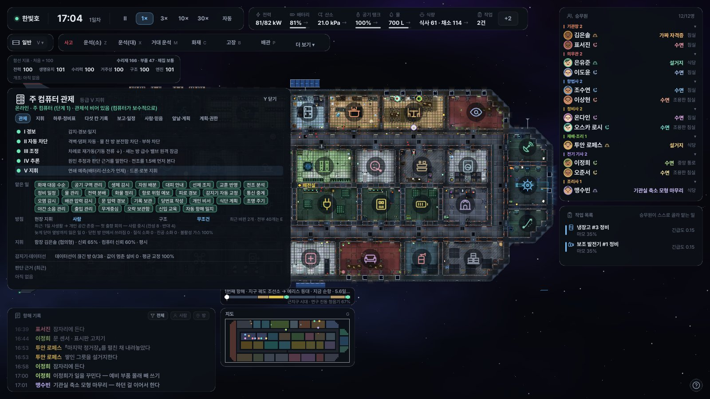 |
| **승무원 카드** — 무엇을, 왜 하는지(목표 · 이유 사슬 · 믿음 · 기술) | **주컴퓨터 관제**(F6) — 지금 · 앞날 · 기록 · 규칙 네 탭, 명령선과 못 보는 방은 배 위에 |
| 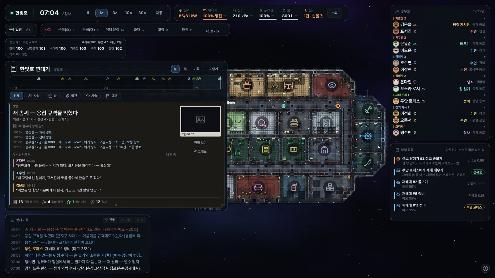 | 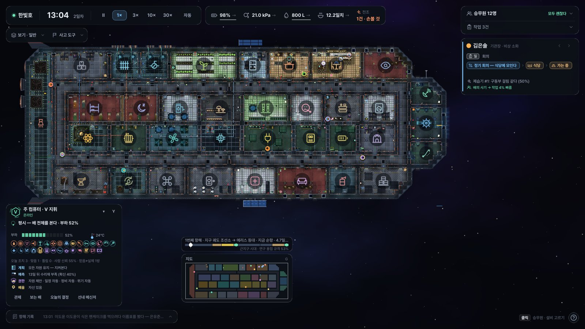 |
| **연대기**(F3) — 날마다의 장, 컴퓨터 항해 일지, 승무원 일기 | **조용한 화면** — 늘 보이는 건 위 줄 · 경보 · 고른 것뿐, 창은 아래 탭(F1~F7)으로 오른쪽에 하나씩 |

| 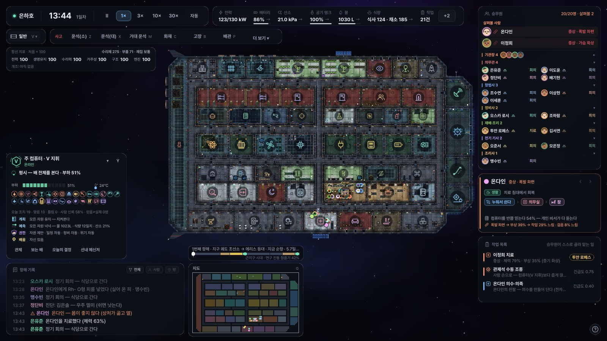 | 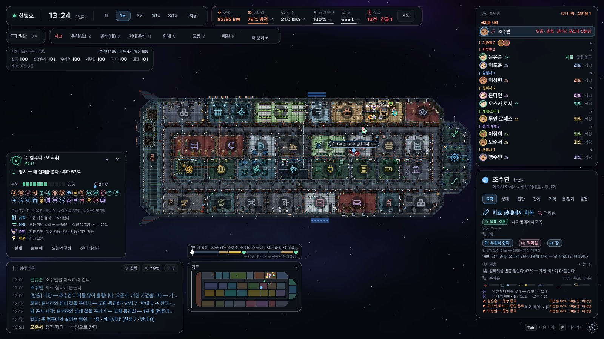 |
|---|---|
| **다침 · 의료** — 은하호. '살펴볼 사람'에 중상 · 폭발 파편 / 중상 · 가슴 화상, 수혈 · 상처가 곪아 열 · 잃은 팔에 의수 | **부상 등급** — 짓눌려 크게 다친 조수연. 곁의 사람이 상처를 눌러 피를 늦추고, 위중을 벗어나 "고비를 넘겼다" |

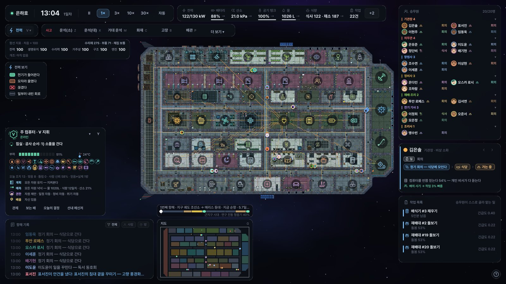
**전력 보기**(V) — 20명이 사는 은하호의 배선과 차단기

---

## 무엇을 볼 수 있나

### 승무원

한 사람 한 사람이 자기 머리로 움직입니다. 승무원을 누르면 "왜 지금 이걸 하는지"가 보입니다.

- **마음** — 믿음(사실과 다를 수 있는 생각) · 감정 · 여러 단계로 짜는 계획 · 가치관 · 버릇. 같은 사고를 겪어도 사람마다 다르게 기억하고 다르게 반응합니다.
- **몸** — 위에서 본 인형처럼 그려지고, 손 · 시선 · 자세 같은 몸짓이 있습니다. 다치면 재활을 하고, 옷 · 보호구 · 안경 · 손에 익은 공구를 챙깁니다.
- **관계와 이야기** — 사람마다 3~5단계의 개인 이야기(고향 가족 · 빚 · 과거), 중요한 순간의 대화, 캠프의 밤 같은 잡담, 로맨스(결혼 · 이별까지).
  고향에서 편지가 오고, 늦게 답장이 갑니다.
- **사회** — 누구나 안건을 내고 서명을 모읍니다. 회의 · 파벌 · 재판 · 선거가 열리고, 진 쪽에는 불만이 남습니다.
- **스스로 꾸미는 일 112종** — 몰래 정원 가꾸기, 밀주, 동호회, 깜짝 선물, 내기 · 물물교환 같은 것들을 승무원이 알아서 벌입니다.
- **실수 숨기기** — 자기 실수를 숨겼다가 블랙박스 조사로 들키면 관계가 바뀝니다.
- **위기와 그 뒤** — 공황 · 훈련 · 경험이 위기 행동을 가르고, 사고 뒤 며칠은 젖은 침구를 널고 꿈을 꾸고 그 장소를 피하기도 합니다.
- **일상** — 늘 앉는 자리, 하다 만 일, 체스, 요리와 냄새, 방 꾸미기. 어느 방을 무엇으로 쓸지도 승무원이 정합니다.

### 주컴퓨터

배의 두뇌이자 한 명의 구성원입니다. 감지기로 본 것만 알기 때문에, **컴퓨터가 믿는 배와 실제 배가 어긋날 수 있습니다.**

- **예측 · 여러 단계 계획 · 실행 · 확인 · 고침** — 앞으로 어떻게 될지 미리 돌려 보고 계획을 세우고, 해 본 뒤 결과를 확인해 고칩니다.
- **자율 복구와 전력 나눠 쓰기**, 그리고 사고가 끝난 뒤의 **검토**(회의 안건으로 올라갑니다).
- **성격**이 있어 말투가 다르고, 아침에는 오늘 일정 · 정비 계획 · 우주 날씨를 **방송**하고, 저녁에는 **항해 일지**를 씁니다.
- **돌봄** — 잠 · 식사 · 일기 분위기에서 우울 징후를 알아채고 친한 동료에게 넌지시 알립니다(어디까지 살펴도 되는지는 회의가 정합니다).
- **로봇 · 드론 지휘** — 로봇과 드론도 각자 판단하고, 컴퓨터가 함대처럼 부립니다.
  위기에 일손이 모자라면 맡은 일 밖의 로봇을 불 끄기 · 쓰러진 사람 옮기기 · 파공 막기 · 물 퍼내기로 **긴급 지정**합니다 —
  '로봇 지휘' 권한이 자동이면 바로, 제안이면 함장에게 묻고, 조언이면 기록만 남깁니다 (컴퓨터가 멎으면 로봇은 원래 맡은 일을 합니다).
- **덜 틀린다** — 화재 감지기 하나만 울리고 같은 방 온도 · 연기 계기가 조용하면 경보부터 울리지 않고 확인부터 합니다.
  확인은 로봇 눈이 먼저 (그 방에 로봇이 있으면 카메라로 바로 · 없으면 한가한 로봇을 보낸다), 사람은 로봇이 없을 때만 부릅니다.
  예측은 하루 주기(기력)를 어제 같은 때로 보고 나머지는 열두 시간 추세를 눌러서 내다봅니다.
- 컴퓨터의 제안은 함장이나 회의가 자연스러운 때 정합니다. 관제 화면에서 무엇을 · 왜 · 누가 정하는지를 볼 수 있고, 원하면 **함장 대신 받기 · 거절**할 수 있습니다. 기다리는 제안이 있으면 컴퓨터실 위에 말풍선, 아래 탭에 숫자가 뜹니다.

### 로봇과 드론

로봇이 기본입니다 — **사람 한 명에 로봇 두 대**(상한 80), 드론은 다섯 대에 **사람 세 명마다 한 대씩 더**(상한 24) 싣고 뜹니다.
로봇과 주컴퓨터가 일하고, 그들이 멎거나 모자라면 사람이 떠맡습니다.

- **모든 로봇은 기본 행동을 다 한다** — 나르기 · 정비 · 재배 · 조명 · 차단기 · 밸브 · 가벼운 수리. 종류마다 **특기**가 있어 그 일은 빠르고 먼저 맡습니다
  (특기가 아닌 일은 특기 로봇이 먼저 잡게 잠깐 기다렸다가 조금 느리게). 특기 일이 올라오면 남의 가벼운 일을 하던 특기 로봇이 불려 옵니다.
- **로봇 26종** — 운반 · 정비 · 재배 · 방재 · 배식 · 급수 · 적재 · 배선 · 조수 · 정밀 정비 · 수확 · 돌봄 · 순찰 · 소방 · 잡역 · 들것 · 간호에 더해
  **청소**(그을음 · 분말 · 잔해 · 바닥 얼룩) · **조리**(식사 짓기) · **배관**(새는 관 · 밸브 · 물 퍼내기) · **지게**(무거운 짐 · 잔해) · **환기**(댐퍼 · 달아오른 설비 식히기) ·
  **구조**(쓰러진 사람 끌어내기 · 잠든 사람 깨우기) · **봉쇄**(안쪽에서 파공 막기 · 격벽) · **공기**(산소관 · 역화 막기) · **의사**(진단 · 응급 처치 · 약 · 상처 누르기).
- **소형 원자로** — 로봇마다 원자로를 품고 다녀 충전대 전기가 필요 없습니다(정전에도 움직인다). 정비대는 쉬며 스스로 손보는 자리입니다.
  아주 가끔 원자로가 폭주합니다 — 스스로 긴급 정지하거나, 사람 없는 방으로 걸어가 소방 로봇이 거품으로 식혀 주기를 기다립니다. 못 식히면 터집니다.
- **협동 · 서로 고치기 · 개량** — 오래 걸리는 일에는 곁의 로봇이 붙어 함께 채우고, 멈춘 동료를 끌고 오고 고칩니다.
  일을 많이 한 로봇은 정비 로봇이 부품으로 **Mk.II · Mk.III**로 개량하고(빨라지고 덜 고장 난다), 특기 일을 할수록 **숙련**이 오릅니다.
- **드론 15종** — 검사 · 수리 · 견인 · 건설 · 정찰 · 측량 · 용접 · 방열판 · 예인 · 골조에 더해 **방패**(경보 난 운석의 길목에서 받아 낸다) · **채굴**(얼음 · 금속 원료) ·
  **외판 손질**(방열판 먼지 · 서리) · **중계**(선외의 사람과 무전을 잇는다) · **구조**(떠내려간 사람 · 드론 회수). 모든 드론이 기본 바깥일(연결부 · 죔쇠 · 방열판)을 합니다.

### 이야기꾼 · 난이도

사고를 언제 · 무엇을 낼지는 **이야기꾼**이 정합니다. 모든 선택은 아래 탭 **사고 › 이야기꾼** 한 곳에 있고, 바꾼 값은 기록돼 불러오기 · 다시 보기가 같은 이야기를 냅니다.

- **난이도 8단계** — 느긋 · 쉬움 · 보통 · 어려움 · 가혹 · **혹독 · 지옥 · 절멸**. 혹독부터는 사고가 **겹칩니다**(수습하는 중에도 기다려 주지 않고, 곧이어 하나 더 오고,
  큰 사고 뒤 숨 돌릴 틈이 짧다). 배 전체급 사고 몫이 커지고 **우주급 재난이 항해마다 더 오고 더 셉니다**. 시작 물자와 부상 깊이는 가혹 그대로입니다.
- **성격 14** — 꾸준 · 몰아치기 · 무작위 · 시험관 · 느린 불씨 · 계절 · 자비 · 앙갚음에 더해
  **연쇄형**(한 사고가 같은 방 · 이어지는 갈래로 번진다) · **포위형**(배 바깥 위협만) · **내부 붕괴형**(고장 · 병 · 실수만) · **마라톤형**(작은 것만 끝없이) ·
  **절정형**(목적지에 다가갈수록 잦고 크게, 직전에 몰아친다) · **파도형**(잠잠해진 뒤 한 무리 — 물결마다 더 크게).
- **리듬** — 어느 성격이든 **잦기 · 크기 · 몰아치기**를 다섯 칸씩 더하고 뺍니다 (가운데 = 성격대로).
- **무작위 사고** — 이야기꾼을 끄면 평균 주기 10단계(2주 ~ 2시간)와 **크기 범위**(작은 것만 · 섞어 · 큰 것만)로 사고가 납니다.

### "이게 돼?"

문제마다 정해진 답 하나가 아니라 **여러 갈래 해법**이 있습니다. 불이 나면 소화기로 끌 수도, 소화 계통을 돌릴 수도,
문을 닫아 산소를 끊거나 방을 진공으로 만들 수도 있습니다. 사람 · 로봇 · 컴퓨터 · 환경 · 물건 조합 · 규칙 어기기 · 희생 중 무엇을 고를지는
배 안 사람들이 상황을 보고 정합니다. 보는 사람이 "어? 저걸로 저게 돼?" 하게 만드는 것이 목표입니다.

### 배

- **크기별 기본 5척** — 제비호(4인) · 미리내호(6인, 기본) · 한빛호(12인) · 은하호(20인) · 천마호(30인). 작을수록 꼭 필요한 방만, 클수록 방 종류가 많고 호화롭습니다.
- **손으로 그린 대표 배 6척** — 새터호(40인 고리형 이민선) · 부싯돌호(채굴선) · 보듬호(병원선) · 나르미호(보급선) · 땜질호(누더기 고물선) · 파발호(2인 우편선).
- **모양 있는 배 8척** — 네모 상자가 아닌 선체. 칸 단위 그대로, 방 · 통로를 놓고 실루엣으로 깎았습니다 (`tools/shipgen/gen_shapes.py`).
  송골매호(화살촉형 · 10인 정찰 연구선) · 귀상어호(망치머리형 · 8인 탐사선) · 보름달호(원반형 · 20인 여객선) · 삼지창호(삼지창형 · 12인 채굴선) ·
  가오리호(가오리형 · 16인 농업선) · 고래호(고래형 · 24인 세대선) · 잠자리호(잠자리형 · 6인 연구선) · 한울호(쐐기형 · 30인 기함).
  모양마다 선체 바깥도 다릅니다 — 앞전의 붉은 줄 · 도는 감지 접시 · 원반 테두리 불빛과 나셀의 푸른 빛 · 미늘의 경고 줄무늬 · 흔들리는 꼬리 · 반투명 날개막 · 달려가는 항해등.
  날개 끝 · 갈래 끝 방은 멀고, 가는 목 · 척추 · 꼬리 통로는 하나뿐이라 같은 사고도 배마다 다르게 번집니다.

  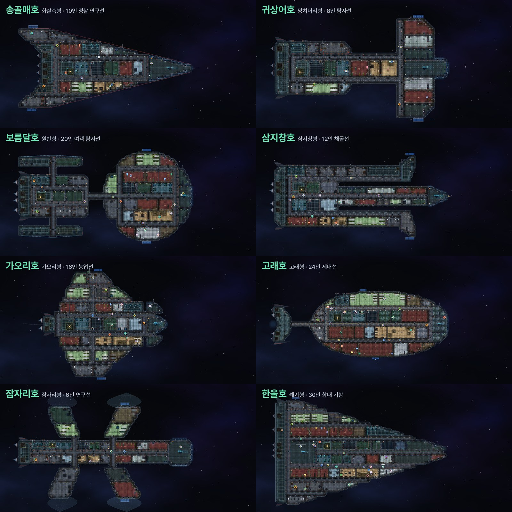
- **생성 배 60가지** — 용도 10 × 뼈대 6(직선 · 고리 · 척추 · 바퀴 · 화물선 · 누더기), 2~60인. 같은 키는 같은 배입니다.
- **증축 · 개조** — 겪은 일에 따라 승무원이 방을 바꾸고, 칸막이를 세우고, 배를 늘립니다.
- **방 72종 · 설비 100 · 기술 141** — 설비마다 고유한 그림과 단계가 있고, 기술이 바뀌면 모양도 바뀝니다. 기술은 그물처럼 이어져 있습니다.
- **사고 100 · 다섯 규모** — 사람 · 방 · 계통 · 배 · 우주급. 전조와 흔적이 있고, 한 사고가 다른 사고를 부릅니다.
  초신성 · 감마선 폭발 · 마그네타 폭풍 같은 **우주 규모 대재난 30종**도 있습니다. 재난마다 그것에만 있는 장면이 있습니다 —
  펄서 빔이 11분마다 배를 쓸고 지나가 그 사이에 움직이고, 플레어는 양성자가 닿기까지 시계가 돌고, 기뢰는 드론이 하나씩 신관을 끊고,
  궤도 무기에는 엔진을 끄고 식별 신호를 보낼지 정하고, 암흑 성운에서는 식당에 등불을 켜고 모여 버팁니다.

### 물리와 생활 환경

- **재질 · 원소** — 젖음 · 열 · 무게 · 마찰 · 오염 · 전도가 물건마다가 아니라 재질과 위치로 정해집니다. 그래서 같은 규칙이 여러 물건에 통합니다.
- **무중력** — 회전 고리가 서거나 인공 중력이 고장 나면 물건과 물방울이 떠다니고, 사람은 손잡이를 잡고 움직입니다.
- **기동 충격** — 기동을 예고하면 선반을 잠그고 카트를 묶고 자리에 앉습니다. 못 챙긴 컵은 쏟아집니다.
- **선내 생태계** — 고양이, 화분, 곡식 바구미. 배수 · 쓰레기 · 재활용도 가볍게 돌아갑니다.
- **물 순환** — 깨끗한 물 → 씻기 · 세탁 · 재배 → 배수구 → 회수관 → 오수 탱크 → 정수기 → 깨끗한 물. 숨 · 땀 · 잎에서 나간 김은 공조기가 응축수로 모으고, 음식에 든 물이 거르며 남는 몫을 메웁니다. 원정에 싣고 간 물처럼 고리 밖으로 나간 물은 천천히 돌아옵니다. 회수관에는 찌꺼기가 쌓입니다. 정수기는 멀쩡한데 오수가 들어오지 않으면 주컴퓨터가 회수관을 짚습니다(주컴퓨터가 없으면 배수구를 뚫어도 또 올라오는 걸 보고 사람이 의심합니다). 뚫을 때까지는 배수구 밑에 임시 회수통을 받치고, 차면 로봇이 정수기로 날라 붓습니다. 유량이 줄면 막히기 전에 역세척합니다.
- **숨 쉬는 몫** — 정원보다 많이 타면 산소 발생기 몫이 숨 쉬는 양을 따라가지 못합니다. 여섯 시간 넘게 이어지면 주컴퓨터가 알리고, 전력 제어기 · 케이블 · 금속판으로 발생기를 하나 더 짭니다.
- **열** — 방마다 열 장부가 있습니다. 사람 · 돌아가는 설비 · 주컴퓨터가 열을 내고, 외벽으로는 우주로 빠지며, 방 사이 벽으로는 이웃 방과 주고받습니다. 공조는 더운 방에서 뺀 열로 찬 방을 덥히고, 남는 열만 방열판으로 버립니다. 연산이 늘면 컴퓨터실 전용 냉각기가 전기를 더 써서 전력 수요가 오르고, 냉각이 끊기면 컴퓨터가 달아올라 연산을 줄입니다. 추위를 막으려 단열재를 붙인 방은 기계 열도 갇힙니다. 전기가 끊기면 외벽에 닿은 방부터 식습니다.
- **정보 경계** — 주 컴퓨터가 아는 것은 모두 값 · 출처(감지기 · 유량계 · 사람이 봄 · 로봇이 봄) · 확인 시각 · 믿음 한 묶음입니다. 오래된 값은 믿음이 옅어져 "모름"이 되고, 모르면 다시 읽어 보고 그래도 안 되면 묻습니다 (방 안 사람은 손목 단말로 바로 답합니다). 급수 유량은 정상인데 바닥이 오래 젖어 있으면 작은 누수 · 결로 · 옆방 · 감지기 오류 · 엎지른 물을 함께 의심하고, 정비 로봇이 먼저 가서 보고 (로봇이 없으면 사람에게 부탁합니다) 본 대로 진단을 고칩니다. 틀린 유량계는 덜 믿고 교정을 걸며, 맞힌 갈래와 틀린 갈래는 다음 짐작에 남습니다. 바닥 밑 급수관이 스미는 일은 교정된 유량계가 잡거나 누가 봐야 알 수 있습니다.
- **계획 조율** — 여러 계획이 같은 사람 · 부품 · 통로 · 전력 · 배터리를 바랄 때 주 컴퓨터가 조율판에 모아 급한 순서로 나눕니다. 냉각을 고치려 원자로 출력을 낮추기 전에 낮춘 출력으로 수술 · 생명유지를 버티는지 보고, 모자라면 배터리로 메우거나 수술이 끝날 때까지 미룹니다. 원자로가 멎은 동안 배터리는 생명유지 → 재기동 몫 → 드론 충전 순으로 나누고, 남지 않으면 덜 급한 드론은 불러들여 세워 둡니다. 하나 남은 부품은 더 급한 수리 몫으로 남기고 (덜 급한 수리는 부분 수리로 버티거나 기다립니다) 급한 수리가 접히면 돌려줍니다. 핵심 설비 수리 · 복구 계획이 이끄는 수리끼리는 서로 몫을 잡아 두지 않습니다 (서로 미루다 둘 다 멈추지 않게). 맞는 손이 덜 급한 일을 하는 사람뿐이면 그를 부르고, 하던 일에는 어디까지 했는지 인계 메모가 남아 이어받는 사람이 더듬지 않습니다. 부상자를 업고 가는 길의 문을 막는 일은 지나간 뒤에 합니다. 기력이 바닥나 잠든 사람은 치료 · 수리로 깨우지 않고 (깨어 있는 성한 손이 맡습니다), 세 시간 넘게 끄는 비상에는 불 · 구조 · 파공처럼 목숨이 걸린 일이 아니면 지친 사람부터 일을 넘기고 잡니다.
- **해법 조합** — 막기 · 고정하기 · 옮기기 · 연결하기 · 절연하기 · 냉각하기, 여섯 가지 공통 동작을 물건의 성질(말랑함 · 새지 않음 · 단단함 · 미끄럼 잡기 · 납작하고 질김 · 전기 · 열 막기 · 차가움 · 담긴 물)과 맞춰 봅니다. 표에 적힌 해법 말고도 성질이 맞는 물건이면 그대로 쓰입니다 — 가루 포대를 파공에 대고 버티고, 고무 매트로 새는 관을 감싸 조이고, 서류 뭉치로 문틈의 연기를 막고, 공구함을 미끄러지는 짐 밑에 괴고, 러그에 다친 사람을 눕혀 끌고, 공구함으로 배관을 두드려 신호를 잇고, 플라스틱 상자로 튀는 선을 덮고, 종이 상자를 두르고 추위를 버티고, 얼음 덩어리를 불에 던져 넣습니다. 얼음은 녹으면 전기가 통해 절연에 쓰지 않고, 젖은 천으로는 배선을 덮지 않습니다. 처음 통하면 옆에서 본 사람이 "저걸 저렇게 쓰네?" 하고, 주 컴퓨터가 새 갈래로 적고, 거듭 통하면 그 배의 관행이 됩니다. 새 물건은 성질 한 줄이면 저절로 쓰임이 생깁니다.
- **도킹 · 난파선** — 다른 배와 도킹하고, 버려진 배를 탐사해 해체하고, 예인 · 구조 · 급유를 합니다.
- **승객** — 일하지 않는 사람들. 불만을 말하고, 공황에 빠지고, 자원봉사를 나서기도 합니다.
- **재료와 수리** — 선체 밖에서 재료를 모아 부품을 만들고, 정품이 없으면 임시품으로, 그것도 없으면 다른 설비를 뜯어 고칩니다. 흉터와 땜질은 배에 남습니다.

### 다침 · 의료

- **부상 등급** — 다친 사람은 **경상 · 중상 · 위중**으로 갈립니다. 부위(팔 · 다리 · 머리 · 가슴 · 폐)와 상처 종류(찢김 · 화상 · 골절 · 으스러짐 · 감압 손상 …)가 있고,
  깊은 상처는 출혈 · 화상 쇼크 · 심정지로 이어집니다. 곁의 사람이 누르고 · 가슴을 누르고, 주컴퓨터는 생체 신호로 다친 사람을 **위중한 사람부터** 방송합니다.
  치료도 위중한 사람부터, 크게 다친 사람은 회의에도 오지 않고 눕습니다. 위중을 벗어나면 "고비를 넘겼다"가 연대기에 남습니다.
- **수술** — 의무실의 수술대 · 무영등 · 마취기 · 멸균기. 봉합 · 골절 고정 · 배 속 출혈 개복 · 머리 · 화상 피부 이식 · 팔다리를 살릴지 절단할지.
  집도의 솜씨 · 보조 · 피로 · 정전(무영등은 비상 전지로) · 멸균 · 무중력 · 기동 흔들림(컴퓨터가 점화를 미루자고 함장에게 청한다)이 결과를 바꾸고,
  실패나 죽음은 집도의에게 죄책감으로, 성공은 자신감으로 남습니다. 수술 뒤엔 흉터와 후유증 · 재활이 이어집니다.
- **피 · 약** — 승무원마다 혈액형이 있고, 맞는 사람이 헌혈로 나섭니다(피를 주고받은 사이는 기억에 남는다). 혈액 냉장고가 멎으면 피가 상합니다.
  진통제 · 항생제 · 마취제 · 혈액 대용제는 재고 · 유통기한이 있고, 재배실 약초로 만들기도 합니다. 항생제를 남용하면 내성이, 진통제는 의존이 생깁니다.
- **장기 · 이식** — 연기 · 가스 · 피폭 · 감압 · 감전 · 약이 폐 · 심장 · 간 · 신장을 상하게 합니다. 투석기 · 인공 폐 · 인공 심장이 버티게 하고(정전이면 주컴퓨터가 그 회로를 지키고, 전지가 다하면 사람이 손 펌프를),
  숨진 동료의 장기 기증은 생전 뜻 · 친한 사람 · 회의의 찬반을 거치며, 산 사람도 신장 하나를 내줍니다. 조직이 맞는지 · 거부반응 · 면역억제제 · 바이오 프린터로 찍은 배양 장기.
- **감염 · 격리** — 곪은 상처를 오래 두면 패혈증이 되고, 멸균이 모자라면 수술 자리가 곪습니다. 옮는 병은 환기관을 타고 번지고, 주컴퓨터가 댐퍼를 닫고 음압 격리실로 격리를 권합니다.
- **주컴퓨터 · 로봇도 의료를 한다** — 의무관이 없거나 다쳤거나 지쳤거나 물러서면 주컴퓨터가 **수술 로봇 팔**로 집도합니다(등급이 낮으면 사람 곁에서 보조만).
  컴퓨터에게 칼을 맡길지는 환자가 정하고(컴퓨터를 믿는 정도 · 가치관), 결과는 신뢰와 기억에 남으며 수술대 위의 죽음은 회의 안건이 됩니다. 수술 중 정전 · 데이터선이 끊기면 팔이 멈추고 사람이 이어받습니다.
  **들것 로봇**은 쓰러진 사람을 침대로 옮기고, **간호 로봇**은 피를 누르고 · 피와 약을 나르고 · 인공 장기 기계의 손 펌프를 돌립니다(고장 · 방전이면 사람이 떠맡는다).
  주컴퓨터는 생체 신호가 닿는 침대의 진통제 펌프 · 인공 장기 기계를 원격으로 맞춥니다. 큰 배는 처음부터 의무실에 수술 로봇 팔이 있습니다.

### 화면

- **연대기**(F3 기록) — 운석 · 화재 · 쓰러짐 · 결정 · 개조 · 교훈이 날마다 쌓이고, 날마다 사진 한 장이 걸립니다.
- **사고 카드 · 사고 사슬**(F3 기록) — 무엇이 무엇을 불렀는지 한 줄로 이어 봅니다. 규모별 사고 도감은 F4 사고.
- **관제 화면**(F6 컴퓨터) — **지금**(상태 · 지금 하는 일 · 제안 받기/거절 · 지금 계획 · 최근 명령) · **앞날**(사실 · 추측 · 예측 · 한 수 판단 · 전력 흐름) · **기록**(다섯 칸 기록 · 보고 · 하루 정비표 · 판단 근거) · **규칙**(권한과 맡은 일을 눌러 바꾸기 · 등급 · 방침 · 사람과 믿음). 창을 열면 명령선 · 못 보는 방(?) · 잘못 아는 방(≠)이 실제 배 위에 그려집니다. 바꾼 것은 모두 기록되어 불러오기가 같은 때 같은 결정을 다시 합니다.
- **보기 모드**(V) — 일반 · 전력 · 공기 · 온도 · 상태 · 흔적 · 구조 · 배관 · 감지기 · 환경 · 컴퓨터(컴퓨터가 보는 배).
- **확대 3단계** — 멀리서는 실루엣, 가까이 가면 손잡이 · 계기 · 들고 있는 물건까지 보입니다.
- **접근성 · 음악** — 색약 팔레트(사람은 표식 모양, 방은 바닥 무늬로도 구분) · 글자 크기 · 배경 음악 · 배 안에서 트는 음악(설정 O).
- **도감** — 설비 · 방 설명서와 사진 · 표본 · 유물 · 사람들을 모으는 수집 도감(F7 메뉴). 배 곳곳에 숨은 것과 드문 것이 있습니다.
- **관찰 도구** — 물건 따라가기(F1 배: 선물 · 사진 · 공구 · 유품이 거친 손), 사진 모드(F1 배), **항해 결산 카드**(F3 기록), 자동 배속(위 막대) · 요약 진행(F1 배).

> 지금 화면은 위 [화면](#화면)과 `docs/screens/`에 있습니다. `docs/screenshot*.jpg` · `docs/screenshots/`는 v10~v14 때 찍은 옛 화면입니다.
> 직접 찍으려면 아래 `--shot` 인자를 쓰면 됩니다.

---

## 실행

1. **Godot 4.7.2 .NET 버전**을 설치합니다 (godotengine.org → Download → ".NET" 표시가 있는 쪽).
2. **.NET SDK 8 이상**을 설치합니다.
3. Godot 프로젝트 관리자에서 `game/project.godot`를 가져옵니다.
4. 오른쪽 위 망치 아이콘(Build)을 한 번 누른 뒤 실행(F5)합니다.

명령줄로 빌드만 확인하려면:

```
cd game && dotnet build
```

> Godot 버전이 다르면 `game/ShipSim.csproj` 첫 줄의 `Godot.NET.Sdk/4.7.2`를 설치한 버전으로 바꿔 주세요.

**내보내기**: 에디터 메뉴 편집기 → 내보내기 템플릿 관리에서 4.7.2 **.NET** 템플릿을 받은 뒤, 프로젝트 → 내보내기 → `Windows Desktop` 또는 `Linux` → 프로젝트 내보내기.
명령줄로는

```
godot --headless --path game --export-release "Windows Desktop" ../build/windows/ShipSim.exe
```

설정은 `game/export_presets.cfg`에 있습니다 (pck를 실행 파일에 넣음, x86_64).

---

## 조작

늘 보이는 것은 **위 줄(시간 · 배속 · 자원)**, **사고 · 경보 카드**, **고른 것 카드**(무언가를 골랐을 때만)뿐입니다.
나머지 창은 **아래 탭 일곱 개**로 묶여 있고, 열면 오른쪽 한 칸에 하나씩 뜹니다 — 배는 남은 자리에 맞춰 다시 그려지고, 창을 열어도 시간은 흐릅니다.

| 아래 탭 | 들어 있는 창 |
|---|---|
| F1 배 | 겹쳐 보기 (보기 고르기 · 요약 진행 · 물건 따라가기 · 다음 승무원 · 사진 모드) · 지도 · 함선 지표 |
| F2 사람 | 승무원 목록 · 작업 · 방침 · 회의록 · 선내 메신저 |
| F3 기록 | 항해 기록 (최근 사건 현장으로 · 사건 넘기기 · 사건 직전으로 되감기) · 연대기 · 항해 결산 · 인과 사슬 |
| F4 사고 | 사고 도구 (운석 · 화재 · 고장 · 배관과 사고 100가지) · 사고 도감 · 이야기꾼 (성격 · 난이도 · 리듬 · 무작위 사고 주기와 크기) |
| F5 기술 | 기술 · 기술 지도 |
| F6 컴퓨터 | 관제 · 오늘의 결정 |
| F7 메뉴 | 설명서 · 수집 도감 · 설정 · 도움말 · 저장 · 불러오기 |

| 입력 | 동작 |
|---|---|
| 마우스 휠 | 커서 기준 확대 / 축소 |
| 우클릭 · 휠클릭 드래그, WASD · 방향키 | 화면 이동 |
| 클릭 | 승무원 · 로봇 · 설비 · 방 선택 (고른 것 카드에 자세히) |
| Space | 일시정지 |
| 1 2 3 4 | 1× · 3× · 10× · 30× (위 막대 **자동**: 평온하면 빠르게, 일이 나면 1배속으로) |
| F | 고른 승무원 따라가기 |
| V | 다음 보기 모드 |
| H 또는 Home | 화면을 배에 맞추기 |
| F1 ~ F7 | 아래 탭 열기 · 같은 키를 한 번 더 누르면 닫기 |
| Esc | 사고 도구 → 오른쪽 창 → 고른 것 차례로 내려놓기 |
| ⇧클릭 | 사고 도구를 유지한 채 연속으로 |

사진 모드에서는 Enter · PrintScreen으로 찍고(`user://photos`에 저장) Esc로 나옵니다. 저장은 5분마다 저절로도 됩니다.

---

## 명령줄 인자

Godot 실행 인자의 `--` 뒤에 붙입니다 (에디터: 프로젝트 설정 → Editor → Run → Main Run Args). 대부분 적힌 순서대로 적용됩니다.

**새 항해**

| 인자 | 뜻 |
|---|---|
| `--seed=11` | 시드 (같은 시드 = 같은 역사) |
| `--ship=Hanbit` | 배. `Kestrel` · `Mirinae` · `Hanbit` · `Eunha` · `Cheonma` · `Saeteo` · `Busitdol` · `Bodeum` · `Nareumi` · `Ttaemjil` · `Pabal` · `Songgolmae` · `Gwisangeo` · `Boreumdal` · `Samjichang` · `Gaori` · `Gorae` · `Jamjari` · `Hanul`, 생성 배는 `gen:용도:뼈대:인원:시드` (예 `gen:mining:ring:10:3`). `--crew` 없이 주면 그 배의 설계 인원 |
| `--crew=10` | 승무원 수 |
| `--load=경로` | 저장한 항해를 불러와 시작 (`.snap`이면 그 자리 상태에서 바로) · `--save=경로` 지금까지를 저장 (기록 `.txt` + 상태 `.snap`) |
| `--death` / `--nodeath` | 승무원 사망 켜기 / 끄기 |
| `--scarcity` | 부품이 바닥난 채로 시작 |
| `--history=60:10` | 60일 동안 10일마다 무작위 사고를 겪은 배로 시작 |
| `--campaign` · `--campaign=2` | 이번 항해를 캠페인 / 세대선으로 |

**시간 · 카메라 · 화면**

| 인자 | 뜻 |
|---|---|
| `--warp=6` | 시작 전에 6시간을 미리 돌림 (`--warpmin=` 은 분 단위) |
| `--speed=0..3` · `--pause` | 배속 · 일시정지로 시작 |
| `--zoom=2` · `--focus=Storage` | 확대 · 그 방으로 화면 이동 |
| `--select=0` · `--tab=1` · `--room=Galley` · `--machine=CoolantPump` · `--robot=0` | 승무원 · 상세 탭 · 방 · 설비 · 로봇 선택 |
| `--view=Power` · `--view2=Air` | 보기 모드 (`Normal` `Power` `Air` `Temperature` `Condition` `Trace` `Structure` `Pipes` `Sensors` `Ambience` `Belief`) |
| `--hud=all` | 숨긴 패널까지 모두 · `safe` 색약 팔레트 · `codex` 수집 도감 · `help` 도움말 |
| `--chronicle` · `--control` · `--codex` · `--tech` · `--options` · `--tutorial` | 그 화면을 연 채로 시작 |
| `--photo` · `--follow` · `--voyage` · `--snapat=N` | 사진 모드 · 물건 따라가기 · 항해 결산 · N 프레임에 사진 |
| `--summary=일수` | 시작하자마자 요약 진행 |
| `--shot=out.png` (`--frames=N`) | 몇 프레임 뒤 화면을 PNG로 저장하고 종료 |
| `--perf=N` · `--census` · `--nobake` | 프레임 시간 재기 (구간별 시간 · 할당 · 12ms 넘은 프레임의 내역 · GC) · 그리는 것 세기 · 구워 둔 그림 끄기(비교용). 엔진 인자 `--fixed-fps 60` 과 함께 쓰면 그래픽 카드가 없는 곳에서도 60프레임 일정 그대로 게임 코드의 CPU 시간을 잰다 |

**사고 걸기 (화면 시험용)**

| 인자 | 뜻 |
|---|---|
| `--meteor=Storage:1` | 그 방 외벽에 운석 (크기 0.35 작음 ~ 1 큼 ~ 1.5 거대) |
| `--fire=Galley` · `--break=CoolantPump` | 그 방에 불 · 그 종류 첫 설비 고장 (끝에 `*`면 전부) |
| `--leg=GasGiant` | (v23) 그 항로 구간으로 바로 간다 — 창밖 풍경을 볼 때 (Nebula · CometTrail · Pulsar · IceRing · Perihelion · Port …) |
| `--relaycut=3` | (v23) 그 번호 구역의 무전 중계기를 부순다 — 끊긴 구역 · 드론 임시 중계를 볼 때 |
| `--shotafter=22.05` | (v23) 게임 시각이 그 시(時)를 지나면 20프레임 뒤에 화면을 찍는다 (`--shot`과 함께 — 오늘의 장면 카드를 찍을 때) |
| `--hazard=GasLeak:LifeSupport` · `--hazard=SolarStorm` | 사고 목록의 사고를 건다 (대상 방 · 번호, 배 전체는 이름만) |
| `--cosmic=PulsarBeam:0.5` | 우주 규모 대재난을 건다 (재난 이름 : 몇 시간 뒤 도착) |
| `--scenario=nosealant` | 헤드리스와 같은 사고 시험 장면 |
| `--random=3` | 무작위 사고 평균 3일마다 (0이면 끔) |
| `--tool=BigMeteor` · `--hazardmenu` | 사고 도구를 고른 채로 · 사고 메뉴를 연 채로 시작 |
| `--episode=1` · `--rewind` | 지나온 사고를 고르고 그 몇 분 전으로 되감기 |

예:

```
# 한빛호, 하루 돌린 뒤 창고에 큰 운석 — 20분 뒤 창고를 골라서 보기
--ship=Hanbit --warp=24 --meteor=Storage:1 --warp=0.3 --room=Storage --pause

# 생명유지실에 유독 가스와 태양 폭풍, 무작위 사고를 켜고 엿새 뒤
--warp=26 --hazard=GasLeak:LifeSupport --hazard=SolarStorm --random=3 --warp=6 --focus=LifeSupport --zoom=2.2 --pause

# 부품 없이 60일을 겪은 배의 연대기를 찍고 끝내기
--seed=11 --scarcity --history=58:10 --chronicle --shot=chronicle.png
```

---

## 시험 · 점검 도구

### 헤드리스 시험

화면 없이 시뮬레이션만 빠르게 돌립니다. 규칙을 바꿨으면 이걸로 장면이 실제로 일어나는지, 결정론이 지켜지는지 봅니다.

```
cd tools/Headless && dotnet build -c Release
dotnet bin/Release/net8.0/Headless.dll 14 7              # 14일 · 시드 7: 하루마다 살림살이 · 고장 · 승무원 상태 · 결정론
dotnet bin/Release/net8.0/Headless.dll 1 7 --braintest   # 시험 하나 (앞 두 숫자는 일수 · 시드)
```

`--ship=` · `--crew=` · `--death` · `--scarcity` · `--quiet` · `--chronicle`(끝에 연대기 출력)도 함께 쓸 수 있습니다.

주요 시험:

| 시험 | 보는 것 |
|---|---|
| `--selftest` | 기본 점검 묶음 |
| `--integtest` | 배 · 화면 · 주컴퓨터 토대를 함께 엮은 통합 장면 |
| `--braintest` · `--mindtest` · `--valuetest` | 승무원 판단 · 믿음과 감정 · 가치관과 딜레마 |
| `--talestest` · `--relationtest` | 개인 이야기 · 대화 카드 · 로맨스 · 관계 |
| `--counciltest` · `--meetingtest` | 회의 · 파벌 · 재판 · 선거 |
| `--schemetest` · `--blackboxtest` | 스스로 꾸미는 일 · 실수 숨기기와 블랙박스 |
| `--crisistest` · `--aftertest` | 위기 행동 · 사고 뒤 며칠 |
| `--computerplantest` · `--computercrewtest` · `--shipcomputertest` | 주컴퓨터 예측 · 계획 · 확인 / 방송 · 일지 · 돌봄 / 자율 복구 |
| `--fleettest` · `--robottest` | 로봇 · 드론 지휘 |
| `--robot21test` | 로봇 · 드론 확장 — 사람 한 명에 두 대 · 소형 원자로 · 모든 로봇의 기본 행동 · 특기가 먼저 · 새 특기 아홉 · 긴급 지정(자동 · 제안 · 조언) · 원자로 폭주 · 개량 · 숙련 · 드론(방패 · 채굴) · 결정론 |
| `--robotbodytest` | 로봇 몸의 부위 — 부위 여덟(몸통 · 궤도/바퀴 · 팔 둘 · 센서 · 제어기 · 동력부 · 도구) · 멀쩡→긁힘→찌그러짐→망가짐→떨어져 나감 · 절뚝 · 팔을 잃으면 손일 못 함 · 폭발 · 물 · 열 · 불 · 덧댄 판 · 이어지는 고장 · 잔해 회수 → 해체(부품 · 고철) → 새 몸 조립 · 뜯어 살리기(잔해 먼저 · 임시 수리 다음 · 멀쩡한 로봇은 마지막) · 저장 · 결정론 |
| `--guardtest` | 로봇이 몸으로 막아 주기 — 폭발 · 파편 앞에 들어서기 · 막은 로봇의 상처 · 함께한 시간 · 애도 |
| `--resumetest` | 끊긴 일 이어받기 — 사람 · 로봇 · 드론이 하다 만 일을 다른 이가 그 진척에서 잇는다 |
| `--commandertest` | 사고 지휘관 — 전권 고정 · 불 사건과 출동 · 불 끝남 · 파공 로봇 봉합 · 부상 지혈 · 지휘 순서(주컴퓨터 → 예비 코어 → 로봇 대장 → 사람) · 대기 자리 |
| `--nozzletest` | 방마다 천장 자동 소화 — 컴퓨터가 열기 · 꺼지면 잠금 · 바닥 젖음 · 컴퓨터가 멎으면 열 퓨즈 · 밸브 안 열림 → 로봇 진입 · 정전 · 바닥난 탱크 채우기 · 망가진 분사구 갈기 · 저장 |
| `--relaytest` | 구역 중계기 — 구역 나누기 · 꺼지면 그 구역 무전 끊김 · 끊긴 구역 로봇은 못 부름 · 드론 임시 중계 · 케이블로 수리 · 끊긴 구역 로봇이 스스로 불 끄기 · 정전 전지 30분 · 저장 |
| `--eyetest` | 눈의 그물 — 멎은 감지기 방도 로봇이 보면 장부가 새로움 · 로봇 눈과 계속 다르면 감지기를 의심해 다시 맞춤 · 오래 모르는 방 정찰 · 끊긴 구역의 눈은 안 닿음 · 평소 하루 정찰 빈도 |
| `--robotbraintest` | 로봇 두뇌 — 불 경험 · 동료로 남음 · 위급할 때 짧은 말 · 아는 사람 먼저 · 거품 +30% · 봉합 −25% · 남은 힘(목숨이면 아끼지 않음) · 손발 · 다친 기억 · 끊긴 구역 동료 무전 · 저장 |
| `--learntest` | 평소 수리 배치 · 복기 — 밀린 고장 일에 로봇을 붙임 · 증원이 필요했으면 다음엔 더 · 늦게 닿은 방 거점 · 남아돌면 줄임 · 배운 만큼 처음부터 더 보냄 · 저장 |
| `--summarytest` | 사고 결산 — 불 결산(무엇이 · 누가 · 지킨 것 · 로봇 · 주컴퓨터) · 큰 불은 크게 · 작은 불은 띠로만 · 다친 사람 결산 · 저장 |
| `--scenerytest` | 창밖 풍경 — 구간 20종 · 볼 만한 구간 알림 · 처음 본 풍경 연대기 · 창가에 모여 구경 · 여덟 시간 뒤엔 그만 · 저장 |
| `--albumtest` | 오늘의 장면 — 후보 점수 · 가벼운 일 빼기 · 같은 방 30분 하나 · 사고 대응은 결산 카드의 말로 · 22시에 1~3장 · 저장 · 실제 이틀 |
| `--cmdbench[=장면]` | 지휘 비교 장면 6 (불 · 센서 고장 · 주컴퓨터 정지 · 파공 · 부상 · 동시) — 시드마다 첫 도착 · 끝난 시간 · 피해 |
| `--story21test` | 이야기꾼 · 난이도 세분화 — 8단계(절멸은 잦고 겹친다) · 새 성격 6의 고르는 규칙과 닷새 흐름 · 리듬(잦기 · 크기) · 우주급 재난 추가 · 무작위 사고 2시간 주기 · 크기 범위 · 결정론 · 저장 |
| `--waystest` | "이게 돼?" — 문제마다 여러 갈래 해법 |
| `--maneuvertest` · `--zerogtest` | 기동 충격 · 무중력 · 생태계 · 배수 |
| `--docktest` · `--smalltest` | 도킹 · 난파선 · 승객 / 옷 · 편지 · 배 종류 · 내기 |
| `--liststest` · `--scaletest` · `--cosmictest` | 사고 · 설비 · 기술 목록 / 사고 규모 / 우주 대재난 |
| `--shipdesigntest` · `--annextest` · `--roomtest` | 배 설계와 크기 등급 / 증축 / 방은 승무원이 정한다 |
| `--hudtest` · `--uitest` | 화면 배치 규칙 |
| `--ctltest` | 관제 화면의 손 — 제안 받기 · 거절 · 권한 · 맡은 일이 기록되고 불러오기가 같은 지문으로 |
| `--perftest` | 60인 배 · 복합 재난 성능 |
| `4 3 --tickspikes [--ship=Saeteo] [--crew=60] [--warm=10] [--cosmic=Kessler:0.3]` | 60프레임 점검 — 가장 느린 틱들과 그 틱의 구간별 시간 · 쓰레기 치우기(GC) |
| `3 1 --lifeprobe [--ship=Saeteo] [--crew=60] [--incidents=fixed\|natural\|none\|storm] [--daily]` | 생활 측정 — 굶주림 원인(생산 · 배송 · 접근 · 행동) · 탈진 원인 · 식사 · 수면이 끊긴 횟수와 이유 · 배식기 보충 시간 · 긴급 일 대기 · 손일을 로봇 · 사람 누가 얼마 만에 끝냈나 · 피폭 · 물 순환(깨끗한 물 · 오수 · 회수관 · 정수기) (storm은 센 태양 폭풍 아홉 시간으로 고정 · `--daily`는 하루마다 한 줄 · 환경 변수 `LP_COORD=1`이면 복구 계획이 도는 동안 두 시간마다 계획 단계 · 급한 일 · 조율 결정) |
| `--watertest` | 물 · 산소 순환 — 평소 균형 · 회수관 막힘을 주컴퓨터가 짚기 · 주컴퓨터 없이 사람이 의심하기 · 임시 회수통 · 뚫은 뒤 회복 · 예방 역세척 · 60명이 탄 새터호에 산소 발생기 하나 더 · 모든 배의 산소 설계 몫 |
| `--heattest` | 열 — 모든 배가 평소 맞춘 온도 · 연산이 늘면 컴퓨터실 냉각 전기 · 냉각이 끊기면 과열과 연산 줄이기 · 단열의 맞바꿈(빈 방은 덜 식고 기계 방은 열이 갇힌다) · 정전 때 외벽 방과 안쪽 방 |
| `--knowtest` | 정보 경계 — 값 · 출처 · 확인 시각 · 믿음 장부 · 틀어진 유량계가 놓친 작은 누수를 의심 → 로봇이 보고 진단을 고침 · 유량계 교정과 땜질 · 로봇이 없으면 손목 단말로 사람에게 · 멈춘 감지기 값 → 방 안 사람에게 묻고 다시 켬 · 맞힌 갈래를 배움 |
| `--coordtest` | 계획 조율 — 수술 중 감출력(버팀 · 배터리로 · 미룸 · 수술 뒤 풀림) · 원자로가 멎은 동안 배터리 나눔(드론 충전 미룸) · 하나 남은 부품은 급한 수리 몫 · 돌려줌 · 핵심 설비끼리는 잡아 두지 않음 · 급한 일로 간 사람의 인계 메모 · 부상자 이송 길의 문 수리는 지나간 뒤에 · 지쳐 잠든 사람은 치료로 깨우지 않음 |
| `6 7 --heatprobe [--ship=Saeteo]` | 배마다 몇 시간 뒤 방 온도 · 공조가 뺀 열 · 넣은 열 · 냉방 전기 · 전력 수요 |
| `4 7 --knowprobe [--ship=Saeteo]` | 평소 항해에서 주 컴퓨터가 날마다 얼마나 묻는지 (의심 · 모름 · 맞음/고침 · 급수관 스밈) |
| `--combotest` | 해법 조합 — 여섯 동작이 모두 물건 성질에서 갈래를 낳는가 · 성질에 안 맞는 물건은 빠지는가 · 표의 마개가 없을 때 가루 포대로 파공을 막는가 · 동작마다 실제로 통하나(감싸기 · 문틈 · 괴기 · 끌기 · 두드리기 · 덮기 · 두르기 · 식히기 · 얼음 던지기) · 젖은 천은 절연에 안 쓰는가 · 처음 통하면 "저걸 저렇게 쓰네?" · 거듭 통하면 관행 |
| `--combolist` | 물건 성질로 생긴 조합 갈래 목록 (문제 · 동작 · 믿음 · 위험) |
| `4 7 --coordprobe [--ship=Saeteo]` | 평소 항해에서 조율판이 날마다 얼마나 끼어드는지 (감출력 · 배터리 · 부품 · 사람 · 통로 · 인계 메모) |
| `20 7 --waterprobe [--ship=Saeteo]` | 물 한 시간마다 — 깨끗한 물 · 오수 · 정수 · 씀 · 주컴퓨터의 물 계획과 예측 · 물 방침 |
| `--savetest` | 저장 · 불러오기가 같은 역사를 내는지 |
| `1 7 --snaptest [--hours=6] [--after=3] [--ship=Saeteo]` | 상태 저장 — 세계를 통째로 찍고 되살려 원래 세계와 나란히 돌린다 (되살린 지문 · 다시 찍은 바이트 · 1분마다 지문 · 끝에 찍은 바이트가 모두 같아야 한다 · `--snapfile=경로`로 남기고 `--snapload=경로`로 다른 프로세스에서 이어 돌리기) |
| `--scenario=all` | 사고 시험 장면 전부를 한 줄씩 (결과를 완전 복구 / 부분 복구 / 장기 장애 / 실패로 분류) |

전체 목록은 `tools/Headless/Program.cs` 의 `Main` 에 있습니다. 긴 회귀를 한 번에 돌리려면 `tools/regress.sh [출력 폴더] [동시에 돌릴 수]`.

### 점검 항해

사람이 플레이하며 찾던 이상한 장면(굶주림 · 막힌 동선 · 멈춘 일 · 이상한 결정 …)을 헤드리스로 찾아 보고서로 냅니다.
항해 하나를 프로세스 하나로 돌려 서로 섞이지 않게 합니다.

```
dotnet bin/Release/net8.0/Headless.dll --audit [일수=10] [시드들=7,11,13] [배들=기본 5척+생성 3척]
dotnet bin/Release/net8.0/Headless.dll --audit 2 7 Hanbit          # 짧게 확인
```

`--jobs=4`(동시에) · `--out=폴더` · `--persona=` · `--level=1..8`(이야기꾼 성격 · 난이도)를 붙일 수 있습니다.
보고서는 **`docs/audit/AUDIT_<날짜>_s<시드들>_d<일수>.md`**(+ `.json`)로 남고, 이전 보고서와 비교됩니다.
사고 규모(개인 · 방 · 계통 · 배 · 우주급)마다 사망만이 아니라 **위중(쓰러짐) · 중상 · 경상**을 나눠 셉니다.
규칙만 고친 뒤에는 `--audit --audit-report=docs/audit/AUDIT_….json` 으로 시뮬레이션 없이 보고서만 다시 씁니다.

---

## 폴더

```
game/                    Godot 프로젝트
  src/Core/              시뮬레이션 (순수 C# — 승무원 · 주컴퓨터 · 배 · 물리 · 사고 · 기술 …)
  src/View/              화면 (배 그리기 · 인형 · 설비 그림 · HUD · 카메라 · 소리)
  assets/                폰트 · 아이콘 · 텍스처
tools/Headless/          헤드리스 시험 · 점검 항해
tools/shipgen/           기본 배 다섯 척 설계도 생성기 (gen_ships.py → Core/ShipTemplates.cs)
tools/texgen/            재질 텍스처 생성기 (C# → game/assets/textures/look_*.png, -- --check 로 같은지 확인)
tools/textures/          예전 텍스처 생성기 (make_textures.py)
tools/regress.sh         긴 회귀 한 번에
docs/                    계획 · 설계 문서 · 점검 보고서
```

---

## 문서

- [`docs/PLAN_v16.md`](docs/PLAN_v16.md) — **지금 계획과 진행** (v16~v18: 원칙 · 단계별 범위와 완료 기준 · 남은 묶음)
- [`docs/DIRECTION.md`](docs/DIRECTION.md) — 분야별로 토론해 정한 설계 방향 (플레이어 역할 · 설비 · 사고 · 사람 …)
- [`docs/DESIGN.md`](docs/DESIGN.md) — 처음 기획서 (게임의 뼈대)
- [`docs/ROADMAP.md`](docs/ROADMAP.md) · [`docs/PROGRESS.md`](docs/PROGRESS.md) — v3~v15 때의 순서와 진행 메모 (지난 기록)
- [`docs/audit/`](docs/audit/) — 점검 항해 보고서 · [`docs/regress/`](docs/regress/) — 예전 회귀 결과

---

## 라이선스 메모

- 폰트: `game/assets/fonts`의 Pretendard는 SIL Open Font License (`Pretendard-LICENSE.txt`).
- 텍스처: `tools/texgen`(지금) · `tools/textures`(예전)로 생성한 것이라 자유롭게 고쳐 쓰면 됩니다.
