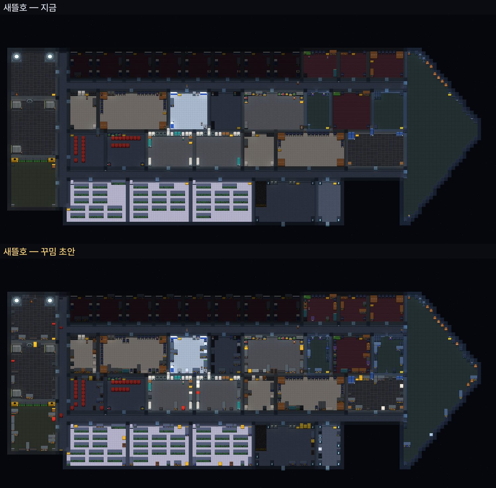
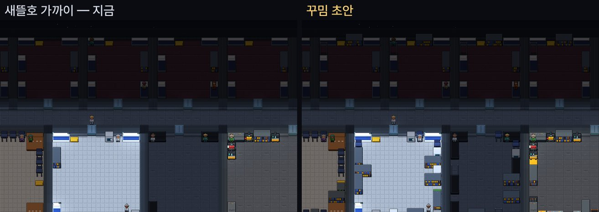

# 배 꾸밈 — 함장 승인 (전부) · 배 도면에 들어감

> 배 일곱 척에 시설 · 장치를 알맞은 밀도로 (텅 비어 보이지 않게 · 길은 막지 않게). **함장이 전부 승인했다** — `Lab --shipgen`이 꾸밈까지 넣어 `engine/data/ships/`를 만든다 (`--draft`는 지금 도면과 견주는 그림만 `build/shipdraft/`에). 저장 판 94.

## 왜
지금 설비가 방 바닥을 덮는 몫이 11~23%. 큰 방일수록 바닥만 넓게 보인다 (통로 0% · 함교 7% · 실험실 6% · 통신실 6% · 에어락 7% · 관측실 5%).

## 무엇을 — 한 척씩 (설비 수 · 방 바닥을 덮는 몫)

| 배 | 설비 | 덮는 몫 |
|---|---|---|
| 화살호 (3명) | 56 → 69 | 23 → 27% |
| 디딤호 (6명) | 106 → 221 | 15 → 28% |
| 살핌호 (12명) | 164 → 340 | 13 → 26% |
| 나름호 (8명) | 196 → 310 | 22 → 29% |
| 쇠돌호 (10명) | 159 → 378 | 11 → 24% |
| 새뜰호 (40명) | 344 → 646 | 15 → 25% |
| 한누리호 (100명) | 660 → 1114 | 19 → 27% |

|  |
|---|
| **새뜰호** 위: 지금 · 아래: 꾸밈 초안 |

|  |
|---|
| **가까이** — 침실 줄 · 의무실 · 정비실: 벽을 따라 선반 · 옷걸이 · 약장 · 공구 벽 · 정비 수레가 서고 · 가운데와 문 앞은 빈다 |

나머지 배: [화살호](screens/furnish/hwasal.jpg) · [디딤호](screens/furnish/didim.jpg) · [살핌호](screens/furnish/salpim.jpg) · [나름호](screens/furnish/nareum.jpg) · [쇠돌호](screens/furnish/soedol.jpg) · [한누리호](screens/furnish/hannuri.jpg)

## 지키는 것 (길을 막지 않는다)
- 문 앞 칸은 비운다 · 방의 빈 칸은 한 덩어리로 이어진다 (어디서든 문까지 걸어 나간다).
- 이미 있는 설비마다 곁에 빈 칸이 하나는 남는다 (침대 · 조리대 · 조종대를 쓰러 갈 자리).
- 대부분 벽에 붙인다 — 한쪽에 몰리지 않게 다른 것에서 먼 벽부터 · 의자 · 달리기틀 · 조종대는 곁의 탁자 · 설비에 붙여도 된다.
- 통로는 세 칸 넘게 넓은 곳의 벽에만 · 일곱 칸에 하나 · 문 둘레 두 칸은 비운다.
- 방마다 종류별로 몇 개까지 (같은 것이 줄줄이 늘어서지 않게 — 식기세척기 · 커피 기계 · 수족관 · 세안대는 방에 하나).

## 방 종류마다 더 놓는 것 (채울 몫)
| 방 | 몫 | 더 놓는 것 |
|---|---|---|
| 침실 | 32% | 선반 · 옷걸이 · 책장 2 · 의자 3 |
| 식당 | 32% | 커피 기계 1 · 선반 · 수족관 1 · 게시판 1 · 화분 선반 3 · 의자 |
| 주방 | 32% | 선반 · 양념 선반 2 · 식기세척기 1 · 오븐 2 · 제빙기 1 · 발효기 2 |
| 함교 | 20% | 조종대 4 · 서버 선반 2 · 선반 4 · 상황판 1 · 충격 좌석 4 |
| 실험실 | 30% | 작업대 3 · 선반 · 책장 3 · 증류기 1 · 세안대 1 · 보정대 2 · 진단기 2 |
| 통신실 | 28% | 조종대 3 · 서버 선반 3 · 신호 증폭기 1 · 청음기 1 · 선반 · 의자 2 |
| 에어락 | 20% | 우주복 사물함 4 · 우주복 건조기 2 · 자석 장화 걸이 2 · 내열복 걸이 2 · 오염 제거 샤워 1 |
| 관측실 | 25% | 망원경 2 · 의자 4 · 책장 2 · 조종대 2 |
| 의무실 | 30% | 약장 2 · 선반 · 혈액 냉장고 1 · 세안대 1 · 의자 3 · 멸균기 1 |
| 정비실 | 32% | 공구 벽 4 · 선반 · 부품 시험대 1 · 보정대 1 · 호이스트 1 · 정비 수레 2 · 짐 그물 |
| 창고 | 38% | 선반 · 짐 그물 · 비상 물자함 2 · 압축기 1 |
| 생명유지실 | 28% | 선반 · 공구 벽 2 · 누출 센서 2 · 진동 센서 2 · 비상 물자함 1 |
| 배전실 | 28% | 선반 · 공구 벽 2 · 열화상 카메라 1 · 방화 담요 1 · 비상 물자함 1 |
| 엔진 · 원자로 · 냉각실 | 24% | 조종대 2 · 공구 벽 2 · 열화상 카메라 · 진동 센서 · 호이스트 · 방화 담요 · 선반 |
| 쉼터 | 32% | 책장 3 · 의자 · 음악 구석 1 · 오락기 2 · VR 의자 2 · 화분 선반 3 · 수족관 1 |
| 운동실 | 30% | 달리기틀 3 · 선반 · 세탁기 1 · 옷걸이 2 · 의자 3 |
| 재배실 | 36% | 해충 덫 2 · 퇴비통 1 · 화분 선반 4 · 선반 |
| 화물칸 | 36% | 짐 그물 · 호이스트 2 · 선반 |
| 컴퓨터실 | 30% | 서버 선반 4 · 조종대 2 · 열화상 카메라 1 · 선반 |
| 제련실 · 격납고 · 드론실 · 학교 · 예배실 | 25~30% | 맡은 일에 맞게 (압축기 · 공구 벽 · 호이스트 · 정비 수레 · 책장 · 게시판 · 의자 · 화분) |
| 통로 | — | 비상등 · 방화 담요 · 비상 물자함 · 손잡이 · 누출 센서 (일곱 칸에 하나 · 넓은 곳만) |

## 세상에 닿는 것 (그림만이 아니다)
1. **모두 실제 물건**이다: 무게 · 재질이 있고 · 타는 재질(고분자 · 천 · 단열재)은 그 칸의 불 연료가 되며 (책장 · 옷걸이 · 의자가 많은 방은 불이 더 잘 번진다) · 칸을 막는다 (사람 · 로봇은 돌아간다).
2. **장치 13종은 전기를 쓰고 부품이 닳아 고장 난다**: 조종대 · 작업대 · 커피 기계 · 오븐 · 세탁기 · 우주복 건조기 · 달리기틀 · 진단기 · 멸균기 · 비상등 · 센서 셋(누출 · 진동 · 열화상). 센서는 주컴퓨터의 눈이 된다 (기계실의 누출 · 떨림 · 열을 더 일찍 안다). 전력은 배마다 여유 안에서 1~2kW 늘어난다.
3. **새 종류 21가지는 재질 표에 더한다** (공구 벽 · 옷걸이 · 약장 · 혈액 냉장고 · 세안대 · 서버 선반 · 망원경 · 음악 구석 · 오락기 · VR 의자 · 화분 선반 · 퇴비통 · 증류기 · 신호 증폭기 · 청음기 · 비상 물자함 · 방화 담요 · 정비 수레 · 양념 선반 · 식기세척기 · 내열복 걸이) — 그림은 이미 있다.
4. 사람이 그것을 **쓰는 행동**은 아직 없다 (놓여 있는 물건). 책장 · 음악 구석 · 오락기 · 망원경을 쉬는 행동이, 방화 담요 · 비상 물자함을 위기 행동이 쓰게 하는 것은 승인 뒤 다음 걸음으로 이을 수 있다.
5. 배 도면이 바뀌므로 설비 번호 · 칸에 기댄 시험과 지문이 바뀐다 → 승인 뒤 모두 다시 맞추고 확인한다.

## 함장 결정 — 전부 승인
1. 밀도: 초안대로 (방 바닥의 약 27%).
2. 장치 13종: 넣는다 (전기를 쓰고 · 부품이 닳아 고장 난다).
3. 통로 벽 꾸밈: 일곱 칸에 하나.
4. 큰 함교: 초안대로 (조종대 · 서버 선반 · 상황판 · 충격 좌석).
5. 다음 걸음 (승인에 들어감): 센서 셋이 주컴퓨터의 눈 · 책장 · 음악 구석 · 오락기 · 망원경을 쉬는 행동이 · 방화 담요 · 비상 물자함을 위기 행동이 쓴다.

## 넣으며 고친 것
- **의자가 많아지자 어울리러 간 이가 혼자 먼 의자에 앉았다** (디딤호 하루 대화 15 → 9): 어울리러 가면 쉬는 사람 곁(말이 닿는 다섯 칸 안) 자리를 고른다 → 대화 13. 규칙 시험 하나 (고치기 전 7칸 · 고친 뒤 2칸).
- **아주 외향적인 이도 외로움이 풀리면 혼자 쉬었다**: 외향 0.6 넘는 이는 외롭지 않아도 빈 시간을 사람 곁에서 보낸다 (어울림이 그의 쉼) — 외향 0.95가 빈 4시간에 1.2시간 어울린다 (내향 0.05는 0).
- 새 물건 21종의 재질 (공구 벽 · 옷걸이 · 약장 … 내열복 걸이) — 타는 재질은 그 칸의 불 연료.
