# 진행 기록 — 자세히

> 이 문서는 README에서 옮긴 자세한 기록 — 새 큰 작업도 여기에 덧붙인다.
>
> 2026-10-26에 README 3 ~ 569줄을 하나도 버리지 않고 옮겼다. 글 · 숫자 · 그림은 그대로 두었다. 한 줄에 수천 글자이던 굵은 글 덩어리만 갈래마다 제목을 달고 줄로 나눴다. 그림 · 링크 경로는 docs/ 기준으로 고쳤다. 요약 (진행률 · 갈래 표 · 지금 도는 일 · 최근 큰 작업)은 [README](../README.md) 맨 위에 있다.

## 차례

- [덧붙인 기록](#덧붙인-기록) — 옮긴 글에 없던 큰 작업부터 (새것이 위)
- [새 엔진 개편](#새-엔진-개편) — 10-26까지 README 맨 위에 있던 기록 (물리 세계 · UI 개선 · 깊이 고침 · 그래픽 · 소리 · 층마다)
- [옛 게임 기록](#옛-게임-기록) — 옛 게임 (원래 가지)의 마지막 진행 기록 (2026-10-16)
- [옛 소개 글](#옛-소개-글)

## 덧붙인 기록

큰 작업 (층 · 묶음)이 끝나면 여기 맨 위에 덧붙인다: 무엇이 보이나 · 누가 무엇을 하나 · 숫자 · 고친 결함 · 문서 · 그림.

### 깊이 고침 DF10 — 마감: 기록 소음 · 몸 숫자 · 같은 관찰 다시 ✔ (10-26 · [DEPTH_FIX.md](DEPTH_FIX.md) · [ENGINE_DEPTH_REVIEW.md](ENGINE_DEPTH_REVIEW.md))

- 보이는 것: 설비 볼트가 50시간마다가 아니라 한 달에 한 번 풀린다 (로봇이 볼트만 조이러 다니지 않는다 — 새뜰호 첫 사흘 조임 6 → 0) · 난방이 꺼진 추운 침실이나 더운 방의 졸린 이는 누워 뒤척이다가 방이 풀리면 잠든다 ('잠에서 깼다'가 두 시간 1,000번 → 0 · 새뜰호 사람 하루 400번 → 0.4번) · 사람 판의 산소 포화가 건강한 이 0.97 ~ 0.98 (예전 모두 0.95) · 피를 흘린 이의 피가 하루에 잃은 부피의 셋 중 둘쯤 다시 찬다 (예전 나흘 그대로) · 장부 판의 산소 줄이 '하루에 쓰는 양' (숨 + 썩음 + 녹).
- 누가 무엇을: 몸 (⑦)은 산소 포화를 폐꽈리 가스 식 · 해리 곡선으로 셈한다 (해수면 0.98 · 4,500m 0.83 · 8,000m 0.60 — 고산 실측) · 사람 (⑧)은 몸이 깨울 것이 있으면 잠들지 못하고 · 피의 산소 0.85 아래에서 숨참을 느낀다 (일산화탄소에 빼앗긴 몫은 못 느낀다) · 로봇은 제 판단으로 나선 일이 문에 막히면 30분 그 일을 다시 하지 않고 · 문틈은 공기 쪽에서 막는다 · 주컴퓨터 (⑩)는 외판 구멍의 자리를 그 벽에 붙은 방으로 본다 (막힌 문 너머 구멍에 보내지 않는다).
- 숫자: 위 · 새 엔진 볼트 2.1일 → 31.2일 · 평시 하루 가장 낮은 포화 0.947 → 0.970 · 1L 잃은 몸 하루 뒤 4.00 → 4.63L · 숨 산소 한 사람 하루 0.88kg (NASA 0.84 — 보고서의 1.02 ~ 1.08kg은 썩음 · 녹을 더한 장부 줄).
- 같은 관찰 다시: 보고서의 탐침 · 장면을 지금 엔진으로 다시 돌린 전후 표 (DEPTH_FIX.md 끝) — 열 경보 디딤호 사흘 16 → 2 · 물 오진 7 → 0 · 로봇 충전독 94 → 60% · 살핌호 다툼 10 → 6 · 사과 0 → 2 · 640MJ 운석에 배가 갈라진다 · 운석 장면 구멍 0.35 → 0.02m² (한 사람은 파편에 그 자리에서 숨지고 한 사람은 살아 손수 막는다). 깊이 점수표에 '고친 뒤' 칸 (로봇 평시 2 → 5 · 구조 5 → 7 · 감정 4 → 6 · 사고의 물리 종합 6.5 → 약 7.8 — 그대로인 갈래는 그대로).
- 고친 결함: 새 곡선이 드러낸 판단의 틈 — 같은 진공 문에 로봇이 셋째로 막힌 것 (제 판단 30분 · 같은 막힘은 10분 안에 거듭 적지 않는다 · 문틈은 공기 쪽 · 외판 구멍의 자리) · 일산화탄소 140ppm 숙소에서 '공기가 나쁘다'며 뛰쳐나간 것.

### 물리 세계 PH15 · PH16 — 판 조각 · 마무리 ✔ (10-26 · [PHYSICS.md](PHYSICS.md) · 물리 갈래가 README 맨 위에 적은 줄 그대로)

**🧱 물리 세계 (함장 요청 10-24) — 설계 ✔ · 구현 100% (PH 커밋 27개 가운데 27 — PH16 마무리 ✔ (로봇 하나가 못 드는 45kg 책장이 넘어지면 주컴퓨터가 로봇 둘을 함께 보내 먼저 닿은 로봇이 둘째를 기다렸다 둘이서 세운다 · 깨진 조각 · 판 조각 · 가루가 깔린 칸은 걷는 이가 돌아간다 · 구멍에 빨려 붙은 몸의 멍은 몸이 셈한다 · 끓는 행성에 내려 물체가 천 개 언저리일 때 한 틱 26초 → 2초 안 — [둘이서 세운 책장](screens/physics/ph16_lift.png)) · PH15 판 조각 ✔ (외판 · 벽이 뜯기면 떨어진 잔칸이 사라지는 점이 아니라 강철 판이 되어 날며 돌고 · 남은 벽에 세게 맞으면 튀며 금 · 구멍을 내고 · 구멍으로 배 안에 들면 바닥에 떨어져 미끄러지다 선다 · 600개를 넘으면 잠든 것부터 가루로 · 돌아 있는 배에도 운석이 제 자세대로 맞는다 — [뜯긴 외판의 판 조각](screens/physics/ph15_plate.png)) · PH14 몸 물체 ✔ (감압 바람에 발이 떨어진 사람 · 로봇이 칸을 건너뛰지 않고 실제 몸으로 미끄러지고 · 벽에 부딪히면 그 빠르기만큼 다치고 · 작은 구멍엔 몸이 빨려 붙어 막고 · 큰 구멍이면 우주로 날아가 멀어진다 — 발이 떨어질지는 세상이 셈하고 사람은 곁의 것을 붙잡을지만 정한다 · [구멍 밖으로 날아가는 이와 로봇](screens/physics/ph14_body.png)) · PH13 판단 ✔ (밝은 방에서 날아드는 상자를 보고 옆으로 비킨다 — 등 뒤 · 연기 속이면 못 비킨다 · 주컴퓨터가 카메라로 본 깨진 조각 · 가루를 로봇에게 맡겨 쓸어 담고 넘어진 소화기를 세운다) · PH11 우주의 물체 ✔ (구멍 밖으로 빨려 나간 물건이 세상 틀로 곧게 날며 돌고 · 배의 벽에 닿으면 튀고 · 다른 몸의 바닥에 들면 실리고 · 300m 뒤 장부 '우주로' — [별 위로 나는 물병](screens/physics/ph11_space.png)) · PH12 물체 볼거리 ✔ (카메라 안에서 컵이 깨지고 · 넘어지고 · 떨어지고 · 가구가 뜯기면 그 3틱을 화면 1초에 1틱으로 — 하루 느린 예산 안) · PH0a 드론이 소화기로 보이던 그림 캐시 겹침 고침 · PH0b 한 틱에 반 바퀴 넘게 도는 조각이 틱 사이에 거꾸로 돌던 것 고침 · PH0c 부스러기가 틱 사이에도 날고 · 돌고 · 방의 빛을 받는다 · PH0d 운석 · 파편이 맞는 순간 들어온 쪽에서 빛줄이 그어진다 · PH0e 주컴퓨터가 생각하는 동안 멈춘 화면이 같은 순간을 되풀이하지 않는다 · PH1a 가구가 보는 쪽을 도면에서 한 번 정해 그림 · 몸이 같은 것을 읽는다 · 바닥 물건의 자리도 지문에 든다 · PH1b 물건 · 가구마다 도트 꼴 — 도트 기둥마다 높이 · 재질 · 질량 · 무게중심 · 회전관성 · 넘어짐 여유 · 바람 넓이 · 누운 꼴 넷 · PH2 도는 도트 — 같은 도트를 64단으로 돌려 층마다 쌓아 그린다 · PH3a 바닥에 놓인 물건이 배의 몸 장부로 옮겨 갔다 — 사람 · 로봇이 놓고 집는 것도 · 바람에 날리는 것도 그 장부에 요청한다 · 깨짐 · 넘어짐 · 가루 · 볼트 칸까지 미리 마련 (저장 판 106) · PH3b 줍는 이가 고른 그 물건을 곁 칸에서 줍는다 · 한 칸에 내려놓인 오물 통 둘도 저마다 알려 둘 다 비운다 · PH4a 바닥 물건이 아이콘 대신 몸 그대로의 도트 꼴로 보이고 · 밀린 물건이 바닥 마찰로 돌며 미끄러지다 벽 · 닫힌 문 · 가구에 튀고 선다 (아직 게임 안에서 미는 것은 없다) · PH4b 닫히는 문짝이 문 칸 물건에서 멈춘다 — 10kg 넘는 것은 문틀에 끼어 문이 낀 채 남고 · 가벼운 것은 문짝이 밀어내고 닫힌다 (문 칸 물건이 더는 문을 열게 하지 않는다) · 날아든 물건에 맞은 이는 몸이 그 맞음을 읽어 다친다 · PH4c 감압 바람 · 구멍 입이 물건을 실수 자리로 민다 — 덮은 칸마다 따로 밀어 구멍 입 곁 상자는 돌며 미끄러져 벽에 닿아 서고 · 구멍보다 큰 것은 빨려 붙어 막고 (막은 넓이를 장에 — 사람 몸과 따로) · 작은 것은 우주로 · 되살린 세계에도 풀린 막음이 남지 않는다 · PH4d 배가 점화하면 바닥 물건이 엔진 반대쪽으로 미끄러지고 (젖은 바닥이면 더 쉽게 · 키 큰 소화기는 깬다) · 갈라진 조각이 밀리거나 돌면 그 위 물건이 바닥이 바뀐 만큼 미끄러지고 원심에 바깥 벽으로 · 운석 충격파 · 기체 폭발이 둘레 물건을 날린다 — 칸 단위로 물건을 옮기던 옛 다리를 다 걷었다 · PH5 관전 화면이 틱 사이를 매끄럽게 잇는다 — 2.4초 한 틱 안의 물건 · 조각 · 배의 길을 기록해 그리는 때만큼 이어 그려 순간이동하지 않고 · 틱 안에서 난 쾅 소리 · 섬광 · 흔들림 · 파편은 그 때를 지나는 장에 난다 (소리가 그림보다 앞서지 않는다) · 다시보기도 · 관찰 장면은 틱마다 8장 · PH6a 물건끼리 부딪힌다 — 같은 무게 상자가 빠르기를 주고받고 · 비스듬히 맞으면 돌고 · 점화 · 돌풍에 구석으로 몰린 물건이 서로 지나가거나 포개지지 않고 쌓인다 (한데 움직일 만한 것을 한 무리로 묶어 함께 셈한다) · PH6b 걷는 사람 · 로봇이 바닥 물건을 찬다 — 지나가던 발에 채인 상자가 걷던 쪽으로 밀리고 · 날아든 상자는 선 이 · 누운 이에게도 맞고 튀며 · 내려놓은 것은 발치 앞에 놓여 놓은 이가 곧장 걸어가도 차지 않고 · 쓰러진 이가 든 것은 걷던 쪽으로 떨어지고 · 주우려는 것은 차지 않으며 · 날아든 것에 맞은 로봇은 다리 · 팔이 상한다 (주컴퓨터의 상상은 물건을 가볍게 셈한다) · PH7 물건에 높이가 생겼다 — 탁자 위 컵은 그 밑을 지나는 상자와 부딪히지 않고 · 탁자 끝을 넘은 병은 떨어져 튀고 · 점화에 소화기 · 물병은 넘어져 눕고 (누운 둥근 것은 구른다) · 쓰러진 이가 놓친 것은 손 높이에서 걷던 쪽으로 날아 떨어지고 · 중력이 꺼지면 물건이 떠올라 천장 · 바닥 사이를 떠다니다 돌아오면 떨어진다 (그림자 · 들어 올림) · PH8 탁자에서 떨어진 유리컵이 강철 바닥에 닿으면 대개 깨진다 (0.75m 80% · 0.3m 10% — 침대 위는 깨지지 않는다) — 원래 그림을 금 따라 자른 조각이 튀고 (깨진 면이 반짝인다) · 잔 것은 반짝이는 가루로 · 든 물은 그 바닥에 고인다 · 소화기 노즐 같은 이음매는 먼저 갈라지고 · 강철은 찌그러지고 · 덜그럭 · 쨍그랑 · 드르륵 소리가 그 재질 · 크기로 난다 (떨군 공구 상자는 생활 소리 — 큰 소리 사건이 아니다) · PH9 일곱 척 식당 탁자에 컵 · 접시 · 침실 선반에 책 · 물병 · 작업대에 공구 상자가 진짜 물건으로 놓였다 (예전엔 탁자 그림의 무늬뿐) — 점화 · 감압 · 폭풍에 똑같이 밀리고 깨지며 · 탁자 칸을 지나는 이의 발은 탁자 위 것에 닿지 않고 · 사람이 탁자 뒤에 서도 그 위 컵이 지워지지 않으며 · 사람 · 로봇은 제자리의 소품을 줍지 않는다 (평시 하루 일어난 일 · 행동은 한 비트도 그대로) · PH10 볼트가 풀린 설비 · 벽 선반이 덜컹임 · 폭풍 · 바람에 뜯겨 나와 미끄러지고 (풀린 냉각 펌프는 다른 배와 부딪힌 덜컹에 뜯겨 그 자리에서 꺼지고 · 조인 펌프는 그대로 돈다) · 놓인 탁자 · 의자는 밀리며 (조금 밀린 것은 제자리에 다시 앉는다) · 문 앞 폭발에 날아간 문은 문짝이 통째로 떨어져 반대쪽 방으로 날고 · 떨어져 나간 작은 덩어리의 설비는 그 꼴 그대로 우주로 가며 · 사람은 뜯긴 침대에서 자지 않고 쓰러진 선반을 돌아간다 (평시 하루 일어난 일 · 행동은 그대로))** → [docs/PHYSICS.md](PHYSICS.md): 물건 · 가구 · 조각 · 문짝이 실수 자리 · 각도 · 빠르기를 가진 몸이 된다 — 감압 바람에 미끄러지며 돌고 · 넘어져 구르고 · 벽에 부딪혀 깨진 조각이 튀고 · 무중력이면 떠서 돌고 · 폭발에 날고 · 볼트가 풀린 설비가 뜯긴다. 보이는 도트가 곧 몸이다 (질량 · 관성 · 바람 면을 도트에서 · 같은 도트를 돌려 쌓아 그린다 · 금을 따라 도트가 쪼개진다). 2.4초 틱 안을 잘게 셈해 화면이 그 사이를 이어 그린다 (결정적 순간은 거의 실시간).

### 관찰 묶음 V1 · V2 — 저장 · 이어 보기 · 항해 번호 ✔ (10-26 · [OBSERVER.md](OBSERVER.md))

- 보이는 것: 처음 화면의 판 고르기 위에 이어 보기 카드가 뜬다 — '디딤호 · 항해 18 · 2일째 · 6명 가운데 6명' · '어제: 1일째 — 회의가 최민준에게 잘못을 묻지 않기로 했다 …' · [다른 항해 ›] [새 항해 ›] [이어 보기]. 이어 보면 멈춘 채 '지난번까지' 카드 (마지막 장 셋 · 산 이)가 뜨고 [계속]으로 잇는다.
- 항해 번호: 켤 때마다 1000 ~ 99999 가운데 새 번호. 번호 창 (메뉴 · 처음 화면의 [새 항해 ›] — 숫자판 · [새로 뽑기]) — 같은 배 · 같은 번호 · 같은 항로 · 손대지 않으면 같은 항해. 다섯 항해까지 남긴다.
- 저장: 날이 바뀐 틱 · 창 닫기 · 처음 화면으로 · 새 항해 · 배 바꾸기 앞. 항해 묶음 (세계 · 연출 기록 · 손 기록 · 화면)을 셋 돌려 쓰고, 되살린 세계 · 연출은 이어 보지 않은 쪽과 바이트까지 같다.
- 숫자: 새뜰 세계 6.04MB → 압축 0.36MB · 묶음 짓기 3.8ms · 이어 보기 54ms · 디딤호 2일째 저장 152KB.
- 고친 결함: 불씨 원인 버퍼를 틱마다 비우지 않아 되살린 세계의 다음 틱 찍기가 갈리던 것 · 다시보기가 한 손 장부 256만 먹여 손이 많은 한 시간이면 먼저 들어온 손을 잃던 것.
- 그림: [처음 화면 카드](screens/observer/v2_start_card.png) · [번호 창](screens/observer/v2_new_voyage.png) · [지난번까지](screens/observer/v2_resume.png)

### 시험 빠르게 TS1 · TS2 ✔ (10-26 · [ENGINE.md](ENGINE.md) '시험 시간')

- 게임 안은 그대로다 (지문 같음 — 속도와 시험 차림만).
- TS1 엔진의 뜨거운 곳: 장의 기체 17가지 고리를 비트 그대로 빠르게 (넷씩 한꺼번에 · 두 구역 나란히 · 같은 값 한 번 · 할 일 없는 액체는 건너뛴다) — 디딤호 장 한 틱 990 → 500µs · 확산 338 → 140µs.
- TS2 시험 차림: 일이 일어난 때의 두 배를 넘게 돌던 시험 열여섯을 그 두 배로 · 물체 예산은 다섯 번 재어 가운데 값으로 (한 번 재던 줄이 흔들려 빨강이 되던 것).
- 숫자: 규칙 시험 묶음 시간표 합 367 → 261초 (TS1) → 254초 (TS2) · 한 갈래로 차례로 돌린 묶음 합 267 → 206 → 195초 · 목표 220초 아래 (−40%)에는 못 닿았다.

### CI 고침 — 좁은 창 자리표 · 곰팡이 그리기 · 띄워 보기 오류 검사 ✔ (10-26)

- 좁은 창 (화면 없이 띄우면 64×64)에서 가운데 칸 자리 셈이 뒤집혀 장마다 예외가 났다 → 칸이 200보다 좁으면 칸 왼쪽에 붙인다 · CI 띄워 보기 오류 856번 → 0 (시험: 여섯 창 × 판 갈래 1056가지 · 작은 창 704가지 예외 0).
- 곰팡이가 처음 핀 장들의 곰팡이 단계 15.4ms → 0.9ms (점 섞기를 처음부터 다 옮긴 기계어로) — CI 그리기 예산 빨강 고침.
- CI 띄워 보기가 이제 10초 동안 ERROR · 예외가 한 줄이라도 나면 빨강 (예전엔 '화면 n초 · 그림 n장' 줄만 봤다).

### README '최근 큰 작업'에서 옮긴 줄 (10-26)

- **물리 PH0 ~ PH10** (10-24 ~ 10-25): 물건 · 가구 · 조각 · 문짝이 실수 자리 · 각도 · 빠르기를 가진 몸이 된다 — 도는 도트 · 바닥 마찰 · 감압 바람 · 점화 · 부딪힘 · 높이와 떨어짐 · 깨짐 (탁자에서 떨어진 유리컵 0.75m 80%) · 진짜 물건이 된 컵 · 접시 · 볼트가 풀려 뜯긴 설비 · [PHYSICS.md](PHYSICS.md)

## 새 엔진 개편

10-26까지 README 맨 위에 있던 기록 그대로 (새것이 위). 맨 위 줄:

**🛠 새 엔진 개편 (가지 `claude/engine-rewrite`) — 진행 약 93% (함장과 다시 정한 '최상' 깊이 목표 기준 — [docs/ENGINE.md 깊이 목표](ENGINE.md) · 물리 세계 단을 더해 96 → 93%)**

### 🧱 물리 세계 (함장 요청 10-24) — 설계 ✔ · 구현 93% (PH 커밋 27개 가운데 25)

→ [docs/PHYSICS.md](PHYSICS.md): 물건 · 가구 · 조각 · 문짝이 실수 자리 · 각도 · 빠르기를 가진 몸이 된다 — 감압 바람에 미끄러지며 돌고 · 넘어져 구르고 · 벽에 부딪혀 깨진 조각이 튀고 · 무중력이면 떠서 돌고 · 폭발에 날고 · 볼트가 풀린 설비가 뜯긴다. 보이는 도트가 곧 몸이다 (질량 · 관성 · 바람 면을 도트에서 · 같은 도트를 돌려 쌓아 그린다 · 금을 따라 도트가 쪼개진다). 2.4초 틱 안을 잘게 셈해 화면이 그 사이를 이어 그린다 (결정적 순간은 거의 실시간).

- PH14 몸 물체 ✔ (감압 바람에 발이 떨어진 사람 · 로봇이 칸을 건너뛰지 않고 실제 몸으로 미끄러지고 · 벽에 부딪히면 그 빠르기만큼 다치고 · 작은 구멍엔 몸이 빨려 붙어 막고 · 큰 구멍이면 우주로 날아가 멀어진다 — 발이 떨어질지는 세상이 셈하고 사람은 곁의 것을 붙잡을지만 정한다 · [구멍 밖으로 날아가는 이와 로봇](screens/physics/ph14_body.png))
- PH13 판단 ✔ (밝은 방에서 날아드는 상자를 보고 옆으로 비킨다 — 등 뒤 · 연기 속이면 못 비킨다 · 주컴퓨터가 카메라로 본 깨진 조각 · 가루를 로봇에게 맡겨 쓸어 담고 넘어진 소화기를 세운다)
- PH11 우주의 물체 ✔ (구멍 밖으로 빨려 나간 물건이 세상 틀로 곧게 날며 돌고 · 배의 벽에 닿으면 튀고 · 다른 몸의 바닥에 들면 실리고 · 300m 뒤 장부 '우주로' — [별 위로 나는 물병](screens/physics/ph11_space.png))
- PH12 물체 볼거리 ✔ (카메라 안에서 컵이 깨지고 · 넘어지고 · 떨어지고 · 가구가 뜯기면 그 3틱을 화면 1초에 1틱으로 — 하루 느린 예산 안)
- PH0a 드론이 소화기로 보이던 그림 캐시 겹침 고침
- PH0b 한 틱에 반 바퀴 넘게 도는 조각이 틱 사이에 거꾸로 돌던 것 고침
- PH0c 부스러기가 틱 사이에도 날고 · 돌고 · 방의 빛을 받는다
- PH0d 운석 · 파편이 맞는 순간 들어온 쪽에서 빛줄이 그어진다
- PH0e 주컴퓨터가 생각하는 동안 멈춘 화면이 같은 순간을 되풀이하지 않는다
- PH1a 가구가 보는 쪽을 도면에서 한 번 정해 그림 · 몸이 같은 것을 읽는다 · 바닥 물건의 자리도 지문에 든다
- PH1b 물건 · 가구마다 도트 꼴 — 도트 기둥마다 높이 · 재질 · 질량 · 무게중심 · 회전관성 · 넘어짐 여유 · 바람 넓이 · 누운 꼴 넷
- PH2 도는 도트 — 같은 도트를 64단으로 돌려 층마다 쌓아 그린다
- PH3a 바닥에 놓인 물건이 배의 몸 장부로 옮겨 갔다 — 사람 · 로봇이 놓고 집는 것도 · 바람에 날리는 것도 그 장부에 요청한다 · 깨짐 · 넘어짐 · 가루 · 볼트 칸까지 미리 마련 (저장 판 106)
- PH3b 줍는 이가 고른 그 물건을 곁 칸에서 줍는다 · 한 칸에 내려놓인 오물 통 둘도 저마다 알려 둘 다 비운다
- PH4a 바닥 물건이 아이콘 대신 몸 그대로의 도트 꼴로 보이고 · 밀린 물건이 바닥 마찰로 돌며 미끄러지다 벽 · 닫힌 문 · 가구에 튀고 선다 (아직 게임 안에서 미는 것은 없다)
- PH4b 닫히는 문짝이 문 칸 물건에서 멈춘다 — 10kg 넘는 것은 문틀에 끼어 문이 낀 채 남고 · 가벼운 것은 문짝이 밀어내고 닫힌다 (문 칸 물건이 더는 문을 열게 하지 않는다) · 날아든 물건에 맞은 이는 몸이 그 맞음을 읽어 다친다
- PH4c 감압 바람 · 구멍 입이 물건을 실수 자리로 민다 — 덮은 칸마다 따로 밀어 구멍 입 곁 상자는 돌며 미끄러져 벽에 닿아 서고 · 구멍보다 큰 것은 빨려 붙어 막고 (막은 넓이를 장에 — 사람 몸과 따로) · 작은 것은 우주로 · 되살린 세계에도 풀린 막음이 남지 않는다
- PH4d 배가 점화하면 바닥 물건이 엔진 반대쪽으로 미끄러지고 (젖은 바닥이면 더 쉽게 · 키 큰 소화기는 깬다) · 갈라진 조각이 밀리거나 돌면 그 위 물건이 바닥이 바뀐 만큼 미끄러지고 원심에 바깥 벽으로 · 운석 충격파 · 기체 폭발이 둘레 물건을 날린다 — 칸 단위로 물건을 옮기던 옛 다리를 다 걷었다
- PH5 관전 화면이 틱 사이를 매끄럽게 잇는다 — 2.4초 한 틱 안의 물건 · 조각 · 배의 길을 기록해 그리는 때만큼 이어 그려 순간이동하지 않고 · 틱 안에서 난 쾅 소리 · 섬광 · 흔들림 · 파편은 그 때를 지나는 장에 난다 (소리가 그림보다 앞서지 않는다) · 다시보기도 · 관찰 장면은 틱마다 8장
- PH6a 물건끼리 부딪힌다 — 같은 무게 상자가 빠르기를 주고받고 · 비스듬히 맞으면 돌고 · 점화 · 돌풍에 구석으로 몰린 물건이 서로 지나가거나 포개지지 않고 쌓인다 (한데 움직일 만한 것을 한 무리로 묶어 함께 셈한다)
- PH6b 걷는 사람 · 로봇이 바닥 물건을 찬다 — 지나가던 발에 채인 상자가 걷던 쪽으로 밀리고 · 날아든 상자는 선 이 · 누운 이에게도 맞고 튀며 · 내려놓은 것은 발치 앞에 놓여 놓은 이가 곧장 걸어가도 차지 않고 · 쓰러진 이가 든 것은 걷던 쪽으로 떨어지고 · 주우려는 것은 차지 않으며 · 날아든 것에 맞은 로봇은 다리 · 팔이 상한다 (주컴퓨터의 상상은 물건을 가볍게 셈한다)
- PH7 물건에 높이가 생겼다 — 탁자 위 컵은 그 밑을 지나는 상자와 부딪히지 않고 · 탁자 끝을 넘은 병은 떨어져 튀고 · 점화에 소화기 · 물병은 넘어져 눕고 (누운 둥근 것은 구른다) · 쓰러진 이가 놓친 것은 손 높이에서 걷던 쪽으로 날아 떨어지고 · 중력이 꺼지면 물건이 떠올라 천장 · 바닥 사이를 떠다니다 돌아오면 떨어진다 (그림자 · 들어 올림)
- PH8 탁자에서 떨어진 유리컵이 강철 바닥에 닿으면 대개 깨진다 (0.75m 80% · 0.3m 10% — 침대 위는 깨지지 않는다) — 원래 그림을 금 따라 자른 조각이 튀고 (깨진 면이 반짝인다) · 잔 것은 반짝이는 가루로 · 든 물은 그 바닥에 고인다 · 소화기 노즐 같은 이음매는 먼저 갈라지고 · 강철은 찌그러지고 · 덜그럭 · 쨍그랑 · 드르륵 소리가 그 재질 · 크기로 난다 (떨군 공구 상자는 생활 소리 — 큰 소리 사건이 아니다)
- PH9 일곱 척 식당 탁자에 컵 · 접시 · 침실 선반에 책 · 물병 · 작업대에 공구 상자가 진짜 물건으로 놓였다 (예전엔 탁자 그림의 무늬뿐) — 점화 · 감압 · 폭풍에 똑같이 밀리고 깨지며 · 탁자 칸을 지나는 이의 발은 탁자 위 것에 닿지 않고 · 사람이 탁자 뒤에 서도 그 위 컵이 지워지지 않으며 · 사람 · 로봇은 제자리의 소품을 줍지 않는다 (평시 하루 일어난 일 · 행동은 한 비트도 그대로)
- PH10 볼트가 풀린 설비 · 벽 선반이 덜컹임 · 폭풍 · 바람에 뜯겨 나와 미끄러지고 (풀린 냉각 펌프는 다른 배와 부딪힌 덜컹에 뜯겨 그 자리에서 꺼지고 · 조인 펌프는 그대로 돈다) · 놓인 탁자 · 의자는 밀리며 (조금 밀린 것은 제자리에 다시 앉는다) · 문 앞 폭발에 날아간 문은 문짝이 통째로 떨어져 반대쪽 방으로 날고 · 떨어져 나간 작은 덩어리의 설비는 그 꼴 그대로 우주로 가며 · 사람은 뜯긴 침대에서 자지 않고 쓰러진 선반을 돌아간다 (평시 하루 일어난 일 · 행동은 그대로)

### 🖱 UI 개선 (함장 요청 10-25) — U 커밋 9개 가운데 9 · 100%

([docs/UI2.md](UI2.md))

- U9 연출 · 마무리 ✔ — 장면 판 줄 머리 '함장의 손 · ' ([장면 판](screens/ui/u9_scenes.png)) · 일으킨 칸 고리 (손이 실제로 일어난 칸 3초) · 두 곳 나눠 보기 (사람을 따라가는 동안 다른 곳의 위험을 구석 작은 창에 — 누르면 그리로 · [침실 불](screens/ui/u9_inset.png)) · 도움말 넉 줄 (사고 탭 · 물건 누르기 · 자세히 · 구석 작은 창)
- U8 예측 장부 ✔ — 주컴퓨터 '예측' 탭: 지금 하는 예측 (그려 보는 중 · 봉쇄 상상 '기다리면 · 지금 닫으면' 작은 그림 둘 · 하는 중인 걸음 · 물자 날 · 대피 · 다음 점화) · 정확도 (봉쇄 상상 · 미리 돌려 보기 · 걸음 시간 · 물자 날 · 대피 도착 · 운석 비키기 · 센서 — 맞음 막대 · '1번뿐 — 아직 알 수 없다' · '걸음 시간을 1.4배 짧게 본다' · 틀린 까닭 · 끼어든 함장의 손은 뺀다) · 날마다 맞음 몫 · 지난 예측과 실제 (상상 그림 둘 → 실제와 나란히 · 안 고른 미래 '일어나지 않아 맞댈 수 없다') · 머리 '예측 맞음 1/1' ([외판 구멍 5분 뒤](screens/ui/u8_computer_predict.png))
- U7 주컴퓨터 자세히 ✔ — 머리 '켜짐 · 센서 12초마다 · 빨아들이는 공기 20℃ · 붙잡은 사건 2 · 그려 보는 중 1 · 못 보는 방 1' · 작은 탭 여섯: 지금 (J 판 그대로) · 예측 (U8) · 아는 것 (방마다 주컴퓨터가 읽은 값과 실제를 나란히 · 못 보는 방 · 어긋난 방이 위 · 산소 조절 센서 읽는 몫 · 모르는 일 '불이 탄다 (주컴퓨터는 아직 모른다)' · 틀린 앎 '불로 안다 · 실제는 꺼졌다' · 바깥 '센서에 잡힌 것 · 못 잡은 것') · 일감 (일감판 · 못 한 일감 · 막힌 곳 · 끈 장치 · 배급) · 말 기록 (한 말 512 · 해 본 방법 · 지어 본 방법) · 몸 · 방침 (제 몸 · 장치 낡음 · 센서가 닿는 곳 · 함장 방침 아홉 · 이 항해의 셈) ([지금](screens/ui/u7_computer_now.png) · [센서 선을 끊은 뒤](screens/ui/u7_computer_knows.png) · [몸 · 방침](screens/ui/u7_computer_self.png))
- U6 로봇 · 드론 자세히 ✔ — 몸 (전지 · 독에서 충전 중 / 다리 · 팔 · 눈 · 속 막대마다 '걷지 못한다' · '손을 못 쓴다'와 원인 사슬 '처음: 함장이 일으킨 폭발' / 보는 거리 · 부품 주머니 · 떠 있음) · 하는 일 (사람과 같은 줄 + 맡은 사건 · 맡은 일감 · 맡은 까닭) · 아는 것 (믿음) · 일지 (판단 32칸 + 주컴퓨터의 맡김 · 미룸 · 놓아줌 · 막힘) ([다리가 상한 로봇](screens/ui/u6_robot.png))
- U5 사람 자세히 ✔ — 작은 탭 일곱: 몸 (숨 · 피 · 체온 · 다침과 그 원인 · 병 · 장기 · 약 · 무중력 · 귀 · 위생 · 입은 것 · 진료) · 마음 (속말 · 느낌 · 바람 · 마음 건강 막대 · 사람됨과 겪은 일로 달라진 것) · 하는 일 (계획 걸음 ▶ · 길 · 맡은 일 · 손 · 막힘) · 아는 것 (믿음마다 어떻게 · 확신 · 지금 실제 '이미 아니다' · '누가 어떻게 아나' 아홉 갈래 — 이 사람은 아나 · 주컴퓨터는 어떻게 · 분야 앎 · 솜씨) · 사람 사이 (짝 · 정 · 믿음 · 앙금 막대 · 기억 · 한 말) · 일지 32칸 (예전 여덟) · 지나온 길 (자리) ([몸](screens/ui/u5_person_body.png) · [마음](screens/ui/u5_person_mind.png) · [아는 것](screens/ui/u5_person_knows.png))
- U4 물건 살펴보기 ✔ — 배 위의 무엇이든 누르면 왼쪽 카드에 (컵 · 조각 · 뜯긴 가구 · 문짝 · 가구 · 설비 · 문 · 벽 · 외판 · 바닥 · 고인 물) 이름 · 옅은 풀이 · 상태 줄 (무게 · 담긴 물 · 놓인 곳 · 움직임 · 깨짐 피로 / 열림 · 주컴퓨터가 잠갔다 · 끼었다와 그 까닭 · 기압 차 / 금 · 피로 · 부식 · 구멍 / 고인 물과 샌 까닭 · 방 한 줄 · 주컴퓨터가 아는 이 방 / 전기 · 부품마다 낡음 · 고장 까닭 '처음: 함장이 일으킨 고장') · 올리면 흰 테두리 · 0.35초 뒤 '탁자 — 누르면 살펴본다' · 고르면 노랑 테두리 · 사람이 겹치면 사람 먼저 · 카드 [사고 ›]는 그 물건에 맞는 사고를 겨눈다 ([컵](screens/ui/u4_look_cup.png) · [문](screens/ui/u4_look_door.png) · [외판](screens/ui/u4_look_wall.png) · [고인 물](screens/ui/u4_look_water.png))
- U3 사고 판 ✔ — 탭 [사고] (X)에서 줄을 누르면 겨누고 (크기 칩 작게 · 보통 · 크게) 배 위를 누르면 일어난다 · 겨눔 고리와 이름표 ('불씨 · 보통 — 침실 둘 침대' · 안 되면 빨강 '여기는 안 된다 — 외판 칸을 누른다') · 운석은 바깥에서 오는 줄 · 물건은 눌러 끌어 던진다 · 선 갈래는 '선과 관'이 저절로 · 다시보기가 손을 같은 틱에 재현하고 항로 고르기도 손이 되었다 ([겨눔](screens/ui/u3_hand_armed.png) · [일으킨 뒤](screens/ui/u3_hand_fire.png) · [운석](screens/ui/u3_hand_rock.png))
- U2 함장의 손 엔진 ✔ — 사고 열여섯 갈래 (불씨 · 외판 구멍 · 전선 · 센서 선 · 설비 고장 · 중력 · 물관 · 냉각관 · 문 끼임 · 산소 센서 어긋남 · 폭발 · 밀어 던지기 · 운석 · 파편 구름 · 별 폭발 · 항로)가 틱의 맨 처음에 이미 있는 월드 길로 일어나고 · 원인 사슬의 뿌리는 '함장이 일으킨 …' · 사람 · 로봇 · 주컴퓨터는 센서 · 본 것으로만 안다 (저장 판 113)
- U1 틀 ✔ — 판 탭 일곱 (장면 · 항로 · 주컴퓨터 · 사슬 · 사람 · 로봇 · 사고) · 사람 줄을 누르면 판이 넓어져 그 사람 자세히 (얼굴 · 이름 · 작은 탭 몸 · 마음 · 하는 일 · 아는 것 · 사람 사이 · 일지) + 따라가기 · 로봇 판 (G — 전지 · 다리 · 팔 · 눈 막대) · 주컴퓨터 판은 열면 곧 자세히 '지금' · 카드 [자세히 보기] · 뒤로 (자세히 → 목록 → 닫기) · 좁은 창의 상태 띠 짧은 값 ([화면](screens/ui/u1_tabs.png) · [로봇 판](screens/ui/u1_robots.png))

### 🔎 깊이 고침 1차 (함장 결정 10-26) — DF 10개 가운데 10 · 100%

([docs/DEPTH_FIX.md](DEPTH_FIX.md) · 근거 [docs/ENGINE_DEPTH_REVIEW.md](ENGINE_DEPTH_REVIEW.md))

- DF10 마감 ✔ — 볼트가 한 달에 풀린다 (50시간 → 31일) · 몸이 깨울 것이 있으면 잠들지 못한다 ('깼다' 폭주 → 0) · 산소 포화가 고산 실측대로 · 잃은 피가 다시 찬다 · 같은 관찰 다시 (DEPTH_FIX.md 끝의 표 · 점수표 '고친 뒤' 칸) — 위 '덧붙인 기록'
- DF7 마음에 남는 것 ✔ — 감정 아래 며칠 가는 기분이 생겼다: 축하 · 반가운 소식 · 구해짐 · 불을 봄 · 다툼 같은 겪은 일과 배고픔 · 졸림 · 오래 심심함 · 외로움이 기분으로 쌓여 기쁨 · 가라앉음 · 짜증의 바닥이 된다 (평시 하루 깬 이의 감정이 모두 0인 때 85% → 14% · 들뜬 이는 말을 더 걸고 어울리러 더 간다 · 사람 카드에 '기분이 좋다 · 가라앉았다') · 위기 뒤 웅성거림 — 불 · 구멍을 처음 안 이가 몇 시간 그 일을 먼저 이야기하고 모르는 이에게 알리고 · 말로만 들은 이는 겪은 이에게 묻고 · 겪은 이는 한 시간 일손을 덜 잡고 사람 곁을 찾는다 (새벽 기름불 판 네 시간 이야기 12 가운데 11이 불 이야기 · 안 난 판 0) · 함께 실컷 웃은 일 · 축하가 무게 있는 좋은 기억으로 남는다 (축하 두 시간 뒤 기쁨 0.05 → 0.14 · 기억 0.10 → 0.5 넘게) · 자는 동안 외로움이 차지 않는다 · 연기에 닫은 문을 '쉬익 소리' 구멍 이야기로 기억하지 않는다
- DF6 물 · 열 경보 · 맡은 일 ✔ — 물 재생기 처리량을 배마다 태울 사람 수에 맞췄다 (디딤호 하루 39 → 86L · 새뜰호 117 → 576L — 디딤호 하루 끝 밀린 오수 26 → 3L) · 오수가 밀리면 주컴퓨터가 '물 재생기가 거르는 양이 드는 양에 못 미친다'를 막힌 곳으로 짚고 샤워 배급 · 거르개 갈기를 낸다 (예전엔 '마시는 양' 탓) · 방송 · 일지 · 배급의 날 수가 한 셈 · 열 경보는 쉬는 몸에서 30분 사이 두 번 재어 · 사람마다 하루 한 번 (평시 하루 건강한 이에게 아홉 번 → 0) · 새뜰호 농부가 재배 선반 · 화분 선반에서 일하고 제 갑판의 다 자란 작물을 거둔다 (출항 때 재배대마다 자람 단계가 다르다)
- DF5 평시의 손 ✔ — 할 일이 없는 로봇이 충전독에서 놀지 않고 제 구역을 한 시간마다 돈다 (방 가운데 · 장치 곁 — 침실 · 씻는 방은 빼고 · 평시 하루 충전독 94% → 40% 남짓) · 켜 둔 조리대 · 오븐을 본 사람 · 로봇이 끄고 (손 닿는 곳이면 그 자리에서 · 성실한 이 · 배의 규칙을 아는 이 · 조리사가 먼저) 주컴퓨터는 쓰는 이 없이 15분 켜진 것을 끈다 (예전엔 오븐이 30시간 켜져 있었다) · 숨진 이를 로봇이 덮어 의무실 · 추모실로 옮긴다 (예전엔 21시간 그대로) · 눌어 없어진 음식도 식량 장부에
- DF4 처지를 보는 부탁 · 맡김 ✔ — 주컴퓨터가 숨이 막혀 가는 이 · 불난 방 안의 이 · 당사자에게 부탁하지 않는다 (운석 장면: 빠진 침실의 두 사람에게 하던 부탁 6번 → 0 · '(대답이 없다)' 12번 → 0) · 팔 상한 로봇을 끊긴 선 잇기에 보내지 않고 도착 시간으로 고른다 · 막 깬 이 · 되살아난 이는 잠기운 · 기운 없음으로 손발이 느리다 (40분 자다 깬 이의 소화 12초 → 22초)
- DF3 막힌 곳은 자리에 ✔ — 주컴퓨터가 막힘을 사건이 아니라 문 · 방 · 연장선 · 계획에 붙여 기억한다 (사건 이름이 불 → 빠졌다 → 쓰러졌다 → 심정지로 바뀌어도 같은 기압 문에 로봇을 거듭 보내지 않는다 · 같은 방의 새 사건은 곧장 다음 안) · 짐이 넘쳐 녹은 연장선은 짐을 줄여 다시 (51A → 21A — 같은 길을 여섯 번 녹이던 결함) · 다 했는데 그대로인 계획 · 미리 돌려 보니 안 된 걸음을 되풀이하지 않는다 · 부탁받은 사람도 막힌 까닭을 돌려준다
- DF2 사회 버그 둘 · 소식은 들은 이만 ✔ — 자는 이는 소식을 듣기 전 슬퍼하지 않는다 (본 · 들은 · 방송 · 소문으로 안 이만 · 침대 금기 · 추모는 처음 안 이가 생긴 뒤) · 이미 아는 시신을 다시 '발견'하지 않는다 · 축하는 좋은 기억 (모든 쌍에 원한이 번지던 결함) · 앙금은 흐려지고 거듭 다툰 이는 사과한다
- DF1 곰팡이 포자 · 쓰러짐 원인 ✔

### 💥 사고의 물리 (깊이 고침 DF8 · DF9 — 물리 갈래) ✔

- DF8 ✔ — 파편이 지난 칸의 전선 · 센서 선 · 관이 끊긴다 (60g · 7km/s가 외판 아래 둘째 줄 전선을 끊는다 — 예전엔 외판 구멍 500cm² 넘어야) · 외판 뒤 칸막이가 붙은 두 겹 모서리도 샌다 (3분 뒤 101 → 12kPa) · 파편이 지나는 순간 그 칸에 있던 이가 맞는다 (생명 박자 위상 다섯 모두 같은 타박 — 예전엔 다섯 가운데 하나만) · 파편 구름이 원뿔로 퍼진다 (넷째 칸 줄에서 다섯 칸)
- DF9 ✔ (가) — 운석의 운동량이 배를 민다 (22t 배에 2kg · 7km/s → 0.64m/s) · 외판 구멍이 운석 지름만큼 (2kg 5651 → 227cm²) · 충격파가 문턱 없이 고르게 (30 · 50 · 80MJ 탁자 1 · 2 · 4) · 작은 폭발 (TNT 120g)은 바닥을 못 뚫는다 · 640MJ 운석이 좁은 통로를 끊어 배가 갈라진다
- DF9 (나) — 진공 옆 닫힌 문이 72시간 버틴다 (정적 하중에 피로가 쌓이지 않는다 · 예전 51분에 날아갔다) · 끊긴 물관이 분에 65L를 뿜는다 (예전 0.5L)

| 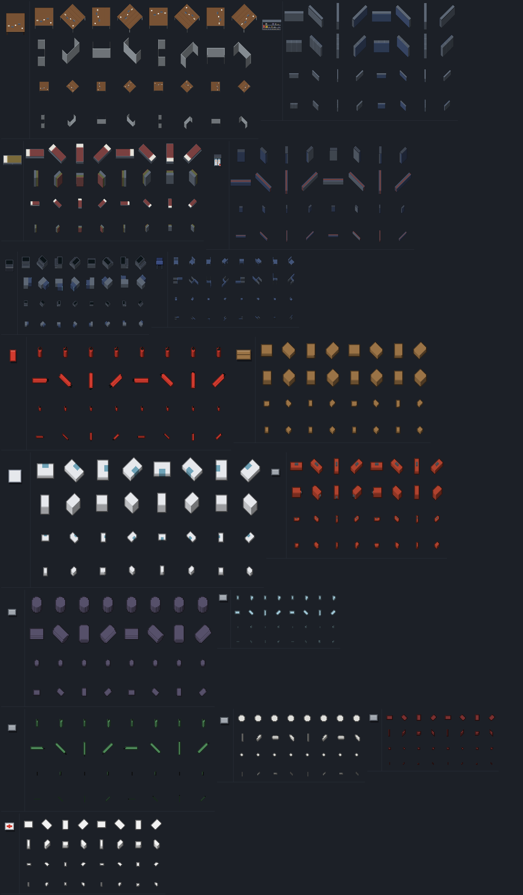 |
|---|
| **도는 도트** (물리 PH2) — 꼴마다 왼쪽이 지금 그림 · 오른쪽 8각 (0 · 45 · 90 … 315°): 줄마다 선 꼴 · 누운 꼴 (칸당 32도트) · 선 꼴 · 누운 꼴 (칸당 16도트). 탁자 · 선반 · 침대 · 우주복 보관함 · 조종대 · 의자 (1배) · 소화기 · 식량 상자 · 우주복 · 공구 상자 · 오물 통 · 컵 · 유리병 · 접시 · 책 · 구급 상자 (3배) |

### 다음 · 100%까지의 차례 · 최종 모습 (10-26 README 그때)

- **다음에 할 일 → [docs/NEXT.md](NEXT.md)**
- **100%까지의 차례 → [docs/MIND.md](MIND.md)** (판단 평가: 사람 19.5 · 로봇 16 · 주컴퓨터 17.5 / 40 → 19단 뒤 40 · 40 · 40) — **4단 보이게 하는 틀 ✔** (판단 일지 · 속말 · 마우스만으로 되는 화면 · 말풍선 · 로봇 칩 · 로봇 카드 · 주컴퓨터 말 창) → 텍스처 첫 묶음 ✔ → 지금: **6단 60프레임** (데우기 ✔ · 넓은 보기 화가 ✔ → 계산 일꾼 · 장 잠재우기) · 5단 화장실 나머지 → 12일 판정 → 8~19단
- **최종 모습 → [docs/MIND.md '최종 모습'](MIND.md)** (함장 질문 10-24: 다 만들면 셋이 무엇을 하고 얼마나 사람답고 · 로봇답고 · 컴퓨터다운가)

### 마우스만으로 ✔

([docs/UI.md](UI.md) — 함장 요청 10-23)

- 빠르기 · 고정 빠르기 ▾ · 소리 · 자막 · 도움말 · 메뉴(배 바꾸기 · 새 항해 · 처음 화면 — 확인 창) · 판 탭 다섯 · 판 줄 누르기 (흔들리지 않는 열쇠) · ▶ 다시보기 · 휠로 넘기기 · 넘김 막대 · 카드 [따라가기][×] · 연출 · 배 전체 · 확대 · 겹쳐 보기 · 방금 장면 · 오른쪽 누르기 = 뒤로 · 커서 쪽 확대 · 올린 사람 이름 · 풀이 글 · 띄우면 출항 준비 (멈춘 채 항로를 고르고 [이대로 출항]).
- 화면 위 누름은 세계로 새지 않는다.
- 자리표는 순수 C# (`ShipView/Hud.cs`) — 여섯 창 크기 × 사람 3~100에서 겹침 0 (규칙 '마우스' 여덟).

### 넓은 보기 화가 ✔

(6단 60프레임 · [docs/GRAPHICS.md](GRAPHICS.md) §3 세밀도 단계)

- 60칸 넘게 보면 칸 하나를 16도트 · 120칸 넘게 보면 8도트로 그린다 (1920 화면에서 한 픽셀에 도트가 하나 넘게 오지 않게 · 경계 ±3칸은 머뭇).
- 바닥 · 벽 · 가구처럼 늘 같은 것은 8×8칸 덩어리로 한 번 구워 두고 (녹 · 구멍 · 그을음 · 선반 채움이 바뀐 덩어리만 다시) · 문 · 사람 · 불 · 연기 · 빛은 장마다.
- 새뜰호 배 전체 한 장 20.2 → 3.6ms · 97×55칸 11~13 → 4.8ms (32도트 그림을 줄인 것과 칸 평균 빛깔 차이 0.2~0.3 / 255).

| 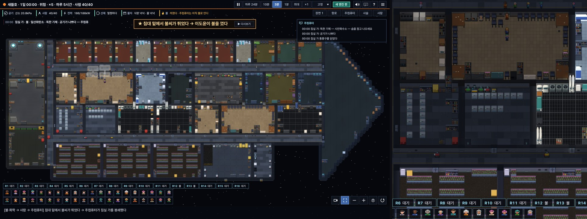 |
|---|
| **넓은 보기** — 왼쪽 새뜰호 배 전체 (칸당 8도트) · 오른쪽 90칸 보기를 1:1로 (칸당 16도트) · 침실 불 11초 (Godot 화면) |

### 텍스처 첫 묶음 ✔

([docs/GRAPHICS.md](GRAPHICS.md) G8 — 함장 요청 10-23 '텍스처가 너무 구려')

- 벽이 선다 (어두운 뚜껑 + 24도트 앞면 — 판 이음 · 볼트 · 방마다 띠등 · 관 · 전선 · 환기구 · 방 종류 띠 · 굽도리 · 앞면은 마주한 방의 빛만) · 문틀과 문짝 (열린 자리로 바닥이 보인다) · 선체 모서리 사선과 바깥 면 · 방 종류마다 바닥 마감 열하나 (벽돌빛 카펫 침실 · 타일 식당 · 흙 매트 재배실 · 격자 생명 유지 · 사선 띠 기관실 — 8칸 주기로 되풀이가 안 보인다) · 가구 16종을 새로 (선반엔 세계의 소화기 · 봉합 통이 보이고 꺼내면 빈 칸 · 보관함 유리 너머 우주복 · 담요는 주인의 색 · 재배 선반의 잎과 생장등).
- 고친 결함: 닫힌 문이 늘 하늘색 (진공 서리) · 밤에 벽이 옆 방 빛을 받던 것.
- 그리기 3.97 → 3.80ms.

| 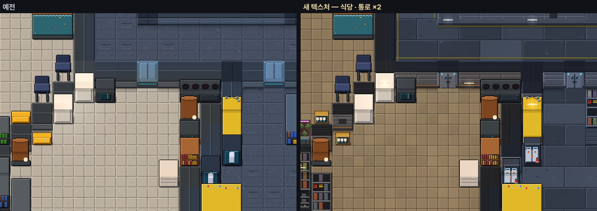 |
|---|
| **텍스처 전후** (왼쪽 예전 · 오른쪽 새) — 디딤호 식당과 통로 ×2: 서 있는 벽과 띠등 · 문틀 · 타일 · 강철판 · 노랑 선 · 물건이 든 선반 · 우주복 보관함 |

### 빛 웅덩이 · 발밑 그림자 ✔

- 방이 고르게 밝지 않고 등 아래가 밝다 (방 평균은 세계 조명 그대로 · 낮은 은은하게 · 등이 낮은 밤 · 정전 비상등은 웅덩이 사이가 어둡게) · 사람 · 로봇 발밑에 그늘.

| 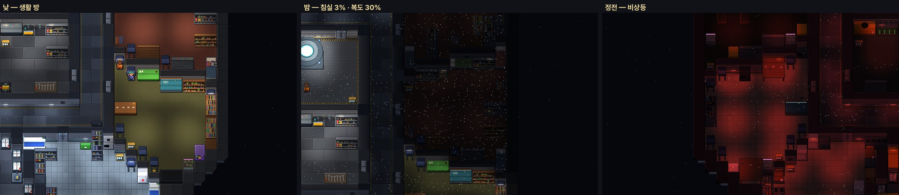 |
|---|
| **빛 웅덩이** — 낮 생활 방 · 밤 (침실 3% · 복도 30%) · 정전 비상등 (흰 점은 그 시각 방사선 화면 잡음 — 세계 값) |

### 말풍선 · 로봇 칩 · 로봇 카드 · 주컴퓨터 말 창 ✔

- 사람이 소리 내어 한 말과 외침('불이야!' · '연기다!')이 머리 위 풍선으로 화면 3~6초 (하루 3분에서도 읽힌다) · 속마음 풍선은 메뉴에서 (고른 이 · 화면 가운데 셋).
- 사람 줄 위 로봇 칩 'R1 불 · R2 대기' — 누르면 로봇 카드: '하는 일: 불을 끈다 ▸ 가는 중 · 맡은 까닭: 주컴퓨터가 맡겼다 — 가장 가까웠다 · 최근 판단: 00:00 맡음 — 불을 끈다'. 오른쪽 위 주컴퓨터 말 창은 방금 한 말 세 줄 (한 줄 2초 넘게 · 12초 조용하면 접힌다 · 누르면 주컴퓨터 판).
- 세계는 그대로 (지문 같음).

| 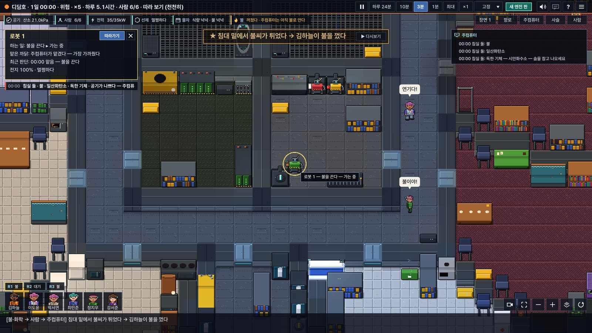 |
|---|
| **디딤호 침실 불 첫 5초** — 왼쪽 위 로봇 1 카드 (맡은 까닭 · 최근 판단) · 오른쪽 위 주컴퓨터 말 창 · 복도의 외침 풍선 '연기다!' · '불이야!' · 왼쪽 아래 로봇 칩 R1 불 · R2 대기 · R3 불 (Godot 화면) |

| 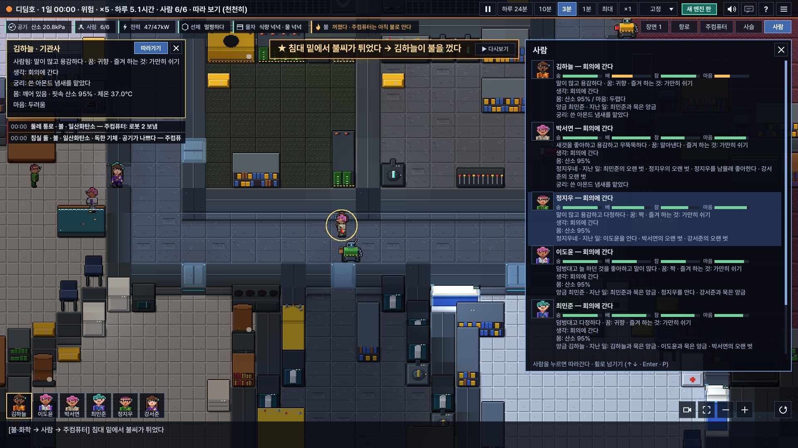 |
|---|
| **마우스만으로 되는 화면** — 위 줄 빠르기 · 소리 · 자막 · 도움말 · 메뉴 · 둘째 줄 판 탭 · 왼쪽 카드 [따라가기][×] · 오른쪽 사람 판 (누르면 따라간다 · 휠 · 막대) · ★ 띠 [▶ 다시보기] · 오른쪽 아래 연출 · 배 전체 · 확대 · 겹쳐 보기 · 방금 장면 (디딤호 불 · Godot 화면) |

### 판단 깊이 설계 → [docs/MIND.md](MIND.md)

- 사람은 세 겹 (내가 아는 것만 · 성격이 다른 행동이 되게 · 하루를 잇는 마음) + 속말 · 슬기 · 식탁에서 먹기 · 일 돌기 · 소식은 들은 이만 · 대화의 속 / 로봇은 손 비우기 · 길 거리 맡김 · 막히면 다른 방법 · 당번 · 순찰 · 팀 / 주컴퓨터는 믿음 판 · 맡기기 값 · 모든 사건에 사다리 · 말 창 · 돌아보기 · 생각 여력.

### 검토 ✔

([docs/REVIEW.md](REVIEW.md) — 함장: 추천대로)

- 0~2단 끝: 소리 누수 · 미량 기체 정화 세 단 · 냄비 물 · 하루 3분 (디딤호 10.6분 → 약 3.4분)

### 3단 판단 결함 넷 ✔

- 손 비우기 · 돌려놓기 · 쓴 소화기 채우기 · 줍기 (화살호 불 뒤 보관함 소화기 11 → 11, 예전 11 → 5) · 막힌 로봇 풀기 (30분 → 곧바로) · 일감 실패 기억 · 길 거리 맡기기 · 처지에 맞는 입말 · 물 배급 계량기 (118 → 172몰).
- 다음: 4단 보이게 하는 틀.

### 그래픽 ✔

(함장 결정 17가지 — [docs/GRAPHICS.md](GRAPHICS.md))

- 모든 그림이 세상의 값에서 나온다 (화면만의 가짜 사건은 없다).
- 방마다 제 빛깔의 조명이 도트마다 곱해진다 (생활 방은 따뜻하게 · 함교는 푸르게 · 재배실은 생장등) · 화면 · 경고등 · 불꽃이 스스로 빛나고 · 벽에 그늘이 진다.
- 밤 22시면 주컴퓨터가 침실을 3% · 복도를 30%로 낮추고 · 정전되면 방마다 비상 전지(3시간)의 붉은 등만 남는다.
- 사고는 세상의 값대로 보인다: 칸 바람이 4m/s를 넘는 곳에만 새는 공기 줄기 · 뜨거운 칸의 아지랑이 · 천장 아래 연기층 · 젖은 전선의 합선 불꽃 · 폭발의 섬광과 충격파 (TNT kg에서 닿는 거리) · 화면 흔들림 · 별 폭발의 방사선 화면 잡음.
- 사람에게는 표정(웃음 · 겁 · 아픔 · 슬픔) · 몸의 자국(피 · 화상 · 붕대 · 동상 · 열과 땀 · 빠진 머리) · 여덟 장 걸음 · 연기 속 기어가기 · 컵 들고 마시기 · 공구 돌리기 · 손짓 · 조는 고개가 생겼다.
- 오래된 벽엔 녹 · 실금 · 바닥엔 쏟아진 냉매 · 전해액이 남는다.
- 결정적 순간엔 화면이 느려지며 가까이 다가가고 · 먼 곳으로는 컷으로 넘어간다.
- 한 장 그리기 34ms → 6.4ms (60프레임).

| 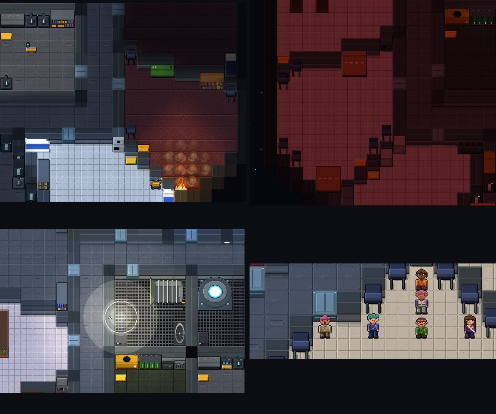 |
|---|
| **불 · 정전 · 폭발 · 표정** — 쉼터 가구의 불이 방을 일렁이게 비춘다 (연기가 빛을 받는다) · 차단기가 모두 내려간 식당은 비상등만 붉다 · 기관실 폭발 0.2초의 섬광과 충격파 · 다섯 표정 (`Lab --scene lights` · `fx` · `people`) |

### 소리 ✔

(함장 결정 18가지 — [docs/SOUND.md](SOUND.md))

- 세상에서 실제로 나는 소리만 난다: 44.1kHz · 폭발은 크게 · 평소는 작게.
- 사람이 하는 일이 그대로 소리가 된다 (발소리 · 식기 · 렌치 · 용접 · 망치 · 흥얼거림 · 잠꼬대 · 웃음) · 몸이 낸다 (코골이 체질 · 연기 · 병의 기침).
- 자는 이는 잠의 깊이만큼 둔하고 · 남의 말소리 · 코골이 · 음악에 깨면 그 사람을 원망한다.
- 140dB 쾅 곁에 있던 이는 귀가 먹먹해지고 (며칠에 걸쳐 돌아온다) · 그 사람을 고르면 화면 소리도 작고 먹먹하고 삐 소리가 난다.
- 주컴퓨터는 방마다 마이크로 비명 · 쾅을 듣고 로봇을 보내 살피고 (자는 이 곁의 악몽 비명은 그냥 둔다) · 사람은 소리 난 쪽으로 고개를 돌린다.
- 쉬는 이는 이어폰 · 작은 스피커 · 기타 중에 고른다 — 곁에 자는 이가 있으면 헤아리는 이는 이어폰을 꽂고, 기타는 치는 이의 기분으로 장조 · 단조가 된다.
- 바탕 음악은 하루 시간 · 항해 달력(바위 띠 앞의 불안 · 빠져나온 안도) · 추모 · 축하 · 고른 사람의 기분을 따라간다.
- 외판은 데워지고 식으며 딱 소리를 내고 · 행성의 모래 폭풍은 외판 너머로 먹먹하게 들린다 · 방송엔 띵동과 자막 · U로 소리 자막(무엇이 · 어느 쪽에서).
- 견본 `Lab --listen demo|hear|life|music|world`.

### 배 꾸밈 ✔

(함장 승인 — [docs/FURNISH.md](FURNISH.md))

- 일곱 척의 방이 맡은 일에 맞게 찼다 (설비가 방 바닥을 덮는 몫 11~23% → 24~29%): 침실엔 선반 · 옷걸이 · 책장, 의무실엔 약장 · 혈액 냉장고 · 멸균기, 정비실엔 공구 벽 · 정비 수레 · 호이스트, 에어락엔 우주복 사물함 · 건조기 · 오염 제거 샤워, 쉼터엔 음악 구석 · 오락기 · VR 의자 · 수족관, 통로 벽엔 일곱 칸마다 비상등 · 방화 담요 · 비상 물자함.
- 문 앞과 쓰러 갈 자리는 비우고 · 빈 칸은 한 덩어리로 이어진다.
- 모두 실제 물건이다 — 무게 · 재질이 있고 타는 것은 불의 연료가 되며 · 장치 13종은 전기를 쓰고 닳아 고장 난다.
- 의자가 많아지자 어울리러 간 이가 혼자 먼 의자에 앉던 것을 고쳤다 (쉬는 사람 곁 자리를 고른다 — 하루 대화 9 → 13).

### 화장실 · 샤워실 ✔

(함장 승인 — [docs/WASH.md](WASH.md))

- 일곱 척에 화장실 11곳 (변기 31 · 샤워 칸 25 · 세면대 18).
- 몸은 차오르고 더러워질 뿐 · 마려우면 사람이 가장 가까운 빈 변기로 간다 (차 있으면 곁에서 줄을 서고 · 망가진 변기는 피하고 · 다 쓰면 비켜선다) · 성실한 이는 손을 씻는다.
- 더러우면 · 운동 뒤 · 자기 전에 6분 샤워 (물 8L가 오수로 · 온수기 3kW · 김이 오른다).
- 참지 못하면 그 자리에 지리고 바닥이 젖는다 — 그러면 바로 씻으러 간다.
- **(다) 주컴퓨터 · 로봇 ✔** — 변기 조절기가 막힘 · 오물 통 · 물 내린 수를 알리면 주컴퓨터가 '사용 금지' 불을 켜고 로봇에게 뚫기 · 통 비우기(퇴비통 · 압축기로 — 질량 그대로) · 닦기를 맡긴다 · 물 배급 때 '샤워는 3분 · 이틀에 한 번' (성실할수록 지킨다) · 화장실 줄이 길면 다른 화장실의 빈 곳으로 보내거나 차례를 알린다 · 빈 샤워 칸에 물이 흐르면 잠근다.
- 주컴퓨터가 멈추면 막힌 변기를 모르고 써서 넘친다 (바닥 물 · 지린내) — 다음 이는 보고 다른 변기로.
- 고친 결함: 씻다 말고 나가면 온수기가 켜진 채 칸이 69℃로 달아올라 다음 사람이 30분 넘게 화장실과 침대를 오가던 것 (디딤호 하루 샤워 0번 → 5번).
- 관찰 장면 [`Lab --scene wash`](screens/wash/care.jpg).

### 화면 띠 ✔

- 위에 배 상태 띠 (공기 · 사람 · 전력 · 선체 · 물자 · 불 — 위험하면 붉게 깜빡임) · 아래에 사람 줄 (얼굴에 지금 표정과 다친 자국 · 위험한 이가 앞에 · 누르면 그를 따라간다 · 40명이면 두 줄).
- 사람 판(P)엔 얼굴과 막대 넷 (숨 · 배 · 잠 · 마음) · 왼쪽 위 사건 띠엔 주컴퓨터가 아는 지금의 일과 막 끝난 일 (누르면 그 자리로) · 오른쪽 위엔 빠르기 단추 (멈춤 · 연출 · ×1 ~ ×3600 — 스페이스 · 1~6).

| 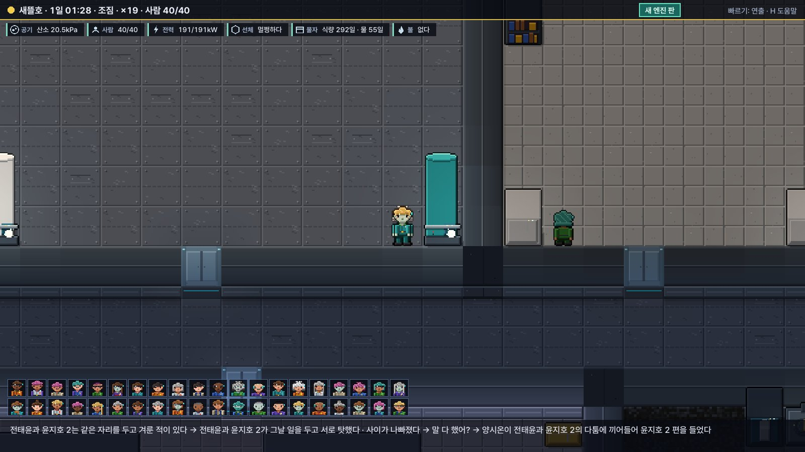 | 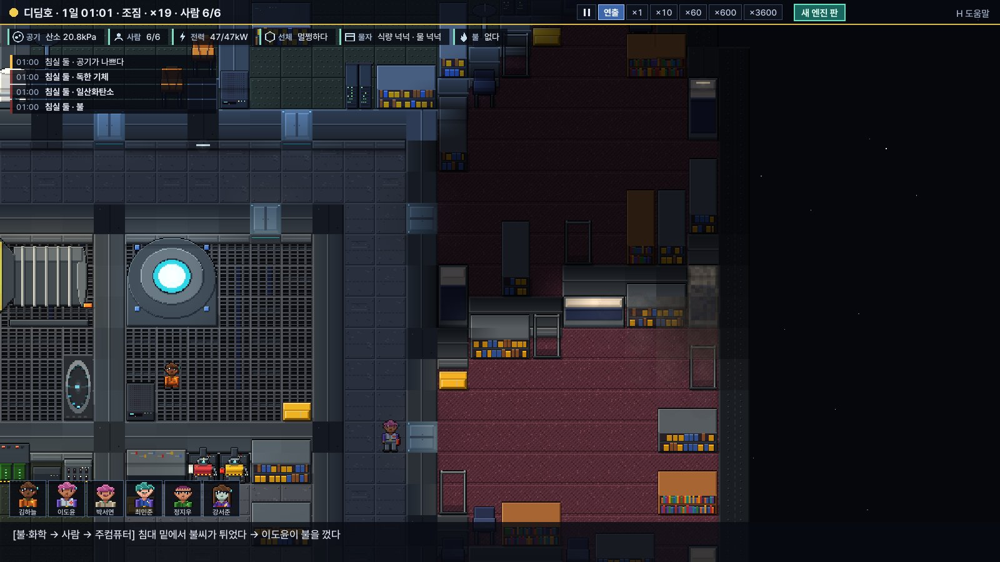 |
|---|---|
| 새뜰호 40명 — 배 상태 띠 · 사람 줄 | 디딤호 침실 불 — 사건 띠 넷 · 빠르기 단추 · 원인 사슬 자막 |

### 최적화 ✔

- 사람 40명 · 로봇 16의 새터호에서, 세계는 바이트까지 같게 (`Lab --fingerprint`): 틱 가운데 2.8ms (하루 = 2분 21초) · 틱마다 새로 잡는 메모리 299 → 42KB · 문이 여닫힐 때 공기 구역 다시 짓기 2.7배 빠르게 · 방사선 가림 21.6 → 10.6ms · 연출이 앞날을 미리 보는 세계는 다른 코어에서 (멈칫 0.2초 → 0.02초) · 다시보기 고리가 2분마다 버리던 5MB 없앰.
- 화면: 한 장 그리기 보통 3.1 → 1.9ms · 넓게 볼 때(배 전체) 57 → 24ms (꽉 찬 타일은 줄째로 · 바닥과 우주는 여러 코어에서 · 빛은 네 점씩 한 번에 — 그림은 점 하나 다르지 않다) · 첫 몇 분의 20~38ms 멈칫(처음 부르는 큰 메서드를 기계어로 옮기는 시간)은 관전 장면을 열 때 미리 옮겨 없앴다 · 소리 섞기 1/60초마다 1.0ms.

### 국소 현상 ✔

- 칸 안을 위 · 아래 두 층으로 본다: 불 위의 뜨거운 연기는 천장에 서고(불 곁 머리 높이 268℃ · 일산화탄소 12,000ppm — 바닥 높이 49℃ · 54ppm) · 소화기의 차가운 이산화탄소는 바닥에 깔린다.
- 선 이는 위 층을, 기어가거나 누운 이는 아래 층을 마신다 — 그래서 연기 속에서는 몸을 낮춰 기어가고, 소리 없는 일산화탄소층 아래 잠든 이는 덜 마신다 (COHb 0.4% · 깨어 앉은 이 2.6%).
- 외판에 구멍이 나면 구멍 곁 사람은 구멍 입으로 모이는 흐름에 끌린다 — 1m²면 우주로 빨려 나가고 · 작으면 몸이 구멍에 빨려 붙어 막는다 (방이 반으로 비는 데 2초 → 86초 — 대신 떨어지지 못한다) · 곁에 의자가 있으면 붙잡고 버틴다 · 상자가 빨려 붙어 구멍을 막기도 한다 (관찰 장면 `Lab --scene local`).

### 이야기 편집 ✔

- 연출이 하루를 한 장으로 묶는다: 날이 바뀌면 "3일째 — 김하늘을 잃은 날" · "5일째 — 1.7kg 운석이 부딪혔다" · 큰 일이 없으면 "조용한 하루" — 아래에 그날의 큰 사슬 ([우주 → 전기·장치 → 선체] 뿌리 → 끝) · 사람 이야기의 한 마디 · 가장 깊은 판단 · 항해 달력의 일 · 하루의 결 ("조용함 → 조짐 4번 → 결정적 순간(07:04) → 조용함") · 주인공 셋 · 다시 볼 장면 다섯 · 이레마다 한 주 장.
- 다시보기는 영화처럼 컷으로 간다 — 첫 조짐(뿌리의 자리) → 일이 난 순간들 → 정점(가장 느리게 · 운석이 뚫은 순간) → 그 소동에 나온 사람마다의 시점("정지우의 자리에서 — …") → 그 뒤, 컷 사이는 건너뛴다 (관전 화면 B · L / 실험실 `--film`).

### 긴 줄기 ✔

- 항해에는 몇 주짜리 흐름이 있다: 전이 궤도에 오르면 주컴퓨터가 별계 지도로 남은 길을 내다보고 항해 달력을 짠다 (바위 띠에 드는 날 · 나오는 날 · 태양 합).
- 사흘 앞이면 "3일 뒤 작은 바위 띠로 듭니다 — 57일 동안 · 파편에 대비합니다" — 예민한 이는 긴장하고, 들 때는 칸막이 문을 닫아 두고 (구멍이 나도 그 방만), 빠져나오면 긴장이 풀린다.
- 태양 합도 미리 알린다 ("통신이 14일 끊깁니다 — 편지 · 원격 진료는 그 전에") (관찰 장면 `Lab --scene longarc`).

### 별계 지도 ✔

- 별계의 천체 · 정거장 · 광산이 실제로 공전한다: 호만 전이로 닿으려면 목표가 앞선 각(화성 44°)만큼 앞서 있을 때 떠나야 하고 (발사 창 — 화성은 780일마다) · 늦게 떠나면 닿은 자리에 목표가 없다.
- 주컴퓨터는 닿을 때마다 · 떠나기 전 다음 들를 곳을 고른다 — 추진제가 모자라면 창이 열리는 정거장에 먼저 들러 채우고 ("다음 들를 곳은 띠 보급소 — 추진제가 모자라다 (남은 Δv 3.3km/s < 붉은 사막까지 5.9km/s) — 채우러 간다"), 원료 · 전자 소자가 바닥이면 먼저 열리는 정거장 · 광산에 들르고, 닿을 길이 없으면 떠나지 않고 기다린다.
- 정거장에 닿으면 곁에 떠 있다가 부탁을 받고 붙어 와 추진제 · 부품을 넘겨주고 · 광산은 원료를 넉넉히 준다 (관찰 장면 `Lab --scene map`).

### 열 · 진동 ✔

- 돌아가는 기계(펌프 · 엔진 · 발전기 · 공조 …)는 초당 25번 떨고, 닳은 베어링일수록 세게 떤다.
- 장치를 붙든 볼트는 그 떨림에 조금씩 풀려 (새 냉각 펌프는 닷새 · 닳은 엔진은 몇 시간) 다 풀리면 "엔진의 볼트가 진동에 풀려 덜컹거린다" — 덜컹거리는 모터는 세 배 빨리 닳고 · 곁 벽에 금이 있으면 떨림이 그 금을 키운다.
- 주컴퓨터는 진동 센서로 알아채 로봇에게 '볼트 조이기'를 맡기고 (사람은 10분 · 로봇은 5분) 조이면 떨림이 가라앉는다 (관찰 장면 `Lab --scene vibration`: 10:06 덜컹 → 10:10 로봇에게 맡김 → 10:16 조임 · 벽의 금은 0.11mm 자라고 멎었다).
- 벽은 데웠다 식히기를 되풀이하면(불 · 볕과 그늘) 피로가 쌓여 정격이 깎이고 결국 금이 간다 — 그 금의 원인은 "열 팽창 · 수축이 되풀이돼 벽이 피로해졌다"로 이어진다.

### 통신 지연 ✔

- 고향과의 통신은 빛의 속도만큼 늦다: 배에서 본 무거운 병이면 주컴퓨터가 진료 기록을 고향 관제 의사에게 보내고, 답은 빛의 왕복 + 읽는 20분 뒤에 와서 진료 기록을 바로잡는다 ("고향 관제 의사: 김하늘이 상한 심장이었다 — 진료 기록을 고쳤다 (26분 만의 답)").
- 고향에서 본 배가 별 곁 2° 안에 들면(태양 합) 통신이 끊겨 편지 · 원격 진료가 기다린다.

### 공급 사슬 ✔

- '수리 꾸러미' 하나로 모든 고장을 고치던 것을 부품 갈래 넷(전기 · 기계 · 봉함 · 거르개)으로 나눴다: 회로가 타면 전기 부품이, 모터가 닳으면 기계 부품이 있어야 한다.
- 부품은 작업대에서 원료로 만들지만 **전기 부품에 드는 전자 소자는 배에서 만들 수 없다** (실어 온 것 · 헌 전기 부품에서 건진 것 · 난파선에서 건진 것뿐).
- 갈아 낸 부품은 버리지 않고 로봇이 정제기로 날라 녹여 다시 원료로 (30분에 하나 — 헌 전기 부품이면 전자 소자를 반쯤 건진다).
- 원료가 모자라면 주컴퓨터가 무엇을 먼저 만들지 정한다 — 생명 유지 장치가 기다리는 부품이 먼저: "원료가 모자라 봉함재를 먼저 만든다 — 산소 발생기가 기다린다 (기계 부품은 미룬다)". 지나는 상선 · 순찰선과 교신하면 모자란 것을 부탁하고, 나눠 주겠다는 배는 맞춰 와서 붙어 에어락으로 넘겨준다 (나눠 줄지는 그 배의 형편).
- 바위 띠 한가운데의 '띠 보급소'는 황도면 가까운 항로만 곁을 지난다 — 거친 항로를 고르면 보급을 얻는다.
- 파편에 부서진 설비는 부품만으로는 못 고친다 — 원료로 '외장 틀'을 만들어 틀부터 새로 짜고 부품을 끼운다.
- 관찰 장면 `Lab --scene supply`.

### 살림은 주컴퓨터가 정한다 ✔

(판단 이관 (아))

- 일감판(누가 무엇을 맡나) · 막힌 곳 찾기 · 정제기 · 수집기를 켜고 끄기를 물자 엔진에서 주컴퓨터로 옮겼다: 주컴퓨터가 1분마다 재고 · 전력 여유를 보고 설비를 켜고 끄며 · 5분마다 만들기 · 예방 정비 · 청소 · 거두기 · 식량 나르기 일을 그 일을 할 수 있는 몸(로봇 먼저)에게 올린다.
- 물자 엔진은 켜진 설비가 만든 것과 장부만 계산한다.
- 옮기다 드러난 결함 — 꺼진 지 오래된 불의 연기가 문을 열 때 옆 방으로 넘어가면 원인이 비었다 → 첫 불씨까지 잇는다.

### 로봇 · 주컴퓨터의 몸은 세상이 ✔

(판단 이관 (사))

- 로봇 몸에 다리 · 팔 · 센서 · 속이 생겼다: 떨어진 화물 상자 · 파편 · 폭풍에 맞으면 충격만큼 상하고 · 불 곁의 뜨거운 공기엔 센서가 먼저 흐려지고 속이 달아 멈추며 · 물이 고인 바닥에 전기가 흐르면 감전되고 · 물에 잠기면 다리 봉함이 새고 · 진공에서 힘을 쓰면 열을 못 버려 속이 단다.
- 다리가 상하면 느리게 걷고 (망가지면 그 자리에 선다) · 팔을 못 쓰면 불 끄기 · 막기 · 고치기를 놓고 '팔이 상해 손을 쓸 수 없다'고 남긴다 — 주컴퓨터는 그 로봇에겐 손이 필요 없는 일만 맡기고 손일은 성한 로봇에게.
- 주컴퓨터도 제 칩이 뜨거우면 세상이 느리게 하고 60℃에서 꺼 버린다 (그 방을 데운 원인까지 사슬로).
- 로봇 카드에 상한 부위와 그 까닭.

### 자연 사건 ✔

(함장 결정 — 이야기꾼을 걷어냈다)

- 이제 무엇도 사람의 마음을 직접 건드리지 않는다.
- 바깥 · 배 안의 일은 모두 세상의 확률에서 저절로 난다.
- **위험도는 항로만**: 출항 전에 함장이 항로 1~8을 고른다 (T 항로 판 — 낮은 번호는 황도면을 벗어난 고요한 길이라 파편 · 지나는 배가 드물고 면을 바꾸는 추진제가 더 든다 · 8은 부서진 옛 정거장의 파편 지대를 지나는 가장 거친 지름길 · 떠난 뒤엔 바꿀 수 없다).
- **미리 알기는 센서로 잡힌 것만**: 센서 배열이 돌면 레이더가 운석 · 배를 크기만큼 먼 데서 · 넓게 퍼진 파편 구름을 · X선 감시가 별 폭발의 조짐을 잡는다 — 센서 배열이 멈추면 주컴퓨터도 모르고 폭풍이 와 선량계가 오르고서야 대피한다.
- **배 안의 일도 세상 법칙에서**: 설계한 배엔 만들 때 남은 작은 흠이 외판 몇 칸에 숨어 자라고 · 합선을 끊은 차단기 접점이 상하면 다시 올릴 때 눌어붙고 (그 아크를 끊어 준 배전반 주 차단기도 상할 수 있다) · 식량 상자를 열다 감기가 옮고 · 출항 때 잠복한 채 탄 이가 있다 · 장치를 손보다 다른 부품을 상하게 하면 알아챈 이가 털어놓거나 말하지 않고 · 뜨거운 장치를 만지다 데거나 공구가 미끄러진다.
- **고향 편지**: 저녁 통신 창에 안테나가 돌면 사람마다 편지가 오고 (기쁜 · 안부 · 슬픈 · 부고 — 고향까지 빛이 오는 만큼 늦게) · 받아들이는 것은 그 사람의 마음.
- **출항 과거사**: 태울 때 한 번 — 아는 사이 · 오랜 벗 · 묵은 앙금 · 남몰래 좋아함이 첫날부터 사람 판에 보이고 · 따질지 풀지는 그들이.
- 관찰 장면 (디딤호 · 항로 8 이틀): 운석 2 · 파편 구름 1 · 지나는 배 2 · 센서에 잡힘 4 · 편지 1 — 깊은 우주의 0.06kg 바위가 벽을 뚫었는데 모두 무사하자 박서연이 사람들을 불러 축하하고 그 자리에서 두 무리가 손을 잡았다 · 잔해 지대가 센서에 잡혀 15분 전에 대피 · '같은 자리를 두고 겨룬 적'이 있던 둘이 서로 탓하다 김하늘이 말렸다.
- 수치(빈도)는 엔진을 다 만든 뒤 맨 끝에 실제 값으로 다듬는다.

| 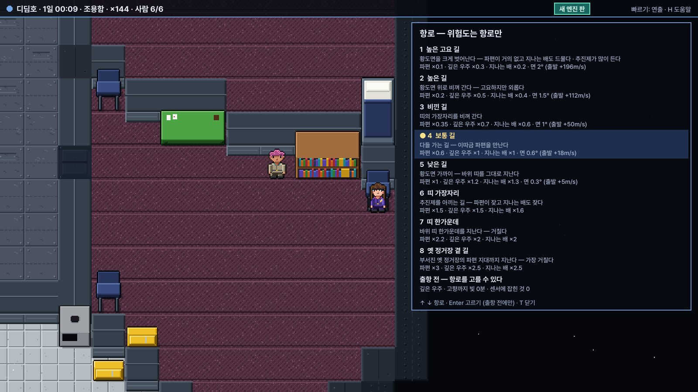 |
|---|
| **항로 판** (T) — 출항 전 디딤호: 여덟 항로 · 파편 · 깊은 우주 · 지나는 배 배율 · 면 기울기와 출발에 더 드는 Δv · 고른 항로 ● · 맨 아래 지금 구간 · 고향까지 빛 · 센서에 잡힌 것 |

### 문화 · 관습 ✔

- 배마다 저절로 관습이 생긴다: 같은 시각에 식당에서 함께 먹는 날이 이레 중 사흘을 넘으면 '저녁 7시엔 함께 먹는다'가 이 배의 관습이 되어 · 그 시각엔 덜 배고파도 먹으러 와 함께 웃고 (이레 동안 모이지 않으면 사라진다) · 반 넘게 꺼리는 방은 '아무도 그 방에서 쉬지 않는다'가 되어 무섭지 않은 이도 그 방을 피하고 · 숨진 이의 침대엔 이레 동안 아무도 눕지 않는다.
- 일이 쌓이면 별명이 붙는다 — 불을 세 번 끈 이는 '불끄기 반장' · 사람을 세 번 구한 이는 '구조대장' · 조리대를 두 번 켜 둔 채 떠난 이는 '깜빡이' (가장 외향인 동료가 부르기 시작하고 · 사람 판에도 나온다).
- 누가 숨지면 다음 날 그와 가장 가까웠던 이가 식당에 모아 한 마디씩 기리고 (슬픔이 반으로 · 함께 슬퍼한 이들이 가까워진다) · 번진 불 · 구멍 · 쓰러짐을 모두 무사히 넘기면 저녁에 가장 외향인 이가 '모두 무사했다 — 한잔하자'며 모아 불을 끈 이에게 잔을 든다.
- 되풀이되는 마찰은 회의 안건이 되어 표결로 배의 규칙이 된다 — 사흘에 밤 말다툼에 깬 일이 셋이면 '밤 10시부터 자는 이 곁에서는 말하지 않는다' (성실한 이는 말을 삼키고 · 덜 성실한 이가 어기고 깨우면 탓이 두 배) · 켜 둔 조리대가 둘이면 '조리대를 떠날 땐 끈다'. 고친 결함: 회의 · 추모를 식당이 아닌 주방(냉장고가 먼저인 방)에서 열어 — 첫날 불이 난 주방을 위험하다고 믿는 이들이 오지 않아 모임이 열리지 못하던 것.

관찰 장면 '디딤호의 엿새' (`Lab --scene culture`): 첫날 기름불을 넘기고 둘째 날 저녁 축하 ("박서연에게 한잔!") → 셋째 날 선반 사고로 박서연이 숨지자 그의 침대는 비워 두고 저녁에 추모 → 엿새째 '깜빡이'가 생기고 조리대 규칙이 서고 · 밤 10시의 함께 먹기가 관습이 된다.

| 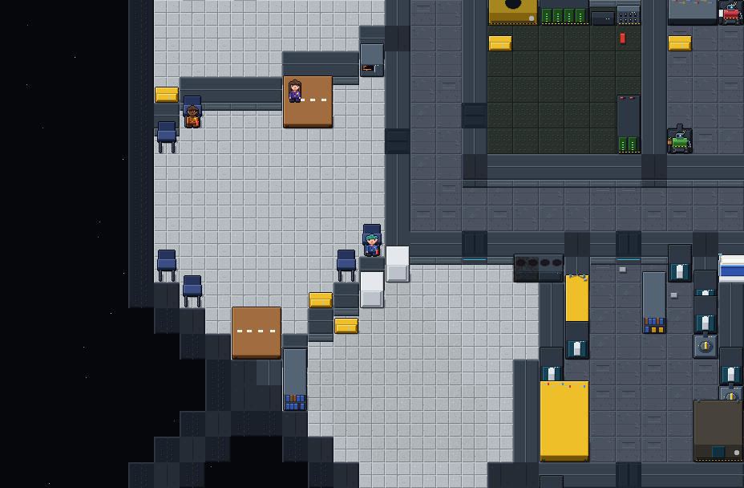 |
|---|
| **추모** — 3일 17:16 디딤호 식당: 김하늘 "박서연은 늘 먼저 웃던 사람이었다" · 최민준 "같이 늦게까지 이야기하던 밤이 생각난다" · 강서준 "아직도 식당에서 그 목소리가 들리는 것 같다" |

### 기억 · 정신 건강 ✔

- 죽을 뻔한 일 · 겁에 질린 일 · 곁에서 본 죽음은 충격으로 남고 · 신경성이 높고 곁에 아끼는 이가 없을수록 외상으로 오래 남는다 (두 달에 반 · 곁사람이 있으면 한 달).
- 외상이 남은 이는 자다가 악몽에 깨 소리치고 · 같은 갈래의 위험(불 · 구멍 · 나쁜 공기)을 알게 되면 그날이 되살아나 겁에 질린다.
- 일이 지나가면 맞서지 않은 이는 겁이 많아지고 · 불을 끄거나 구한 이는 단단해진다.
- 몇 주의 짐(고립의 피로 · 외로움 · 얕은 잠 · 슬픔 · 외상)은 우울이 되어 일손을 놓고 침대에 틀어박히고 끼니를 거르며 · 긴장과 외상은 불안이 되어 까닭 없는 공황 발작으로 그 자리에 주저앉는다.
- 낫는 길: 아끼는 동료가 '요즘 어때' 하고 묻고 들어 주고 · 주컴퓨터가 악몽 · 발작 · 얕은 잠 같은 표를 보고 하루 한 번 말을 걸고 · 사흘째에도 남으면 다정한 이에게 상담을 부탁하고 (로봇은 이야기를 들어 줄 수 없다) · 잠을 못 자면 로봇이 수면제를 가져온다 (진통제와 함께면 숨이 얕아진다 · 매일 먹으면 내성).

### 장기 · 약 · 수술 ✔

- 심장이 멎으면 동료가 가슴을 누르고 로봇이 아드레날린을 놓고 제세동한다 · 산소가 오래 끊기면 뇌 · 심장 · 폐에 손상이 남는다.
- 약은 용량대로 듣는다: 진통제는 내성이 붙고 많으면 숨이 얕아지고 · 해열제는 하루 4g 넘으면 간을 상하게 하고 · 항생제를 덜 먹이면 내성균이 생긴다 (서툰 이는 두 배로 주기도 한다).
- 돌보는 이는 증상만 보고 병을 짐작한다 — 일산화탄소 중독을 감기로 보고 제 침대에 눕혔다가 로봇이 기체 센서로 다시 보고 바로잡는다 (잘못 본 이는 배운다).
- 속 출혈 · 맹장염은 주컴퓨터가 수술을 잡고 로봇이 치료 침대에서 마취하고 연다 (진통제가 없으면 마취 없이) · 낫지 않던 손상은 재생 젤로 걷어 내고 · 심장이 크게 상한 이에게는 인공 심장을 넣고 · 여섯 시간 안에 숨진 동료의 간이 다른 이를 살린다.

### 인공 중력 · 무중력 ✔

- 배마다 인공 중력 발생기가 하나 있다: 끄거나 망가지거나 전기가 끊기면 10초에 중력이 사라지고 · 다시 돌면 30초에 1g로 선다 · 떨어져 나간 조각은 발생기가 없어 떠다닌다.
- 중력이 사라지면 사람은 떠서 손잡이를 잡고 간다 (처음인 이는 느리고 · 여덟 시간쯤 지내면 익숙해진다 · 로봇은 자석 발로 느리게) · 침대 밖에서 자던 이는 떠다니다 부딪혀 깨고 · 중력이 돌아오면 서툰 이는 바닥에 떨어져 넘어진다.
- 주컴퓨터는 꺼진 발생기를 곧 다시 켜고 · 무너질 때 '손잡이를 잡으세요' · 돌아올 때 '바닥 쪽을 잡으세요'를 알려 — 들은 이는 넘어짐이 4분의 1로 준다.
- 무중력에서는 쏟아진 물이 바닥에 퍼지지 않고 둥근 물 덩어리로 떠 방 안을 떠돌다 벽 · 의자 · 설비에 들러붙고 — 전선이 지나는 칸에 붙으면 합선한다 · 구멍이 나면 돌풍이 떠 있던 물을 우주로 끌고 나가고 · 중력이 돌아오면 떠 있던 물이 그 자리에 쏟아져 엉뚱한 곳에 웅덩이가 생긴다 · 그을음도 가라앉지 않아 오래 떠 있다.
- 무중력에서는 뜨거운 공기가 떠오르지 않아 불꽃이 제 둘레 공기만 먹다가 몇 분 만에 스스로 꺼지지만 · 통풍구 곁의 불은 계속 탄다 · 가만히 자는 이의 얼굴 앞에는 날숨이 고여 머리가 아파 깨고 — 그 뒤로는 통풍구 앞에 침낭을 묶고 잔다.
- 무중력에 오래 있으면 근육(주마다 1.5%) · 뼈(달마다 1.25%)가 약해져 — 운동으로 반쯤 늦추고 · 약해진 이는 중력이 돌아올 때 넘어지고 뼈가 부러지기도 한다 · 처음 사흘은 우주 멀미로 덜 먹고 가끔 토한다 (토한 것도 떠다닌다).
- 마지막으로 (바) 관찰 장면 '중력이 꺼진 식당': 점심때 발생기가 멈추면 식탁의 국 · 물병이 떠오르고 · 로봇이 있으면 16분 · 없으면 사람이 떠서 건너가 27분에 고친다 — 보며 고친 결함: 운동하고 난 몸의 열을 주컴퓨터가 열병으로 방송하던 것 · 발생기 고유 그림 · 떠 있는 사람은 바닥에 그림자.

### ② 사고 화학 ✔

- 마지막으로 더한 것 (사) 관찰 장면 '폼 침대 불': 새벽 두 시 침실의 빈 침대 곁 충전기 불꽃이 폼 매트리스에 붙으면 1분 만에 그 방에 일산화탄소 · 시안화수소가 차고 · 자던 이는 열과 불빛에 깨 외치고 나가며 · 주컴퓨터는 '독한 기체 — 숨을 참고 나오세요'를 알리고 통풍구를 닫고 봉쇄한다 · 로봇이 있으면 1분 안에 끄고 · 로봇이 없으면 사람에게 부탁한다.
- 보며 고친 것: 불 앞 연기에 밀려난 이가 곧장 되들어가기를 되풀이하던 것 (이제 몇 분 물러나 있고 '연기에 밀려났다'를 남긴다) · 로봇이 없는 배에서 '로봇이 모두 바쁩니다'라 하던 것 · 한 방을 두 번 봉쇄하던 것.
- 그 전 (바) 소화제: 이산화탄소 소화기가 생겼다 (배전반 · 주컴퓨터 곁에 하나씩 · 작업대에서 만든다) — 차가운 이산화탄소를 뿜으면 불꽃이 들이쉬는 공기가 옅어져 꺼지지만 · 식히지는 못해 뜨거운 침대는 기체가 걷히면 다시 붙고 · 물은 식혀 끄고 다시 붙지 않는다 · 작은 불은 소화기로 꺼지지만 큰 불은 하나로 못 끈다 · 불꽃은 방 공기를 먹어 닫힌 방은 방 전체가 옅어져야 꺼지고 뜨거운 방의 불은 옅은 산소에도 버틴다 · 전기가 흐르는 불(눌어붙은 차단기의 아크)에는 로봇과 전기를 아는 사람이 멀어도 이산화탄소 소화기를 들고 · 모르는 사람은 가까운 물 소화기를 뿌리다 감전된다 (원인 사슬에 남는다).
- 고친 결함: 다른 물건을 든 사람이 불을 끄러 가지 않던 것 · 옆 의자로 번진 불의 원인 사슬이 끊기던 것.
- 그 전 (마) 누출: 산소 발생기의 조절 센서는 늙으면 산소를 낮게 읽어 — 발생기가 쉬지 않고 돌아 배가 소리 없이 짙은 산소가 된다 (냄새도 색도 없어 사람은 못 느낀다) · 주컴퓨터가 제 방 센서와 견줘 23.5%에서 잡아 '산소가 짙다 — 불꽃 · 조리를 멈추세요'를 알리고 조리대를 끄고 센서를 다시 맞춘다 (주컴퓨터가 꺼져 있으면 아무도 모른다) · 산소 발생기 봉함이 터지면 갈라 낸 수소가 방에 차고 · 주컴퓨터 불붙는 기체 센서가 폭발 하한의 25%에서 알리고 그 방을 배기한다 · 그래도 불꽃이 튀면 터지고 그 원인 사슬이 봉함 샘까지 닿는다 · 냉매 암모니아는 5ppm부터 지린 냄새로 안다.
- 그 전 (라) 리튬 전지 열폭주: 배터리 하나가 셀 묶음 여덟 — 불 곁에서 케이스에 닿은 양 끝 묶음부터 달아올라 150℃에 안전 밸브가 쉬익 열리며 전해액 증기(이산화탄소 · 수소 · 메탄 · 일산화탄소)와 플루오린 화합물을 뿜고 (공기의 물과 만나 플루오린화수소 — 코와 눈을 찌르고 자던 이도 깬다 · 피할 곳이 없으면 폐를 다친다) · 200℃에 펑 터지며 폭주해 불이 나고 · 그 열이 옆 묶음을 달궈 몇 분 간격으로 차례로 번진다 · 파편에 찌그러지면 곧바로 · 80℃쯤은 버티고 · 다 쓴 배터리는 뿜기만 하고 불은 나지 않는다.
- 고친 결함: 열을 빨아들이는 반응이 칸 공기의 열보다 크면 에너지가 생겨나던 것 · 눌어붙은 차단기를 로봇이 손으로 끊는 일이 우연(옛 배터리가 1분 만에 터져 전기가 끊김)에 기대던 것 — 이제 배전반 주 차단기까지 낡았을 때 로봇이 끊는다.
- 그 전 (다) 산소와 불: 재질마다 스스로 타오르는 가장 옅은 산소(한계 산소 지수)가 있어 · 산소가 짙으면 훨씬 세게 타고 낮은 온도에서도 붙으며 (아폴로 1호처럼) · 기압이 낮아도 산소 비율이 같으면 그대로 타고 (NASA 시험) · 산소가 옅어지면 작은 불은 스스로 꺼지지만 둘레가 뜨거운 큰 불은 버틴다.
- 그 전 (나) 냄새 · 증상 · 센서: 염화수소는 누구나 '코를 찌르는 매캐한 냄새'로 · 시안화수소의 쓴 아몬드 냄새는 열에 여섯만 맡는다 — 맡은 이가 외쳐 못 맡는 이도 말로 알고 · 혼자면 어지러워진 뒤에야 늦게 나간다 · 자던 사람은 시안화수소에 깨지 않는다 · 주컴퓨터 공기 센서가 기체 이름과 짙기를 방송하고 ('시안화수소 80ppm — 숨을 참고 나오세요') · 달아오른 피복의 염화수소로 불보다 먼저 안다.
- 그 전 (가) 재질마다 다른 독가스: 전선 피복(PVC)은 달궈지기만 해도 염화수소가 빠져 방이 매캐해지고 · 침대 · 좌석의 폼(폴리우레탄)이 산소 모자라게 타면 시안화수소가 차 몇 분 만에 쓰러진다 (200ppm이면 5분).

### ④ 칸 강체 ✔

(함장 요청 — 움직임 · 부딪힘 · 파괴를 칸으로)

- (가): 떨어져 나간 조각이 몸이 된다 — 뚫린 곳으로 공기를 뿜으며 그 반대로 밀려 돌고 멀어지며 · 안의 사람 · 설비는 스크립트 없이 함께 간다 (화면에도 돌아간 채로) · 배가 점화하면 배만 나아가고 조각은 뒤에 남는다
- (나) 안의 것이 관성대로 — 조각이 덜컹이면 상자가 미끄러지고 선 사람이 넘어지며 · 빠르게 도는 조각 안의 상자는 바깥 벽으로 밀려간다
- (다) 부딪힘 — 먼 쪽 벽이 뚫린 조각은 뿜는 공기에 밀려 배로 되돌아와 부딪히고 (사람이 넘어지고 배도 밀린다) · 세게 부딪히면 맞닿은 벽이 찢겨 공기가 샌다 · 조각도 또 갈라진다
- (라) 잔칸 4×4 — 벽 · 바닥이 25cm 조각으로 들쭉날쭉 뚫리고 찢기며 (찢긴 금속 테) · 갈라진 자리의 찢긴 끝이 양쪽에 남는다 · 부딪힘도 그 모양대로
- (마) 부스러기 알갱이 — 떨어져 나간 판 조각이 알갱이로 날아 화면에 보이고 · 빠지는 공기가 기압만큼 세게 밀며 · 다른 몸에 박히면 그 몸을 밀고 · 빠르고 작은 것은 외판을 뚫지만 크고 느린 덩어리는 찌그러뜨릴 뿐 · 멀리 가면 우주로
- (바) 관전 화면 — 갈라진 조각이 틱 사이에도 미끄러지듯 움직이고 · 카메라가 멀어진 조각까지 따라가며 · 배가 돌면 별도 돈다.
- 다음: 볼 거리 (갈라짐 · 부딪힘을 하이라이트로).
- 설계: 떨어져 나간 조각이 실제로 움직이고 돌며 · 안의 사람 · 물건 · 설비가 함께 가고 · 고정 안 된 것은 관성대로 날아가고 · 부딪히면 닿은 칸이 부서져 또 조각이 된다 (구조는 칸 안 4×4 잔칸 · 기체 · 열은 1m 그대로).

### ⑥ 배선 · 배관을 칸마다 + 고장 원인 ✔

- 모든 전선 · 냉각관 · 물관 · 센서 선이 칸마다 깔리고 끊긴 칸 뒤로는 안 간다.
- 방금 더한 것: 새는 관 찾기 — 젖은 바닥의 관은 녹슬어 바늘구멍이 나고 (자리를 모른다) · 주컴퓨터가 물이 쓰는 만큼보다 빨리 주는 것으로 알아 방마다 밸브를 잠가 가며 좁히고 · 그 방 관을 로봇이 따라가며 찾아 죈다
- 그 전: 피복을 타고 번지는 불 — 산소가 짙은 낮은 기압 대기(34%)에서는 전선 칸 하나의 불꽃이 전선 묶음을 따라 기어 열린 문 너머 옆 방까지 번지고 그 길의 전선이 끊긴다 · 닫힌 문에서 멈추고 · 보통 공기에서는 그 칸에서 꺼진다
- 그 전: 고장 원인 — 닳음의 까닭이 원인 사슬로 (불이 지나간 방의 정화기 거르개는 그을음이 끼어 막히고 원인이 그 불까지 · 정비 때를 넘겨 돈 모터는 베어링 기름이 말라 · 배기구가 막혀 달궈진 주컴퓨터 회로는 일찍 낡고 · 늘 뜨거운 칸의 전선 피복은 늙어 갈라져 합선)
- 그 전: 선과 관을 칸마다 — 간선 · 급전선 · 가지선 · 냉각관 · 물관 (평소엔 안 보이고 겹쳐 보기 O '선과 관'에서만) · 간선이 끊기면 원자로가 섬으로 떨어져 배터리가 받는다 · 냉각관이 끊긴 원자로는 식지 못해 멈춘다 · 물관이 끊긴 산소 발생기는 물을 못 가른다 · 불에 탄 급전선은 식어도 차단기를 올릴 수 없어 로봇이 가서 잇는다 · 합선 아크가 같은 칸의 원자로 간선까지 태운다
- 그 전: 판단 엔진 끝 — 생각 사슬을 화면에 — 주컴퓨터 판에 지어낸 계획의 궁리와 걸음(✔ 마침 · ▶ 하는 중) · 회의가 넣은 매뉴얼 · 사람 카드 · 사람 판에 그 사람의 궁리 · 궁리 끝에 해낸 일은 볼 거리 (판단 엔진 끝 — 다음: 배선 · 배관을 칸마다)
- 그 전: 회의가 매뉴얼을 고친다 — 주컴퓨터가 지어낸 방법('임시 에어락')이 통하면 회의 안건이 되고 · 사람마다 주컴퓨터를 믿는 정도 · 성실 · 기압 앎으로 표결해 매뉴얼에 넣는다 (믿지 않는 배는 '주컴퓨터가 지어낸 것을 어떻게 믿나'로 부결) · 같은 꼴의 다음 구멍은 해 보지 않아도 막힐 것이 센서로 보이면 매뉴얼로 바로 궁리한다 (계획까지 31분 → 0.4분 · 막기까지 64분 → 16분) · 매뉴얼대로 했다가 두 번 넘게 틀어지면 '빼자' 안건
- 그 전: 사람의 궁리 — 구멍을 막으러 가다 문 앞에서 막힌 사람이 차례로 궁리한다 (막힌 까닭에서 배운다 → 주컴퓨터가 이미 계획을 세웠으면 따른다 → 제가 아는 방 · 문 그림으로 제 지식만큼 궁리한다 → 주컴퓨터가 해 주면 되는 길이 보이면 묻는다 → 그것도 없으면 '방법을 모르겠다') · 해내면 그 분야를 더 안다 · 주컴퓨터 계획 실행기의 결함 셋을 고쳤다 (끼워 넣은 걸음을 덮어써 같은 걸음이 스무 번 겹치던 것 · 계획을 세운 뒤 몸이 제 자리를 떠나 맞지 않는 계획을 하던 것 · 제 계획의 몸이 지나갈 문을 제가 잠가 1분마다 같은 실패를 되풀이하던 것) · 작업 도구: 단계별 시간 · 표본 수집 · 되풀이 접기
- 그 전: 벽이 버틸까 — 파편에 길게 찢긴 방을 봉합 꾸러미로 일곱 시간 덮고 다시 채우면 금이 다시 달려 찢어지던 일 · 이제 주컴퓨터가 금 센서로 다시 채우면 버틸지 셈해 받칠 벽은 로봇이 먼저 덧대 받치고 · 받쳐도 못 버티면 막지도 채우지도 않고 닫아 둔다 (예비 공기를 아낀다) · 큰 구멍은 여러 번 덧대는 만큼 시간을 셈한다
- 그 전: 로봇이 없는 배에서는 주컴퓨터가 사람에게 부탁해 함께 궁리한다 — 그 사람의 몸에 맞춰 (우주복이 있어야 옅은 공기에 든다 · 봉합 꾸러미가 몇 개 있나) '우주복을 입는다 → 문틈을 막는다 → (주컴퓨터가) 앞방 공기를 되돌린다 → 들어가 구멍을 막는다'를 지어내고 · 그 사람은 출입 금지에서 빠져 맡은 걸음만 한다
- 그 전: 주컴퓨터가 궁리한다 — 안에서 · 바깥에서 막기가 다 막히면 아는 원리(기압 차 · 밸브 · 공기 되돌리기 · 문틈 · 공기냉각 …)로 다른 길을 지어낸다 ('지어낸 안: 문틈을 막고 → 앞방 공기를 예비 탱크로 되돌리고 → 문을 열어 → 들어가 막는다' — 임시 에어락) · 위험한 걸음 앞에서 세계를 복제해 미리 돌려 보고 · 비울 방은 문을 잠그고 사람에게 출입 금지 (따를지는 사람마다) · 같은 실패를 되풀이하지 않는다
- 그 전: 막힘 — 일이 막히면 까닭을 안다 ('로봇 1이 방1에서 막혔다 — 문 너머가 우주로 트여 기압을 맞출 수 없다' · 문이 끼었다 · 지난번에 안 열린 문밖에 길이 없다 · 바깥으로 나갈 문이 없다) · 주컴퓨터가 맡긴 로봇의 막힘을 읽어 일지에 쓴다 · 고쳐진 문은 다시 믿는다.
- 다음: ⑥ 배선 · 배관을 칸마다 · ④ 칸 강체(움직임 · 부딪힘 · 파괴) · ② 사고 화학 · 인공 중력 · ⑦ 장기 · 약 · 수술 · ⑧ 정신 건강 · ⑨ 문화 · ⑪ 공급 사슬 · ⑤ 통신 지연 · 별계 · ⑫ 긴 줄기 · ⑬ 이야기 편집.

### 그 전 기록 — 처음 화면 · 판단 이관 · 깊이 바퀴 3 · 2 · 층마다 (옛 '지금 하는 일')

- **지금 하는 일: 게임을 켜면 처음 화면에서 기존 판 · 새 엔진 판을 고른다 ✔ (새 엔진 판은 새 엔진 · 새 배 일곱 척 · 새 관전 화면만 — 엔진이 도는 것을 따로 볼 수 있다) · 조용할 때 카메라가 사람들의 일상을 차례로 비춘다 ✔ · 인공 중력 · 무중력 ✔ · ⑦ 장기 · 약 · 수술 ✔ · ⑧ 기억 · 정신 건강 ✔ · ⑨ 문화 · 관습 ✔ · ⑫ 자연 사건 ✔ (이야기꾼을 걷어냄 · 항로 판) · 판단 이관 (사) 기계 몸 ✔ — 다음: 판단 이관 감사 시험(사회가 낸 행동마다 판단 기록) · ⑪ 공급 사슬 · 별계 지도.**
- 그 전: 깊이 바퀴 3 — ⑧ 마음 · ⑨ 사회 깊게: 인생 목표 ✔ (사람마다 솜씨 · 귀향 · 짝 · 배를 지킨다 · 알아낸다 중 하나 — 그 목표가 불로 달려갈지 먹으러 갈지를 가르고 · 점화를 놓치면 집에 가고 싶던 이만 무너진다)
- 거짓말과 속임 ✔ (제 실수를 숨긴 이가 그 장치를 고친 동료에게 떠넘기고 · 듣는 이는 반쯤 믿고 · 그때 곁에서 본 이나 주컴퓨터의 정비 기록으로 들통나면 믿음이 무너진다)
- 오래 남는 배움 ✔ (불 · 구멍 · 나쁜 공기를 곁에서 보거나 겪은 이는 3주 동안 그 위험에 더 일찍 움직인다 — 구멍을 겪어 본 이는 옅은 공기에 마스크를 5분 먼저 쓴다 · 두 주 넘게 안 쓴 솜씨는 녹고 다시 익히면 처음보다 빠르다 · 주컴퓨터의 주간 비상 훈련)
- ⑨ 회의 · 재판 · 선거 · 반란 ✔ (한 사람에게 원망이 모이면 식당에 모여 한 마디씩 하고 표결한다 — 사과 · 벌 당번 · 근신 · 무죄 · 대표를 믿는 이는 대표의 말 쪽으로 기운다 · 대표가 없거나 무너지면 비밀 투표로 다시 뽑는다 · 배급 중 굶주림이 이틀을 넘으면 배급을 따르지 않기로 표결해 보관함을 드러내 놓고 연다 · 위기가 나면 흩어진다)
- 방금 더한 것: 고립의 피로 — 닫힌 배의 같은 얼굴 · 같은 일과에 몇 주에 걸쳐 지쳐 간다 (예민하고 새것을 바라는 이일수록 · 붐비고 잠이 얕을수록) · 지친 이끼리는 말이 더 부딪치고 묵은 일을 더 쉽게 꺼내고 덜 참는다 · 쉼 · 다른 배와의 교신 · 도착이 풀어 준다
- 그 전: 다툼을 곁에서 본 사람이 끼어든다 — 한쪽을 아끼는 이는 편을 들어 상대의 원망을 사고 · 다정하고 용감한 이는 말려 둘의 화를 가라앉힌다
- 그 전: 한밤에 곁에서 크게 떠든 이의 말소리에 잠을 깬 사람은 그 사람을 조금 원망하고 기억한다 (예민한 이일수록 더 · 기계 소리엔 탓할 사람이 없다) — 작은 마찰이 쌓여 다툼이 된다
- 그 전: 배가 새는 동안 주컴퓨터가 방마다 예비 공기를 넣다 껐다 하며 한 시간에 다 써 버리던 결함 — 이제 새는 동안은 다시 채울 몫을 남기고 마스크로 버티게 하며 · 채울 공기가 없으면 비워진 방은 닫아 둔다
- 그 전: 마스크함이 없던 배 — 큰 구멍 뒤 옅은 공기에 쓸 마스크가 없어 모두 숨지던 판 → 사람이 머무는 방마다 산소 마스크함 (마스크가 사람 수보다 많게)
- 그 전: 센서 무선 — 센서 선이 끊겨도 전기가 있는 방은 옆 방을 거쳐 무선으로 (느리게) 보인다 · 해치를 닫으면 덜 닿고 문을 열면 더 멀리
- 그 전: 예비 공기가 바닥나 배 전체가 옅어지자 갈 곳 없이 한 칸에서 뛰어다니며 산소를 세 배로 쓰던 결함 — 이제 도망칠 곳이 없으면 마스크를 쓰고 가만히 숨을 아낀다 · 낮은 기압에서 산소 비율이 34%를 넘지 않게
- 그 전: 파편 폭풍이 다가와도 주컴퓨터가 가만히 있어 파편 하나에 셋이 숨지던 결함 — 이제 15분 앞에 바람 아래쪽 안쪽 방으로 모이라고 방송하고 열어 둔 해치를 닫는다 (주컴퓨터를 믿지 않는 이는 흘려듣기도 한다 · 양성자 폭풍엔 방사선이 가장 덜 드는 방으로)
- 그 전: 기준 평가(`Lab --judge`)에서 긴 항해가 모두 무너져 쫓아 보니 — 큰 구멍 뒤 옅은 공기(42~48kPa)에서 사람들이 아무것도 모른 채 한꺼번에 쓰러졌다 → 이제 몸이 어지러움을 느끼면 산소 마스크를 쓰고 · 주컴퓨터가 사람이 있는 닫힌 방에 예비 공기를 바로 넣는다 (살핌호 죽음 9 → 0)
- 그 뒤 ⑨ 회의 · 재판 · 선거 · 반란.
- 깊이 바퀴 2 ✔ — 층마다 '최상'까지 ([docs/DEPTH.md](DEPTH.md))
- ⑨ 사회 ✔ (짝 · 무리 · 지도자 · 화해와 맞섬 · 보강: 함께 먹기 · 따라 나가기 · 다친 짝 · 옆 방 비명)
- ⑧ 마음 ✔ (요리 · 실수에서 배우기 · 몸의 시계(아침형 · 저녁형) · 쉬는 시간에 하는 일 일곱 · 장소의 기억)
- ⑩ 주컴퓨터 ✔ (로봇이 없으면 사람에게 부탁 — 받거나 까닭을 대고 거절 · 급한 일부터 · 제 몸이 뜨거우면 느려지고 멈춤 · 이산화탄소는 방 평균)
- ⑪ 일 · 물자 ✔ (모자라면 배급 — 배식기가 사람마다 하루 몫을 잰다 · 덜 성실한 이는 밤에 보관함에서 몰래 한 끼 · 본 이는 원망 · 주컴퓨터는 빈 끼니만 안다 · 막힌 곳을 거슬러 찾는다 · 물 회수율)
- ⑦ 생명 ✔ (다친 이를 로봇이 먼저 돌본다 — 구급 상자 · 없으면 맨손 · 덮지 않은 상처는 곪아 열 · 패혈증 · 감기가 곁에서 옮고 앓는 이는 눕는다 · 시끄럽고 밝은 잠자리에선 덜 잔다 · 굶으면 몸무게와 기운이 준다)
- ⑫ 이야기꾼 ✔ (조짐 → 절정 → 여파의 막 · 큰 일 뒤엔 무너진 배를 더 때리지 않고 고향의 반가운 소식 · 다친 이가 많으면 쉰다(가혹함 8은 안 쉼) · 감기 · 일하다 다침 · 짝사랑 · 숨긴 실수(고장 나면 털어놓거나 숨긴다) · 일에 닿은 사람이 주인공 · 이 배에서 헛도는 씨앗은 덜 심는다)
- ⑬ 연출 ✔ (카메라가 1분 30초 앞을 미리 본다 — 복제한 세계를 앞에 두고 함께 굴려 운석이 부딪히는 순간 이미 그 자리를 보고 있다 · 연쇄의 앞머리를 따라간다 · 공기가 나빠지는 방의 사람에게 몸이 알기 전에 · 업고 뛰는 사람을 따라 · 두 곳에서 일이 나면 엇갈려 · 화면 아래 줄에 '[우주 → 선체 → 사람 → 공기·열]'처럼 연쇄가 건넌 갈래 · 큰 일을 먼저 와서 본 몫 44 → 66%)
- 소리 ✔ (돌아가는 기계가 바탕 소음이 된다 — 시끄러운 기계실에선 비명을 못 듣고 크게 외친다 · 시끄러운 잠자리 · 곧 망가질 펌프의 끽끽을 들은 이가 미리 갈거나 · 고칠 줄 모르면 알려 로봇이 간다 · 불 우르릉 · 수소 폭발 쾅 · 열폭주 펑 · 쉬익은 틈 크기와 기압 차대로 · 먼 소리는 늦게 닿는다)
- 화면 ✔ (C 사슬 판 — 지금 장면이 어디서 시작해 어느 갈래를 건넜나 · 마디를 고르면 그 자리로 · P 사람 판 — 걱정스러운 사람부터 몸 · 마음 · 짝 · 앙금 · J 주컴퓨터 판 맨 위에 지금 사건 · 배 형편 · O 겹쳐 보기 — 공기(진공 · 옅은 산소 · 일산화탄소) · 열 · 연기 · 사슬 선)
- ⑤ 바깥 ✔ (배가 실제로 가속한다 — 로켓 방정식 · 엔진이 한쪽으로만 민다 · 항해는 출발 · 고침 · 도착 점화 (3분 전 방송 · 불이 나 있으면 미룸 · 엔진이 멈추면 놓쳐 지나쳐 간다) · 갑자기 켜면 서 있던 사람이 넘어지고 물건이 미끄러진다 · 레이더가 2~9초 앞에 운석을 잡아 사람이 넘어질 값과 견줘 비킨다 · 상선과 교신 · 조난선에 가서 생존자를 태운다 (옮는 병도 함께) · 난파선의 매연 · 바위 띠)
- ⑥ 망 ✔ (생명 유지 방의 급전선이 젖거나 타서 다시 올릴 수 없으면 로봇이 옆 방에서 연장선을 끌어온다 — 문틀에 깔린 동안 그 문은 닫히지 않고 · 젖으면 옆 방까지 합선 · 봉쇄해야 하면 주컴퓨터가 뽑는다 · 수리 꾸러미가 떨어지면 커피 기계 · 조명 같은 덜 중요한 장치에서 부품을 떼어 고친다 — 헌 부품이라 일찍 다시 망가진다 · 물 재생기 봉함이 새면 바닥 물이 전선 길을 적셔 합선)
- ① 기반 ✔ · 일꾼 하나가 ④ 구조 → ② 물질 → ③ 장 (조용한 구역 잠재우기까지)
- 방금 고친 것: 로봇 둘이 에어락에서 엇갈려(하나는 바깥문 쪽으로 공기를 빼고 하나는 밖에서 안쪽 문을 열고) 배 공기를 12시간 동안 우주로 흘려 디딤호 6명이 숨지던 결함 — 이제 안에서 남이 나가는 중이면 밖에서 기다린다 · 비운 에어락의 안쪽 벽은 압력 경계 · 봉쇄한 방 문을 충전독 로봇 때문에 닫지 못하던 결함

### 게임을 켜면 처음 화면에서 고른다

- `game/project.godot`를 Godot 4.7.2 .NET으로 열어 빌드 · 실행(F5) → **1 기존 판** (옛 게임 그대로) · **2 새 엔진 판** (새로 만든 엔진만 — 새 배 일곱 척 · 새 관전 화면 · 옛 배 · 옛 화면은 쓰지 않고 도트 그림만 같다 · 위 줄 오른쪽에 늘 '새 엔진 판' 표).
- 명령 줄로 바로: `-- --new --ship=Didim --seed=18` · `-- --old`.

새 엔진 판 키: 스페이스 멈춤 · 1~6 빠르기 · 끌기/WASD 카메라 · F 연출 따라가기 · Tab 배 전체 · B 다시보기 · 사람 누르기 · L 볼 만했던 장면(골라 다시보기) · T 항로 (출항 전에 고르기 · 지금 구간) · J 주컴퓨터(지금 사건 · 배 형편 · 일지) · C 사슬(지금 장면은 어디서 시작됐나) · P 사람 · O 겹쳐 보기(공기 · 열 · 연기 · 사슬 선) · M 음악 · 소리 끄기 · N 다음 배 · Esc 처음 화면

| 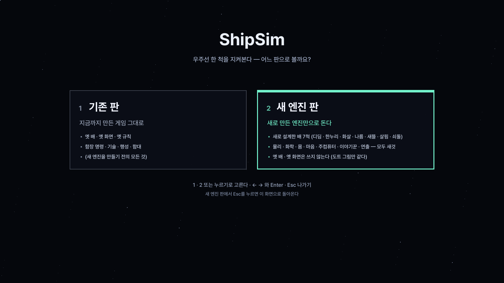 | 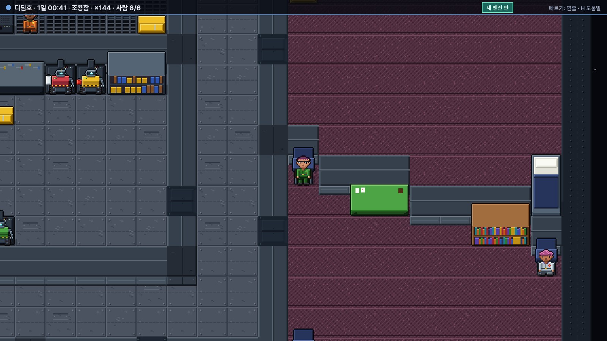 |
|---|---|
| **처음 화면** — 1 기존 판 · 2 새 엔진 판 (마지막에 고른 쪽이 밝다) | **새 엔진 판** — 디딤호 (새로 설계한 배) · 새 엔진의 세계 · 연출 · 화면만 |

### 배 일곱 척

- 생성기 `dotnet build/lab/Lab.dll --shipgen [배] [--show]`가 도면을 만들고 스스로 검사한다 (방이 끊기지 않나 · 모든 방이 문으로 이어지나 · 문 앞 · 설비 옆에 설 자리 · 침대 = 사람 · 엔진에 띄워 사람을 태워 본다)

| 배 | 사람 | 맡은 일 · 모양 | 식량 |
|---|---|---|---|
| 화살호 | 3 | 연락선 — 뾰족한 뱃머리 · 뒤로 젖힌 날개 · 엔진 둘 · 착륙 | 97일 |
| 디딤호 | 6 | 탐사선 — 팔각 몸통 · 대각선 착륙 다리 넷 · 가운데 하강 엔진 · 탐사 장비고(탐사차 · 드론) | 217일 |
| 살핌호 | 12 | 연구선 — 긴 몸통 · 줄기 끝 실험실 꼬투리 셋 · 관측 돛대와 관측실 · 방열판 | 417일 (재배 33%) |
| 나름호 | 8 | 화물선 — 등뼈 통로 양쪽에 떠 있는 화물칸 여덟 · 앞쪽 작은 거주 구역 | 267일 |
| 쇠돌호 | 10 | 채굴선 — 고리 통로 안에 광석 창고 · 정제 공장 · 굴착 팔 · 착륙 다리 여섯 | 272일 (재배 20%) |
| 새뜰호 | 40 | 이민선 — 두 줄 통로 · 침실 여덟 · 재배 갑판 셋 · 셔틀 격납고 | 412일 (재배 62%) |
| 한누리호 | 100 | 세대선 — 도는 고리(안쪽 침실 · 바깥 재배 갑판 열둘) · 바퀴살 넷 · 가운데 축(엔진 · 대형 원자로 · 함교 · 셔틀) | 다 기른다 (109%) + 비상 95일 |

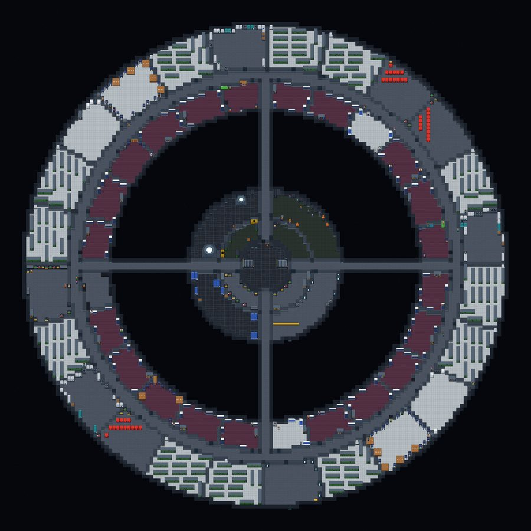

| 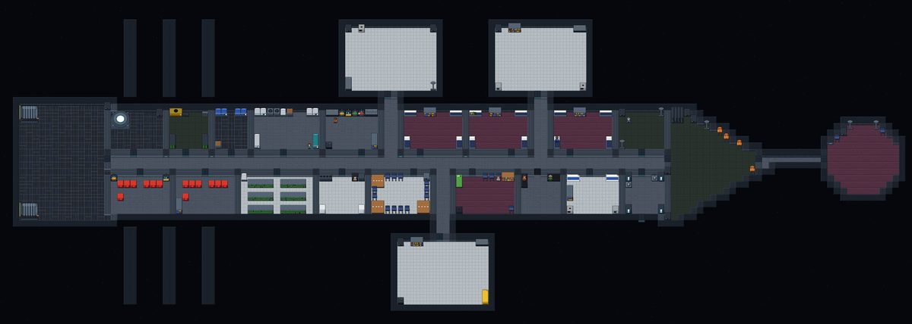 | 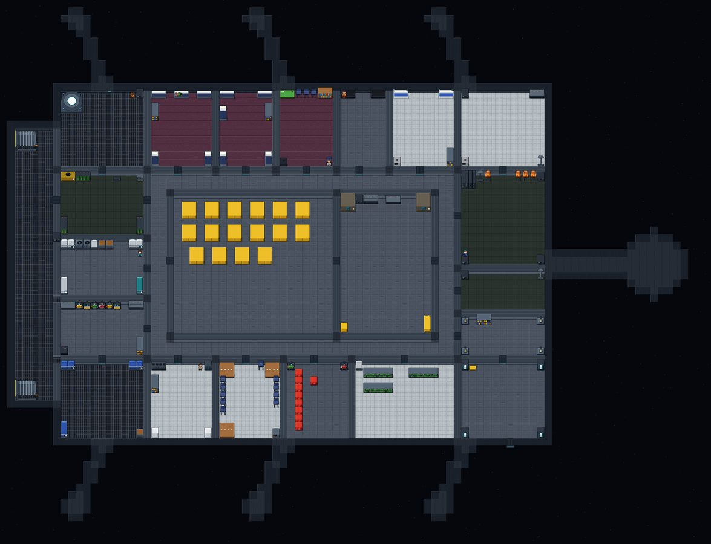 |
|---|---|
| **살핌호** — 실험실 꼬투리 셋 · 관측 돛대 끝 관측실 | **쇠돌호** — 광석 통(노랑) · 정제 공장 · 굴착 팔 · 다리 여섯 |
| 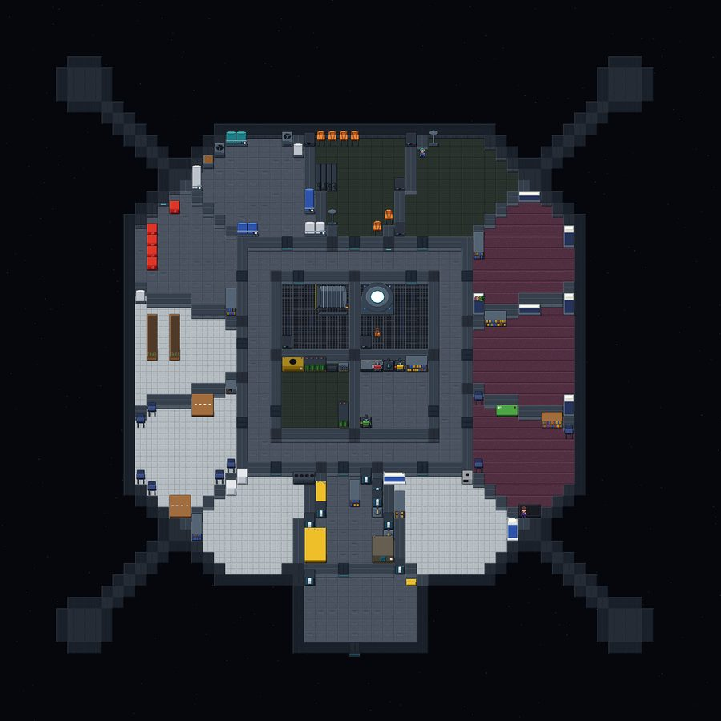 | 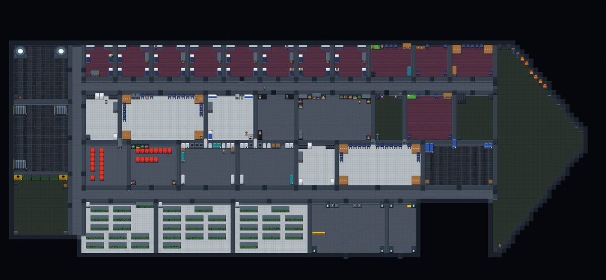 |
| **디딤호** — 착륙 다리 넷 · 남쪽 에어락이 내리는 길 | **새뜰호** — 재배 갑판 셋 · 셔틀 격납고 |
| 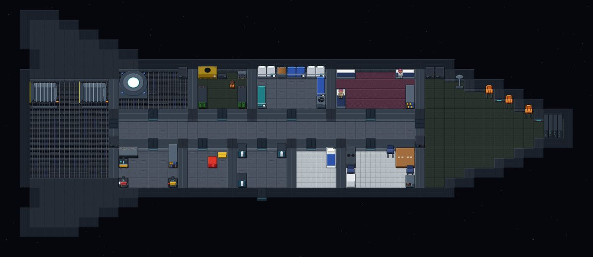 | 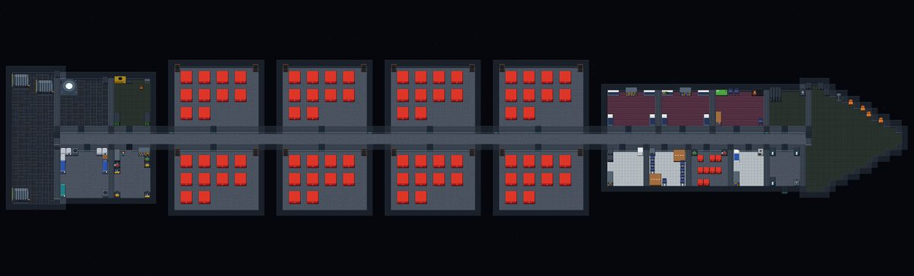 |
| **화살호** — 3명 · 60일 연락선 | **나름호** — 화물칸 여덟 (화물 상자 80) |

| 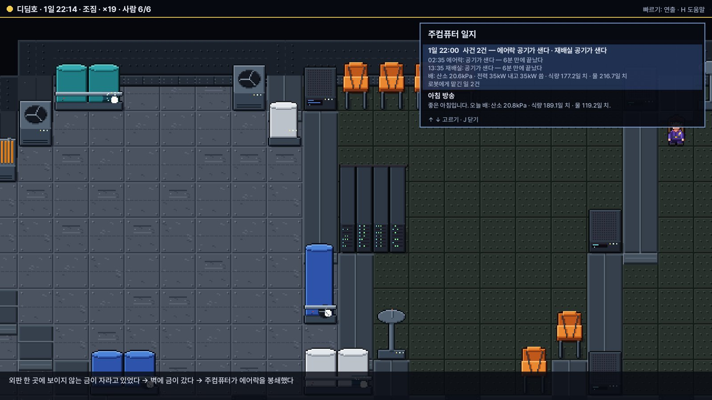 |  |
|---|---|
| **주컴퓨터 일지** (J) — 디딤호 하루: 외판에 간 금 둘 · 몇 분 만에 끝났나 · 배 산소 · 식량 · 물 며칠 치 · 아침 방송 | **항로 판** (T) — 항로 1~8 · 출항 전에만 고른다 · 지금 구간 · 고향까지 빛 |

| 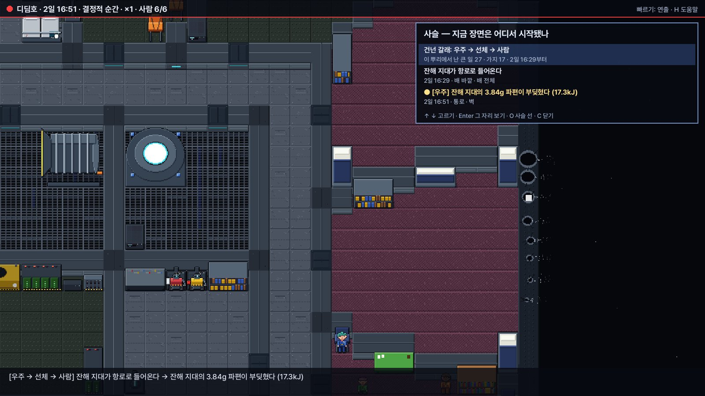 | 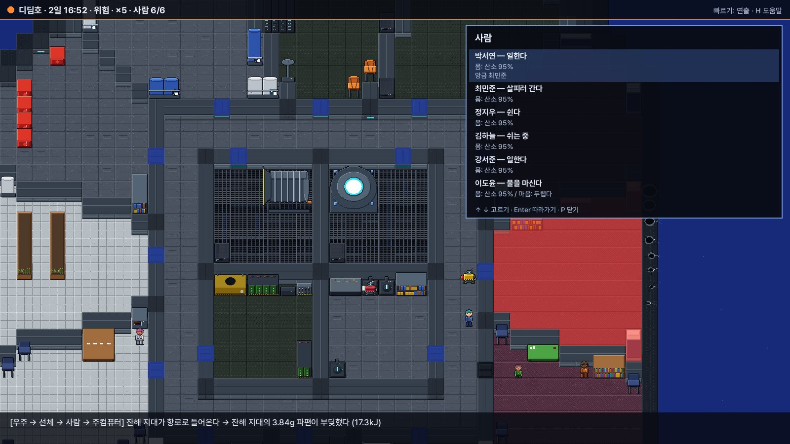 |
|---|---|
| **사슬 판** (C) — 디딤호: 잔해 지대 → 파편 → 외판 → 사람 → 주컴퓨터, 마디를 고르면 카메라가 그 자리로 | **사람 판** (P) + **공기 겹쳐 보기** (O) — 파편에 뚫린 방(빨강: 산소가 옅다)과 걱정스러운 사람부터 |

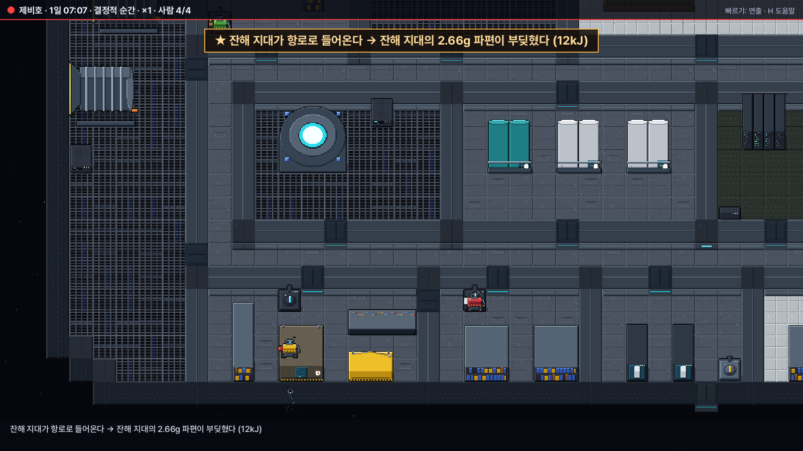

짜 맞춘 사고 대신, 탄탄한 엔진들이 서로 부딪혀 사건이 저절로 생기게 하려고 코어를 새로 짭니다. 옛 게임은 원래 가지에 그대로 있습니다.

설계와 진행: [docs/ENGINE.md](ENGINE.md) (엔진 13개 · 약속 · 과정 · 자는 동안 혼자 정한 것)

| 층 | | 한 줄 |
|---|---|---|
| ① 기반 · ② 물질 | ✔ | 시계 · 결정론 병렬 · 찍기/되살리기(원래 세계와 바이트까지 같다) · 원인 사슬 · 원소 → 물질 → 반응 |
| ③ 장 물리 | ✔ | 기체 12종이 틈으로 흐르고 섞이고 · 열 · 물 · 소리 · 빛 |
| ④ 구조 · ⑤ 바깥 | ✔ | 벽 · 문이 압력을 버티다 지친다 · 운석 · 파편 구름 · 별 폭발 |
| ⑥ 망 · ⑦ 생명 | ✔ | 전기 회로 · 냉각 · 공조 · 공기 재생 · 장치 고장 / 숨 · 체온 · 상처 · 돌봄 · 곪음과 열 · 옮는 병 · 잠의 질 · 몸무게 · 작물 · 곰팡이 |
| ⑧ 마음 | ✔ | 보고 듣고 냄새 맡은 것만 믿는다 · 외쳐 알린다 · 불 끄기 · 구멍 · 문틈 막기 · 끼익거리는 문 받치기 · 업어 내기 · 로봇의 선외 작업(에어락으로 나가 외판 바깥에서 막는다) |
| ⑨ 사회 | ✔ 첫판 | 함께 쉰 시간으로 가까워진다 · 구해 준 이에게 목숨을 빚진다 · 친구를 잃으면 일손을 놓는다 · 주컴퓨터가 닫은 문 안에서 누가 죽으면 경보를 덜 믿는다 |
| ⑩ 주컴퓨터 | ✔ | 센서로만 안다 · 경보 · 로봇 보내기 · 봉쇄 전에 세계를 복제해 5분 앞을 돌려 본다 · 눌어붙은 차단기는 로봇을 배전반으로 · 무정전 · 문의 압력 맞춤 밸브 · 큰 감압 뒤 예비 공기로 다시 채우기 |
| ⑫ 자연 사건 | ✔ (이야기꾼 대신) | 위험도는 항로 1~8만 · 미리 알기는 센서로 잡힌 것만 · 배 안의 일은 세상 확률(만들 때의 흠 · 차단기 접점 · 상자의 감기 · 출항 때 잠복 · 손보다 상함 · 일하다 다침) · 고향 편지 · 출항 과거사 — 사람의 마음은 건드리지 않는다 |
| ⑬ 연출 | ✔ 첫판 | 볼 곳을 스스로 고르는 카메라 · 조용하면 빨리 · 조짐에 느리게 · 결정적 순간 아주 느리게 · 하이라이트(첫 조짐부터) · 다시보기 · 재미 측정기 |
| ⑪ 일과 물자 | ✔ 첫판 | 일감판 · 정제기가 원료를 만들고 작업대에서 봉합 · 수리 꾸러미와 소화기를 만든다 · 쓴 시간으로 예방 정비 · 곰팡이 청소 |
| 소리 | 첫판 ✔ | 물리로 만드는 소리 — 두 겹 퍼짐(공기 · 뼈대) · 문 · 벽 너머는 먹먹 · 진공은 조용 · 재질마다 다른 쾅 · 틈 크기마다 다른 쉬익 · 방 크기만큼 울림 · 우주복 숨 |
| 새 화면 | 2단계 ✔ | 옛 도트 화가로 새 엔진 장면 그리기 (`engine/ShipView`) · `Lab --film` 하이라이트 필름 · **새 엔진 판** (게임 처음 화면에서 고른다 · `game/src/NewEngine` — 연출 카메라 · 빠르기 · 원인 사슬 글 · 함장의 손) |

### 재미 측정기(`Lab --fun`)가 찾아 고친 것

배를 이틀씩 돌리면 엔진의 빈틈이 이야기로 드러납니다:
- 파편에 끼인 에어락 바깥문 → 안쪽 문틈 5cm²로 배 전체 공기가 다섯 시간에 걸쳐 빠짐 → 로봇이 **쉬익대는 문틈을 막고**, 진공을 등져 **끼익거리는 문을 덧대 받친다**
- '새는 문틈 = 내 방 구멍'으로 믿게 했더니 사람들이 **진공 통로로 뛰쳐나가** 죽음 → 위험은 문 너머
- 이야기꾼이 잠복 원인(합선 불씨 셋 …)을 '조용하다'며 쌓았다가 한꺼번에 터짐 → **대기 긴장**을 셈한다 · 눌어붙은 차단기는 로봇이 배전반에서 **손으로 끊는다**
- 이산화탄소 걸러 내는 장치가 두 척에만 → 공기 재생기가 이산화탄소도 거른다
- 빈 엔진실 외판의 5cm² 금이 14시간 동안 아무도 모르게 배를 빼 여섯 명이 죽음 → 주컴퓨터가 **배 전체의 느린 샘**을 본다
- 잔해 폭풍 뒤 배가 71kPa로 낮아지자 문을 열 때마다 방마다 봉쇄 · 해제를 되풀이 (하루 하이라이트 26개) → **옮겨 간 공기는 샘이 아니다**
- 진공이 된 휴게실(구멍 94cm²) 문은 기압 차로 안 열려 13시간 그대로 → 로봇이 **에어락으로 나가 외판 바깥에서 막고**, 문 밸브로 방을 다시 채우고, 주컴퓨터가 **예비 공기**로 배를 되돌린다 (70 → 96kPa)
- 전기 45kW가 다 방 열이 되는데 공조가 통풍구 한 칸만 식혀 엔진실이 76℃까지 → 방 평균으로 조절하고 방 전체를 식힌다 (20~21℃)
- 냉각 펌프 봉함이 터져 암모니아가 4분 만에 덕트로 배 전체에 퍼지고, 자던 두 사람이 경보 하나 없이 죽음 → 주컴퓨터가 **독한 기체**를 재 통풍구를 닫고 그 방 덕트를 **정화기로만** 돌려 거른다 · 코를 찌르는 냄새에 **잠이 깬다** · 폐 손상은 짙기만큼
- 파편이 엔진실 문을 반쯤 열린 채 끼워 배 전체 공기가 그 방 외판 금으로 빠지고 24명이 죽음 (고래호) → 주컴퓨터가 **끼인 문**을 알아채 로봇이 비틀어 바로잡고 닫는다 → 0명
- 우주복을 아무도 벗지 않아 서늘한 방에서 열사병 · 쓰러진 몸이 달리던 대사량 그대로 익음 · 연기 마신 사람이 의무실에서 숨이 모자라 죽음 → **우주복 냉각 · 벗기**, 쓰러지면 기초 대사, 치료 침대 **산소 요법** → 쓰러졌다가 업혀 와 살아나는 '아슬아슬'이 처음 생겼다
- 되살린 세계가 첫 틱부터 원래와 갈라짐 (설비 열용량 · 구역 정보를 안 찍었다) → **다시보기 · 주컴퓨터의 상상이 바이트까지 같은 미래**

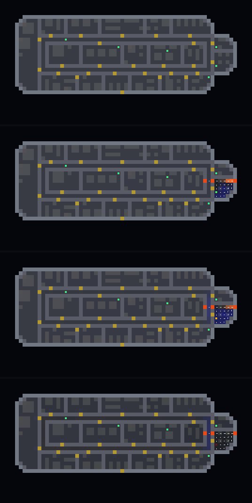

운석 장면의 원인 사슬 (엔진이 저절로 이어 붙인 것):

`운석 하나가 배를 향해 온다 → 1.5kg 운석이 부딪혔다 (27,000kJ) → 진공에서 숨을 못 쉬었다 → 죽었다`

· 옆 방 문: `… 운석이 부딪혔다 → 압력 차가 벽을 밀었다` (끼익 소리 · 문틈으로 쉬익)

### 저절로 나온 장면들

(짜 넣은 줄거리 없음)

- 불: 사람이 보고 외친다 → 같은 방 로봇이 보관함에서 소화기를 꺼내 먼저 끈다 → 사람은 로봇에게 맡기고 방을 빠져나간다
- 잔해 지대: 외판에 구멍 열 곳 → 로봇들이 차례로 막고, 진공이 된 에어락 문틈을 막고, 휘는 문을 덧대 받친다 → 배는 80kPa로 버틴다
- 일산화탄소: 냄새가 없어 깨어 있는 사람은 두통으로만 '공기가 이상하다'고 느끼고 · 잠든 사람은 깨지 않는다
- 사람 이야기: 업혀 나온 사람은 구한 로봇에게 '목숨을 빚졌다' · 친구를 잃은 사람은 일손을 놓는다

시험: 법칙 95 · 규칙 462 모두 통과 · 관전 장면 빌드 + 화면 없이 10초 (GitHub Actions `engine`) · 1틱(2.4초) 계산 1.1 ~ 2.3ms · 한누리호(세대선) 사람 100 + 로봇 30: 5.2ms (게임 1시간 7.8초)

## 옛 게임 기록

옛 게임 (원래 가지)의 마지막 진행 기록 — 10-26까지 README에 있던 그대로 (제목만 한 단 내렸다).

### 📌 최신 업데이트 · 진행 상황 (2026-10-16)

**지금 하는 일: 시험 시간 줄이기 2단계 ✔ — 전체 시험 22분 → 약 9분 · 빠른 묶음 3분 10초 → 2분 20초 · 결과는 몇 줄로 — 다음: 남은 통계 시험(growthtest) · 긴 항해 붕괴 원인** (진행 약 97%)

> **개발 과정을 바꿨습니다** ([자세히](DEV_PROCESS.md)): 전체 회귀 52번을 세어 보니 시험 136개 중 90개가 상관없는 변경에도 통과 ↔ 실패를 오갔습니다. 이제 시험을 세 층으로 나눕니다.
> **규칙 시험**(작은 배에서 규칙 하나 · 몇 초 · 반드시 통과) · **핵심 15**(늘 통과하던 것) · **장면 시험**(막지 않고, 기준에선 통과하던 것이 다른 시드에서도 실패할 때만 조사).
> 기능마다 `tools/quick.sh` (약 2분 20초) · 전체는 **GitHub Actions가 푸시마다** 10조각 동시에 돌려 (약 9분) 한 장으로 요약하고, `tools/ci/last.sh`가 결과를 몇 줄로 읽어 옵니다.

> 진행 방식: 기능을 먼저 쭉 만들고, 각 기능은 빌드 + 그 기능 시험으로 확인해 올렸습니다. 지금은 맨 끝의 전체 시험 단계입니다. 자세한 기록: [긴 항해 점검](LONG_RUN.md)

#### 시험 시간 줄이기 2단계 — 전체 22분 → 약 9분 ✔

| | 처음 | 지금 |
|---|---|---|
| 빠른 묶음 (`tools/quick.sh` · 규칙 + 핵심 15 · 빌드 포함) | 3분 10초 | **2분 20초** — 오래 걸리는 시험부터 (가장 긴 것이 맨 끝에 혼자 돌던 것) |
| 전체 138개 (GitHub Actions · 푸시마다) | 21분 49초 | **9분 10초** — 10조각 · 실측 초로 고르게 · growthtest 자식 프로세스 · 한 번에 한 실행 |
| 결과 읽기 | 긴 로그 · 작업 목록 | **`tools/ci/last.sh` 3~5줄** (상태 · 걸린 시간 · 한 줄 요약 · 조사할 것) |

- 결과는 그대로입니다: 실행 #4 · #6 · #7 · #8 모두 🟢 114/138 · 빨강 0 · 새 실패 0.
- 이제 바닥은 growthtest 한 개(러너 하나의 CPU 4개를 다 써서 약 7분) — 더 줄이려면 시험 내용을 바꿔야 해서 여기서 멈췄습니다.
- 자세히: [개발 과정](DEV_PROCESS.md) (실행별 걸린 시간 표 · CI가 빠른 까닭 · 해 보고 그만둔 것)

#### 시험 시간 줄이기 — "첫날 배"를 한 번만 돌린다 ✔

많은 시험이 하루를 보낸 배에서 장면을 시작합니다 (한빛호 하루 약 15초). 같은 시드 · 같은 배 · 같은 스위치면 늘 같은 배이므로, 처음 한 번 돌려 통째로 찍어 두고 다음부터는 되살립니다 (0.2초 · 프로세스끼리도 임시 폴더로 나눔 · 코드가 바뀌면 자동으로 다시 돌림).
- **켜고 끈 결과가 같은지 먼저 확인했습니다**: 시험 137개를 끄고 · 켜고 두 번 돌려 출력을 견줌 → 처음엔 2개(aftertest · crisistest)가 달랐습니다.
  원인: 시험이 켜고 끄는 전역 스위치 중 속성으로 된 25개(`RoomPlanSystem.ThinkOff` · `CrisisCrewSystem.Off` 등)가 캐시 열쇠에서 빠져, 스위치를 켠 채 만든 첫날 배가 보통 첫날 배 자리에 저장되었습니다 → 고침.
  고친 뒤 **137개 모두 시간 줄만 빼고 글자까지 같습니다** → 기본으로 켰습니다 (끄려면 `SHIPSIM_WARM=0`).
- **같이 찾은 게임 버그**: "몰래 꺼내 먹기"가 창고 목록을 한 시간씩 붙들어 두면서 언제 모았는지는 저장하지 않아, 저장을 불러온 배와 그냥 이어 간 배가 다른 창고로 갈 수 있었습니다 → 고침.
- **시간**: 전체 회귀 5,269초 → 4,349초 (−17%) · 시험별 합 13,290 → 11,689초 (−12%) · 첫날 배를 많이 쓰는 시험은 반 아래로 (responsetest 32 → 7초 · hazard70test 151 → 65초 · crisistest 363 → 232초).
- 남은 큰 몫이던 growthtest (20일 항해 16번 · 37분)는 시드마다 자식 프로세스로 나눠 동시에 돌립니다 → CI에서 약 7분 (결과 줄 16개 · 판정 모두 이전과 글자까지 같음).
- 진단 도구: `--warmdiff` · `--warmsplit=파일 --scene=…` (프로세스를 나눠 틱마다 지문) · `SHIPSIM_HASHTRACE=1` (시험 안에서 틱마다 지문) · `--warmdiff --floodcheck` (길찾기 캐시 — 48시간 2,415번 모두 같음).

#### 이어서 고친 것 — 재료 수집 · 극한 환경 대비 (항상성)

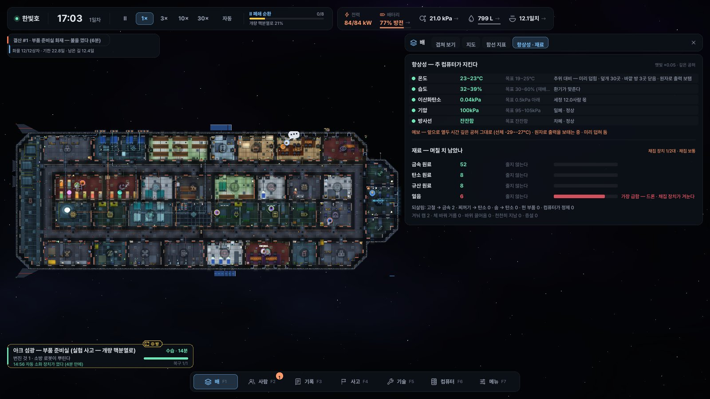

**재료 수집** — 주 컴퓨터가 원료마다 "며칠 치 남았나"를 날마다 재고 움직입니다 (회의 없이).
- **거두는 힘을 배 크기에 맞춘다**: 30명 배도 채집 장치가 한 대였습니다. 이제 설비 60대에 한 대쯤을 맞추고, 모자라면 주 컴퓨터가 선체 벽가에 채집 장치 증설 공사를 올립니다 (원료가 며칠째 급하면 한두 대 더).
  큰 배는 금속판 · 케이블 · 구조재를 더 쌓아 둡니다 (30명 배가 금속판이 12개 아래로 떨어질 때까지 정제하지 않던 것).
- **모자란 원료를 겨눠 캔다**: 채굴 드론이 가장 급한 원료를 노려 캐고, 채집 장치는 체를 바꿔 끼워 그 원료를 더 거릅니다 (넘치는 원료는 흘려보낸다).
  혜성 꼬리 · 얼음 고리에선 혜성 조각을, 소행성대 · 난파선 무덤에선 작은 바위를 드론이 끌어와 쪼갭니다. 돌 많은 구간에선 반나절 천천히 지나며 더 거둡니다. 그래도 이틀 넘게 바닥이면 원정을 꺼냅니다 (원정은 회의로).
- **배 안에서 되살린다**: 재활용실이 없는 배도 정제기에서 고철을 녹이고, 갈아 낸 헌 부품을 뜯어 고철 · 쓸 만한 속(구리선 · 전자재)을 건집니다. 음식 찌꺼기 · 남는 채소는 말려 탄소로.
  탄소가 모자라면 주 컴퓨터가 생명유지실에 **탄소 회수기**(새 설비)를 답니다 — 사람이 내쉰 이산화탄소에서 탄소를 뽑습니다 (전기를 많이 먹는다).
- **정제기가 놀던 것**: 원료는 수백 개 쌓였는데 사람은 다른 일에 밀려 정제기가 놀았습니다. 이제 사람 · 로봇이 쓰지 않는 정제기는 주 컴퓨터가 혼자 천천히 돌립니다 (사람이 하면 세 배 빠르다 · 금속판 · 구조재 먼저).
  정제기 한 대를 해체된 로봇이 쥔 채 하루 넘게 묶어 두던 버그도 고쳤습니다.
- 30일 네 척 (전 → 후 · 20일째 / 30일째):
  천마호(30명) 금속판 16 → **48** · 케이블 10 → **48** · 탄소 원료 0 → **60** · 금속 원료 17 → **92** (채집 장치 1 → 6대 · 탄소 회수기 2대) ·
  한빛호(12명) 금속판 15 → **23** · 케이블 9 → **23** · 구조재 8 → **14** (주 컴퓨터가 혼자 정제 249번) ·
  미리내호 고장 4 → **0** · 탄소 원료 0 → **11** ·
  보듬호(14명) 고장 2 → **0**이지만 금속 원료는 여전히 바닥 — 원정 요청 8번 (작은 배는 아직 빠듯하다: "잘 관리하면 버티지만 가끔 원정이 필요한 긴장")

**항상성** — 극한 환경을 "대비하면 버티는 곳"으로.
- **우주 공간도 실감 나게**: 선체 바깥이 햇빛 쪽 · 그늘 쪽으로 다르고 (보통 항로 1~11℃), 근일점은 뜨겁고 (선체 22~34℃) 깊은 공허 · 얼음 고리는 찹니다 (−28℃). 구간이 바뀌면 선체가 몇 시간에 걸쳐 따라갑니다.
- **주 컴퓨터가 지킨다**: 앞 구간 예보를 보고 들어서기 전에 미리 덥히거나 식히고, 바깥 방 단열 덮개를 내리고, 덜 쓰는 창고 · 화물칸은 닫아 열을 사람 있는 방으로 돌리고, 원자로 출력을 올려 난방에 보태고, 안쪽 방으로 모이라고 방송합니다. 뜨거운 구간에선 햇빛이 빈 쪽으로 오게 배를 돌리고 천천히 굴립니다.
  오락실 · 명상실 · 예배실 · 체육관은 닫지 않습니다 (추울수록 지친 사람이 쉬러 간다).
  → 깊은 공허 하루: 사람이 지내는 방 최저 18.4℃.
- **착륙 열 점검**: 행성에 내릴지 정할 때 "덮개를 다 내리고 원자로를 올리면 이 추위 · 더위를 버티나"를 방마다 · 전기까지 셈해, 못 버티면 내리지 않습니다. 얼어붙은 행성(선체 −17℃)에선 덮개를 내려 난방이 110 → 34kW로 줄고 방은 따뜻합니다.
- **한 화면**: 아래 탭 "배 › 항상성 · 재료"에 온도 · 습도 · 이산화탄소 · 기압 · 방사선의 지금 값 · 목표 · 지금 하는 자동 대응이 한 줄씩 보입니다. 너무 습하면 제습, 메마르면 가습, 이산화탄소가 짙은 방엔 세정을 몰아 줍니다.
- **오진**: 추운 행성에서 아무 수리나 "난방을 고친다"로 적던 것 — 이제 전기가 끊긴 방이거나 열을 대는 설비를 고칠 때만 그렇게 봅니다.

**전체 시험에서 찾아 고친 것**
- **불 앞에 아무도 없는데 "소화조가 잡는다"**: 창고에 세워 둔 운반 로봇이 거품만 다 쓰고, 소화 일을 받은 두 사람은 문 밖 · 에어락에서 서성이는데 주 컴퓨터가 그 둘을 소화조로 세어 진공 소화를 30분 미뤘습니다.
  → 맡겨 본 지 6분이 지나도 불이 줄지 않으면 실제로 불 앞에 선 손만 셉니다.
- **다 먹은 늦은 끼니 접시가 식탁에 남던 것**: 거의 다 먹고 마지막 숟가락 전에 불려 가면 이름표 접시가 그대로 남았습니다.
- 운에 기대던 장면 시험 13개를 단단하게 (열 · 얼어붙은 행성 · 털어놓기 · 인계 · 잠긴 문 · 열사병 · 태양 폭풍 · 탄내 · 아는 것의 차이 · 기항지 상륙 등).
- **시험**: 새 장면 시험 19개 (`--matbtest`) 모두 통과.
- **전체 회귀 (137개 · 44cb413)**: **통과 113 · 실패 24** (기준 611a77f: 통과 98 · 실패 38) — 기준보다 새로 실패한 것은 growthtest 한 개 (배운 배의 치료 한 번당 효과 12.0 ↔ 12.2%p — 예전 기록에서도 자주 뒤집히던 통계 항목, 다음에 고침) · 나머지 23개는 기준에서도 실패하던 장면 시험 · 예외 · 멈춤 없음.

#### 그 전에 고친 것 (1) — 로봇 왕복 · 로봇 스스로 고치기 · 수혈 · 원정대

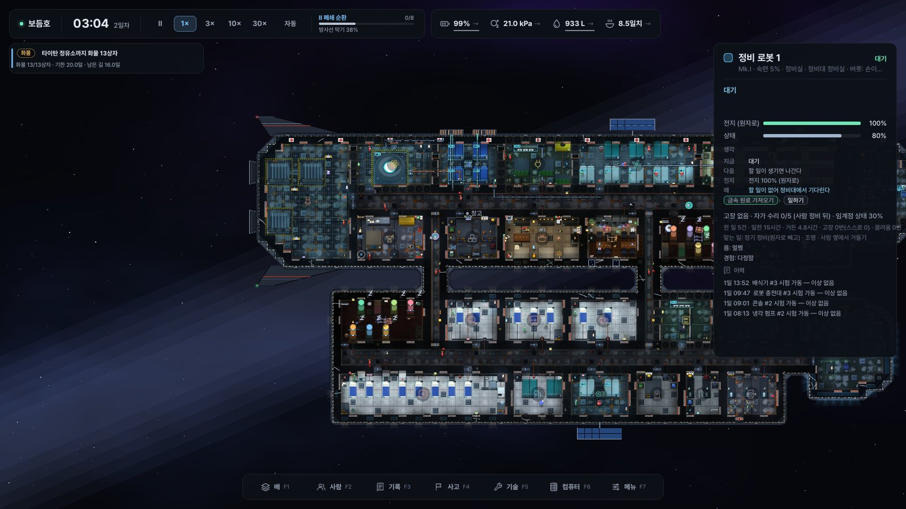

- **로봇이 같은 길을 오가거나 멈춰 서던 것**: 여러 대가 한 사람을 거들러 한꺼번에 25분을 걸어가 한 대만 거들고 나머지는 돌아서던 것, 방금 닦은 자리를 다시 닦으러 오가던 것, 이미 낀 공동 작업에 또 끼려던 것을 고쳤습니다. 거들러 가는 사이 일이 끝날 것 같으면 아예 나서지 않습니다. 다친 사람 곁에 보낸 로봇은 그 자리를 지킵니다.
  → 한빛호 · 미리내호 · 보듬호 · 천마호 사흘: 같은 두 일을 번갈아 하던 로봇 10대 → 1대.
- **로봇이 스스로 고친다**: 전엔 센서 · 끼임 · 과열만 스스로 고쳐서, 흔한 구동 불량마다 사람이 부품을 들고 가야 했습니다. 이제 구동 · 제어기 · 전지 고장도 충전대로 돌아가 스스로 고칩니다 (부품 없이 임시로 맞추고, 다음 정비 때 제대로).
  사람 · 동료 로봇이 고치는 것은 맞아서 부서졌거나 물 · 불 · 진공 · 방사선에 상한 고장, 불에 그을린 것뿐입니다.
- **당직이 수술대를 붙들던 것**: 당직 서는 사람이 수술대 위에 한두 시간씩 서 있어, 의무관 없는 배에서 수술 팔이 열 시간 동안 수술을 못 열었습니다. 이제 사람이 눕는 자리(수술대 · 치료 침대)는 당직 자리가 아닙니다.
- **수혈을 맡은 사람이 바뀌며 한 번도 못 넣던 것**: 피 팩을 들고 가던 의무관이 40분이 지나면 다른 사람에게 맡은 일을 넘기고 게시판을 보러 가 버렸습니다 (두 시간 동안 셋이 번갈아 나서고 한 번도 못 넣었다). 이제 가는 중이면 끝까지 맡습니다.
- **인공 심장 전지**: 충전 중에 누가 말을 걸면 일어나 88%에서 끊겼고, 35% 아래로 떨어질 때까지 다시 앉지 않았습니다. 이제 충전대에 앉은 채 듣고, 60% 아래면 틈날 때 마저 채웁니다.
- **공황에서 깨운 사람**: 마주 앉아 달래서 깨운 사람은 비상 자리를 받지 못해, 불이 아직 타는데 당직을 서러 갔습니다. 이제 누가 어떻게 깨웠든 깨운 사람 곁의 자리를 받습니다.
- **원정대가 배의 손을 다 데려가던 것**: 정비 솜씨 순으로 뽑다 보니 정비할 줄 아는 사람이 모두 원정을 떠나, 팔을 잃은 동료가 이틀 넘게 의수를 못 달았습니다.
  → 정비 · 의료를 할 줄 아는 마지막 성한 손은 배에 남습니다 (뽑을 때 · 떠날 때 · 에어락을 나설 때 세 번 봅니다). 의수 · 의족을 아직 못 단 사람은 원정에 나서지 않고, 의수 · 의족 일은 미룰수록 앞당겨집니다.
- **시험**: 운에 기대던 장면 시험 13개를 단단하게 고쳤습니다 (장면의 사람이 배고프거나 다쳐 다른 일로 빠지던 것, 로봇이 먼저 해치워 사람의 장면이 사라지던 것 등). 원래 깨져 있던 주컴퓨터 시험 2개도 이번 고침으로 통과합니다.

#### 그 전에 고친 것 (2) — 약 과용 · 항생제 · 증축 방 · 선외 귀환

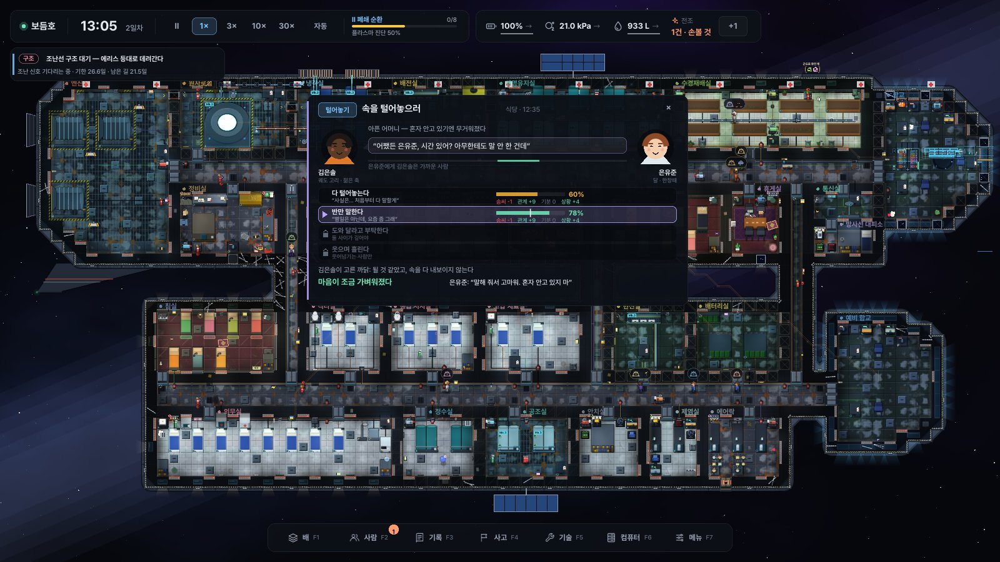

- **신부전 · 간부전의 원인은 약 과용이었습니다**: 숨진 사람의 장기는 모두 '약을 너무 많이 썼다'로 상해 있었습니다. 붕대 · 천으로 한 처치까지 약으로 셌고, 키트 없이 처치하면 곧바로 또 불러 하루 열 번 넘게 "약"을 쓴 셈이 됐습니다.
  → 실제로 약을 쓴 횟수만 세고, 의무관 · 의사 로봇은 하루 네 번을 넘기지 않습니다 (넘으면 붕대로 처치만).
- **키트가 바닥나도 항생제는 씁니다**: 전엔 선반에 항생제가 있어도 키트가 없으면 진단만 하고 돌아서 곪은 상처가 패혈증이 됐습니다. 감염된 사람이 있는데 항생제가 0이면 약초 · 탄소를 먼저 항생제에 씁니다.
- **증축 방이 덫이 됐습니다**: 별채 밑에 또 별채를 붙이자, 안쪽 사람들이 남의 선실을 지나야만 나올 수 있었고 주인이 자면 문 앞에서 돌아서 굶었습니다 (고래호 하루 1,155번). → 막다른 방에서는 그 선실을 지나 나오고, 침실 증축은 한두 사람 선실에 붙이지 않습니다.
- **선외 작업은 에어락까지 걸음을 봅니다**: 큰 배 선체를 손잡이로 옮겨 가는 길이 한 시간이 넘는데 산소 36분에야 돌아서 둘이 밖에서 숨졌습니다. → 산소가 걸음 × 1.25 + 10분 아래면 돌아섭니다.
- 그 밖에: 잔해 지대에 추진제 없이 갇히지 않게 · 채굴 드론이 얼음이 넉넉하면 금속 · 탄소를 · 받아 든 칸에 선 채 먹으면 한 걸음 비켜서기.
- **90일 결과 (사망 / 탄 사람)**: 천마호 28/42 → **0/44** · 보듬호 16/16 → **0/16** · 한울호 38/60 → **1/37** · 고래호 22/34 → **2/43** · 보름달호 22/41 → **4/34** · 제비호 100일 8 → **1**. [자세히](LONG_RUN.md)

#### 그 전에 고친 것 (3) — 부품 고갈 · 정원 · 굶주림 우선

- **수리 부품 고갈**: 큰 배는 작업대가 6~9대인데 한 번에 1대만 썼고, 릴레이 · 축전기처럼 재료가 넉넉한 부품도 사람들이 쉬느라 아무도 안 만들어 고장이 70일 넘게 밀렸습니다.
  → 작업대마다 서로 다른 부품을 함께 만들고, **수리를 기다리는 부품은 정비 로봇이 먼저 만듭니다** (채소로 만드는 것은 사람 몫).
  → 얼음 · 규산만 쌓이고 금속 원료 · 탄소가 바닥나면 원료를 캐러 잔해 지대로 갑니다 (전엔 합계로 보아 넉넉해 보였다).
  **천마호 90일째 고장 80건 → 18건.**
- **정원을 넘겨 태우면 배가 알아서 넓힌다**: 침대가 모자라면 회의 없이 바로 밖에 **침실**을 붙이고, 입이 늘었는데 배 안에 재배대 놓을 데가 없으면 **재배실**(재배대 2대)을 붙입니다.
  넘겨 태우는 것은 침대 쪽만 — 먹을 것은 재배대가 실제로 늘어난 만큼만 더 태웁니다 (먹을 것까지 넘겼던 제비호 · 보듬호가 무너졌다).
- **굶주린 사람은 여가보다 먼저 먹는다**: 동료를 잃은 뒤 취미 · 차 · 일기가 굶주림을 이겨, 냉장고에 채소 400개를 두고 열 명이 굶어 죽던 일을 막았습니다.
- **전력이 모자랄 때 여분 산소 발생기를 쉬게**: 사람 수만큼만 돌리고 나머지 전기를 조리대 · 배식기로 (원자로가 멈췄을 때는 생명유지를 건드리지 않습니다).
- **소리 8개 다시 만듦**: 비 · 눈보라 · 지진 · 천둥 둘 · 우주급 경보 · 로봇 구동음 · 도마질 — 점검표에 '다시 만듦'으로 올렸습니다.

#### 마지막 시험 — 긴 항해에서 찾아 고친 것

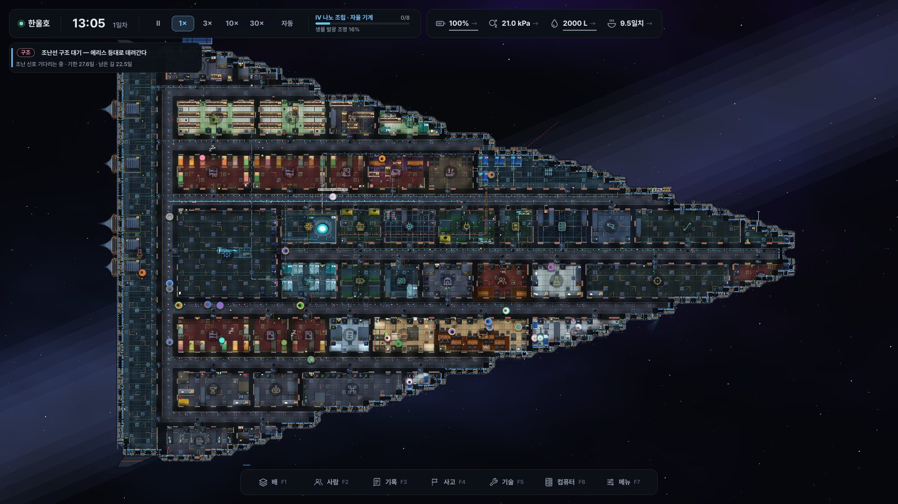

- **처음 90일 항해에서 다섯 척이 모두 무너졌습니다.** 고장보다 굶주림이 먼저였습니다 — 굶주리면 쓰러지고, 쓰러지면 신장이 상해 숨지고, 일손이 사라져 고장이 쌓였습니다.
- **식량 비상 재배대 공사**: 재배대가 대는 끼니가 먹는 끼니보다 모자라면 회의 없이 바로 재배대를 짭니다. **정전 때 냉방은 식량 설비 다음**으로 전기를 받습니다.
- **정원만큼만 태운다**: 기항지 손님 · 이주민 · 피란 가족 · 밀항 · 구조 · 원정 생존자가 60명 한도만 보고 탔습니다 — 4인 배 제비호가 40일 만에 12명이 되어 굶었습니다. 이제 잘 자리와 재배대 끼니만큼만 태웁니다 (목숨이 걸린 구조는 조금 더 비집습니다).
- **배식 줄이 멈추던 버그**: 줄 맨 앞 사람이 받는 칸에서 막히면 자리를 붙든 채 되풀이해 뒷사람이 아무도 못 받았습니다. 이제 막히면 자리를 놓고, 받는 칸 바로 곁이면 거기서 받습니다.
- **잠긴 구역 문**: 냉장고 가는 길이 의무실 · 선실을 지나면 문 앞에서 돌아섰습니다 — 배고픈 사람은 비상 해제 손잡이로 지나갑니다.
- **로봇이 먼저**: 조리 로봇이 없는 배에서도 사람이 45분 넘게 못 잡은 조리는 아무 로봇이나 합니다. 굶주린 환자에게는 치료할 때 영양 수액을 놓습니다.
- 제비호 45일: 굶주림 118,509회 → 24회 · 사망 1~4명 → 0.
- **90일 × 5척 · 1년 결과**: 초반 굶주림은 크게 줄었지만 90일을 버티는 배는 아직 없습니다 — 60일이 지나면 **수리 부품이 바닥나** 고장이 50~80건 쌓이고, 보듬호는 **전력 여유**가 없어 무너지고, 큰 배는 먼 걸음과 지침이 겹칩니다 (제비호 1년: 160일째 전원). 다음 고칠 일입니다.
- **마지막 전체 회귀 (130개)**: 통과 98 · 실패 32 — 20은 원래 있던 실패, 12는 오늘 고친 뒤 장면 통계가 문턱 근처에서 뒤집힌 것 (예외 · 멈춤 없음). [자세히](LONG_RUN.md)

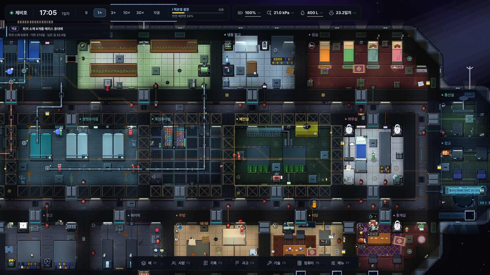

#### 기술 체계 대개편 ✔ (`--techtreetest` 9/9 · [결정 기록](TECH_REDESIGN.md))

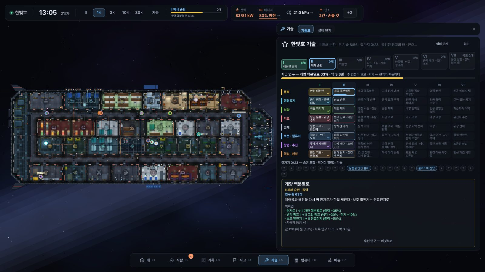

- **기술표 하나**: 예전의 시대 기술 · 그물 · 숨은 기술 · 설비 단계(142개)를 **시대 7 × 줄기 8 = 본 기술 56 + 곁가지 23**으로 합쳤습니다. 시대 하나의 여덟 기술을 모두 익히면 다음 시대.
  Ⅰ 핵분열 출항 → Ⅱ 폐쇄 순환 → Ⅲ 핵융합 → Ⅳ 나노 조립 · 자율 기계 → Ⅴ 반물질 · 인공 생태계 → Ⅵ 중력 제어 · 성간 추진 → Ⅶ 공간 접힘 · 살아 있는 배 (마지막 시대 = 항해의 목표).
- **누가 고르나**: 회의(주 컴퓨터 권고)가 이유와 함께 고르고(“불이 네 번 났다”), 함장은 기술표에서 하나를 **[우선 연구]**로 누를 수 있습니다. 갈림길은 배의 형편으로 기울고(수경 재배실이 있으면 조류 광합성), 익히기 전까지 함장이 뒤집을 수 있습니다.
- **무엇으로 연구하나**: 작업대 · 솜씨 좋은 사람 · 실험, 그리고 **겪은 일**(불 · 운석 · 고장 · 굶주림 · 항해가 그 줄기 연구를 밉니다) · 표본 · 유물 · 다른 배. 작은 기술은 3~6일, 시대는 한두 달.
- **익힌 순간**: 화면 가운데 큰 카드 — 말 + **전후 숫자**(원자로 힘 100% → 135% · 불 100% → 70%) + 설치할 설비. 위 줄에는 늘 **시대 이름 + 다음 기술 막대**.
- **공사로 설치**: 익힌다고 설비가 바로 바뀌지 않습니다 — 로봇 · 승무원이 재료를 들고 한 대씩 고쳐 달고, 배 위에서 설비가 바뀌는 순간이 보입니다. 높은 단계의 대가(전기 · 닳음 · 고장)는 약하게.
- **잃기**: 그 솜씨를 아는 사람이 모두 떠나면 경고 뒤 열흘에 잊습니다(지은 설비는 남고 새로 못 짓습니다). 다시 배우면 반값.
- **크기별 시작 시대**: 8명 이하 Ⅰ · 9~14명 Ⅱ · 15~24명 Ⅲ · 25명 넘음 Ⅳ — 앞 시대를 이미 알고 설비도 그 단계로. 고래 · 한울 · 보름달 · 보듬호는 모자랐던 정수기 · 재배대 · 배식기 · 배터리를 더 싣고 떠납니다.
- 실험 담당이 병실에 누워 있으면 반나절 넘게 아무도 실험하지 못하던 버그를 고쳤습니다.

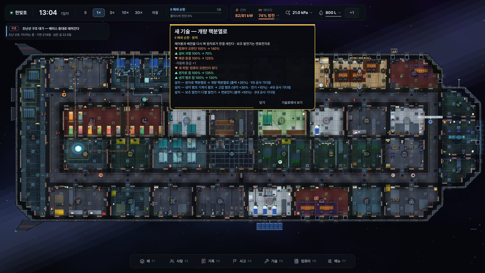

#### 볼거리 ✔ (`--funtest` 10/10)

- **반려동물**: 사람이 많은 배에는 개 · 새, 수조가 있으면 물고기, 재배실에는 벌. 개는 좋아하는 사람을 따라다니고, 새는 식당 · 휴게실을 날아다닙니다.
  쉬는 사람 · 지친 사람이 더 자주 쓰다듬고(하루 30번 남짓), 쓰다듬은 동물 곁에 있으면 마음 병이 조금 더 빨리 낫습니다. 벌통에서는 가끔 꿀.
- **살아 있는 행성**: 행성마다 생명이 있습니다 (생명 없음 · 미생물 · 이끼 · 외계 식물 · 작은 동물 · 숲 · 무리 지은 동물). 행성 카드에 '생명' 줄.
  밖에 나간 사람이 표본을 가져오면 실험실에서 연구 — 좋은 씨앗(재배실에 섞어 심음) · 나쁜 씨앗(작물 병) · 길들인 외계 애완동물 · 우리를 빠져나가 배 안에 숨은 생물(사람을 놀라게 하고 식량을 뒤지다 로봇에게 잡힘) · 기생체 감염.
- **다른 배와의 만남**: 교역 항로 · 순찰 항로에서 나란히 섭니다 — 교역선(넉넉한 원료를 모자란 부품과 바꿈) · 조난선(살아남은 사람을 태움) · 다른 세대선(잔치 · 사람 교환) · 약탈선(드론이 막아서거나 물자를 내줌).
  만난 배가 선체 옆으로 다가와 통로를 잇고, 끝나면 멀어집니다. 항해 카드 위에 만남 줄.
- **기항지 상륙**: 항구 구간에 닿으면 반쯤 내려 장을 보고 기념품을 사고(일기에 남음), 가끔 술집에서 다툽니다. 다녀온 사람은 쉬고 향수병이 덜합니다.
- **축제 · 명절**: 배의 100일 생일 · 수확 축제 · 혼인 잔치 — 식당에 줄 전구가 걸리고 저녁에 다 같이 먹고 노래합니다.
- **다시보기**: 기록 탭 사진첩의 '▶ 다시보기' — 남은 장면 가운데 큰 장면 열 장을 날짜 순으로 한 장씩, 장면마다 그 방으로 화면이 갑니다.

#### 주컴퓨터의 자아 · 외계 기생체 · 도전 시나리오 ✔ (`--arcstest` 통과)

- **주컴퓨터의 자아**: 겪은 일이 쌓이면 사람에게 묻기 시작하고(“왜 별을 그렇게 오래 보나요?”), 식당 투표로 이름을 받고(등대 · 해솔 · 벼리 …), 다친 사람을 걱정하고 떠난 사람을 기억합니다.
  지나치게 지키려다 갈등이 생기면 재부팅 투표 — 그대로 두면 '친구', 초기화하면 이름도 질문도 사라졌다가 처음부터 다시 배웁니다. 밤마다 주컴퓨터의 일기.
- **외계 기생체**: 포자 · 낯선 땅에서 묻어 와 하루 남짓 잠복(춥고 밥을 두 그릇 · 숨기는 사람도) → 의무관 · 의사 로봇 · 생체 검사로 발견 → 같은 방에 번짐 → 치료법 연구(실험실이면 빨리) → 치료.
  너무 오래 두면 몸 밖으로 빠져나와 환풍구에 숨고, 배선 · 식량을 갉다가 로봇 수색에 잡힙니다.
- **도전 시나리오 넷** (`--scenario=`): `o2return` 산소 탱크 폭발 뒤 귀환 · `iceexpedition` 얼음 행성에 갇힌 탐험대 · `lonesurvivor` 혼자 남은 승무원 · `lastten` 반쯤 부서진 배에 마지막 열 명.

#### 큰 사고 여섯 ✔ (`--bigtest` 통과)

- **전자기 펄스**: 로봇 · 드론 · 주컴퓨터가 꺼지고 사람 손만 남습니다 — 전기 아는 사람이 한 시간에 몇 대씩 손으로 다시 켭니다 (25대 → 3시간 뒤 6대).
- **원자로 노심 카운트다운**: 제어봉이 끼었고 세 시간. 로봇을 먼저 들여보내고(몸이 방사선에 탐), 못 하면 가장 용감한 기관사가 들어가며, 끝내 못 하면 노심을 떼어 냅니다.
- **작물 대역병**: 재배실이 한꺼번에 시듭니다 — 종자 보관소가 있으면 하루 반, 없으면 사흘 격리 재배(죽 한 그릇).
- **궤도에 붙잡힘**: 무게 버리기 회의(“살아야 짐도 있지” vs “희귀 광물만은 남기자”) — 덜 아까운 것부터 버리고, 모자라면 골조가 울며 겨우 빠져나옵니다.
- **냉각 폭주 결빙**: 배 한쪽이 영하 30도 얼음 동굴(동파 · 문 끼임 · 갇힌 사람 저체온) — 로봇이 열을 끌어와 녹입니다.
- **겹친 재난**: 이야기꾼이 사나우면(7단계 이상 · 복수 · 절정 · 포위) 큰 사고 둘에 환경 배 전체 사고까지 겹칩니다.
- 환경에 따라 잦기가 달라집니다 (자기장 · 번개 → 전자기 펄스, 열 → 노심, 포자 · 방사선 · 어둠 → 대역병, 고중력 · 가스 거인 → 궤도, 결빙 → 냉각 폭주). 항해 카드 위에 큰 사고 줄(남은 시간).

#### 극한 환경 사고 ✔ (`--envtest` 통과 · [사고표 설계](EXTREME_ENVIRONMENTS.md))

- 지금 머무는 곳(내려앉은 행성 · 항로 구간 · 우주 재난)의 **온도 · 날씨 · 대기 · 중력 · 방사선 · 빛 · 자기장 · 지형**으로 환경 17가지를 읽고, 요인 기제 22가지의 세기를 정합니다.
- 사고 = 기제 × 대상 × **규모 다섯**(개인 · 방 · 계통 · 배 전체 · 우주급) — 환경마다 규모별 40~65가지, 모두 4,730가지.
  예: 에어록 결빙 · 배관 동파 · 우주복 히터 고장 · 착륙 다리 결빙 · 냉각 한계 · 선체 부식 · 초거대 번개 서지 · 시간 지연 편지 폭탄 · 대분화 — 선체까지 덮친다.
- 주컴퓨터가 **낌새**를 보면 알리고 로봇을 보내 미리 막습니다(방 규모 16번 중 10번 막음). 못 막으면 기존 사고 · 부상 · 병 · 피폭 · 방 온도 · 독한 공기로 번지고, 우주급이면 일찍 뜹니다.
- 같은 기제를 다섯 번 겪으면 익숙해져 덜 다칩니다. 항해 카드에 '환경' 줄(어디 · 몇 도 · 날씨 · 위험 · 센 기제 · 낌새).
- **새 천체 8종**: 가스 거인 · 얼음 위성 · 금성형 · 메탄 위성 · 화산 위성 · 혜성 · 소행성 · 떠돌이 행성.

#### 마음 돌봄 ✔ (`--mindcaretest` 14/14)

- **주컴퓨터가 한 시간마다 사람마다 마음을 살핍니다** (긴장 · 우울 · 불면 · 외상 후 스트레스 · 진통제 의존 · 깊은 상처 · 향수병 · 슬픔).
  - 지침: "두 시간쯤 휴게실(오락실)에서 쉬세요" — 쉼 · 취미를 더 고르게 됩니다.
  - 마음 병: **말벗 로봇**(연보라 둥근 몸 · 말풍선 표식)이 찾아가 곁에 앉아 이야기를 듣고, 고향 소리를 틀고, 잠들기 전 숨 고르기를 같이 합니다. 말벗 로봇이 없거나 부서지면 간호 · 의사 로봇이 대신 갑니다(덜 듣습니다).
  - 깊으면(심하거나 · 사흘째 그대로거나 · 로봇이 못 가면) **사람이 이어받습니다**: 상담 자격자 → 의무관 → 가장 가까운 동료. 그동안 환자는 자리에 앉아 이야기합니다.
  - 불면에는 밤마다 잠 처방(조명 · 안대 · 백색 소음) — 잠을 덜 설칩니다. 돌봄을 받으면 '곁에 누가 있어야' 낫는 병이 빨리 낫습니다.
- **오락실**: 마음이 지친 사람이 늘면 승무원이 휴게실 하나를 오락실로 고칩니다(설계도는 그대로). 오락기 · 가상 고향 의자가 들어오고, 의자에 앉으면 고향 풍경과 소리로 향수병이 풀립니다.
- 세 사람 넘는 배는 말벗 로봇 한 대를 싣고 뜨고, 환자가 로봇 한 대에 셋 넘게 이틀째면 한 대 더 짜 들입니다.
- 향수병 균형: 한도(보통 75% · 버릇 95% · 승객 90%)로 천천히 다가가 멈추고, 가까운 사람이 둘 넘으면 덜 깊어지며, 깊을 때만 긴장이 조금씩 오릅니다 (90일 평시에 배가 무너지던 원인 후보).
- 승무원 카드에 '마음 돌봄' 줄 (무엇 때문에 · 누가 돌보는지 · 말벗 · 상담 횟수).

#### 주컴퓨터 대개편 1단계 — 사고 지휘관 ✔ (`--commandertest` 통과 · `--cmdbench` 장면 6)

- **주컴퓨터가 전권 자동 제어** — 고정이라 바꿀 수 없습니다. 지휘 순서: **주컴퓨터 → 예비 코어 → 로봇 대장 → 사람**. 위가 고장 나거나 부서지면 다음이 이어받습니다.
- 불 · 파공 · 부상마다 **사건 하나에 지휘관 하나** — 가장 가까운 로봇이 먼저 뛰고, 도착한 뒤에 모자라면 더 부릅니다. 끝나면 로봇을 풀어 주고 기록을 남깁니다.
- 평소에는 위험한 방 근처에 로봇을 **대기 자리**에 세워 두고, 사고 때는 **전력 질주**(몸이 더 닳음).
- 오른쪽에 작은 **지휘 카드** — 누가 지휘하는지 · 사건마다 어디서 · 몇 대가 · 얼마나 걸렸는지.
- **방마다 천장 자동 소화 설비(물안개)** ✔ (`--nozzletest` 통과) — 주컴퓨터가 불을 알면 바로 열고, 컴퓨터가 멎었으면 천장 열 퓨즈가 녹을 만큼 뜨거워져야 저절로 열립니다.
  탱크는 12분치 · 정전이면 펌프가 안 돌고 · 밸브가 낡으면 안 열리고 · 불길 · 폭발에 분사구가 녹거나 터집니다. 망가지거나 비면 로봇이(못 하면 사람이) 퓨즈로 갈고 배의 물로 채웁니다.
  창고 불 4칸: 지휘 건이 열린 지 7분 만에 꺼짐 (증원 없이).
- **구역 중계기** ✔ (`--relaytest` 통과) — 배를 방 여럿씩 구역으로 나누고 구역마다 무전 중계기. 불 · 폭발에 부서지거나 정전에 전지(30분)가 닳으면 그 구역 무전이 끊깁니다:
  주컴퓨터는 그 구역 로봇의 눈 · 사람의 무전을 못 받고 그 구역 로봇을 부르지 못합니다(감지기는 데이터선이라 따로 읽힘). 끊긴 구역 로봇은 **스스로** 눈앞의 불 · 피 흘리는 사람부터 챙기고,
  1분 뒤 드론이 선체 밖 그 구역 곁에 떠서 임시로 잇고, 로봇(못 하면 사람)이 케이블로 고칩니다. 지휘 카드 맨 위에 끊긴 구역이 뜹니다.
- **눈의 그물** ✔ (`--eyetest` 통과) — 무전이 닿는 로봇은 지나가는 방을 늘 보고 주컴퓨터 장부에 '로봇이 봄'으로 올립니다(감지기가 멎은 방도 다시 앎).
  로봇이 본 것과 감지기 값이 계속 어긋나면(헛불 · 사람이 있는데 0명 · 값 멈춤) 감지기를 의심하고 그 로봇이 그 자리에서 다시 맞춥니다.
  20분 넘게 모르는 중요한 방(침실 · 의무실 · 함교 · 원자로 · 생명 유지 · 주방)엔 가까운 한가한 로봇을 정찰 보냅니다 — 평소 하루 2번쯤.
- **로봇 두뇌** ✔ (`--robotbraintest` 통과) — 지휘 건을 끝까지 함께하면 그 사건(불 · 파공 · 부상자)의 솜씨가 늡니다(불 다섯 번이면 거품 +30% · 파공 다섯 번이면 봉합 −25%).
  여러 번 같이 뛴 로봇끼리는 손발이 맞아 증원 때 먼저 불리고 같은 불에서 더 잘 끕니다. 다친 사람 곁에 간 적 있는 로봇은 그 사람이 다시 다치면 먼저 갑니다.
  낡고 덴 적 많은 로봇은 목숨이 걸리지 않은 큰 불엔 덜 불립니다(목숨이 걸리면 아끼지 않음). 말투는 평소엔 버릇대로(또박또박 · 수다 · 무뚝뚝 · 다정), 위급하면 "창고 불 5칸 · 진입 · 거품 100%"처럼 짧게.
  무전이 끊긴 구역에서 혼자 벅찬 불이면 가까운 동료를 직접 부릅니다. 로봇 카드에 '경험' 줄.
  - 고친 버그: 공기가 새는 방 문을 주컴퓨터가 봉합 로봇에게도 열어 주지 않아 로봇이 문 앞에서 기다리던 일 → 봉합하러 가는 지휘 건 로봇은 잠깐 열어 들여보냄 (봉합 시작 3분)
- **평소 수리 배치 · 복기** ✔ (`--learntest` 통과) — 30분 넘게 아무도 안 맡은 고장 · 파손 일은 주컴퓨터가 할 줄 아는 한가한 로봇을 직접 붙입니다.
  지휘 건이 닫히면 복기: 증원이 필요했으면 다음엔 처음부터 손을 더 보내고(불 4칸 3대 → 4대), 작은 불에 남아돌았으면 줄이고, 첫 손이 늦게 닿은 방은 거점을 더 챙깁니다.
  - 파공을 다시 봤더니: 바람이 센 방(15kPa 넘게 새는 방)에서 로봇이 휩쓸려 실링폼을 놓치고 다시 가져오길 되풀이했습니다 →
    로봇은 문 앞에서 기압이 떨어지길 기다리고, 그동안 외벽 구멍은 사람 몫을 거둬 **드론이 선체 밖에서** 막습니다. 정비대에 붙어 쉬던 지휘 건 로봇도 다시 부릅니다.

#### 효과음 ✔ (실제 게임 `--soundcheck`로 확인)

파일 없이 게임이 켜질 때 파형을 만들어 씁니다(새 소리 25가지).

- **행성 환경음**: 내려앉은 행성마다 바깥 소리가 다릅니다.
  - 날씨: 바람(셀수록 높고 거칠게) · 비 · 산성비 · 태풍 · 모래 폭풍(알갱이) · 눈보라 휘파람.
  - 땅: 용암 들판의 끓는 거품과 깊은 웅웅 · 분기공 · 간헐천 · 수정 들판이 바람에 울리는 소리(노래하는 행성은 크게).
  - 일: **가까운 번개**(화면이 번쩍이는 그 순간 찢어지는 소리 → 구르는 천둥) · 먼 천둥 · 지진 · 땅 꺼짐 · 내려앉을 때 "쿵" · 내려가고 뜰 때 엔진.
  - 선체: 달궈진 행성에선 선체가 "딱딱" · 얼어붙은 행성에선 "끼익".
  - 공기가 없는 행성엔 바람 · 비가 없고, 땅을 타고 오는 낮은 울림만 들립니다.
- **일하는 소리**: 자리에서 손을 놀리는 사람 · 로봇마다 하는 일에 맞는 소리가 납니다.
  - 렌치(수리 · 정비) · 용접(외벽 · 파공 · 격벽) · 망치(만들기 · 치우기) · 전기(차단기 · 배선) · 자판(함교 · 연구 · 근무) · 지글지글과 도마(요리) · 가위(재배) · 삑삑(치료 · 수술) · 걸레 · 소화기 · 드릴(제작).
  - 로봇은 조금 높고 빠르게 냅니다. 진공인 방에선 소리가 없고, 10배속 넘게 빠를 때는 쉽니다.
- **확대율마다 다르게**:
  - **멀리**(배 전체): 바깥 날씨가 그대로 크게 들리고, 안쪽 기계음은 작게, 일하는 소리는 안 들립니다.
  - **중간**(방 몇 개): 바깥이 조금 먹먹해지고, 가장 가까운 셋의 일하는 소리가 작게 들립니다.
  - **가까이**(사람 하나): 바깥은 선체 너머로 먹먹하게(900Hz 거름 · −9dB) 들리고, 일하는 소리 넷이 또렷합니다.
- **설정(O)**: 효과음 켜기와 크기, 환경음 켜기와 크기를 따로 고릅니다. 소리 길도 효과음 · 환경음 · 바깥으로 나눴습니다.
- 확인: 번개 행성 · 가마솥 · 서리밭 · 모래 폭풍 · 용암 행성에서 확대 0.15 / 0.75 / 1.88로 돌려 봤습니다. 모든 소리가 실제로 울렸고, 반복 소리의 이음새는 매끄러웠고, 잘린 소리는 없었습니다.

| 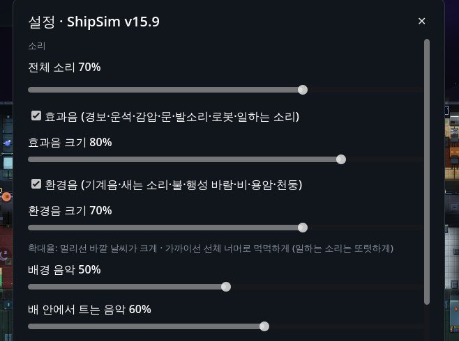 |
|---|
| **설정 › 소리** — 효과음 크기 · 환경음 크기 · 확대율 안내 |

#### 지식 전수 · 외부 세계 기억 ✔ (`--mentortest` 통과)

- **사수 · 부사수**: 의료 · 기관 · 전기 · 항법 · 정비 · 재배 · 조리마다 가장 잘하는 사람이 부사수 하나를 오래 곁에 두고 가르칩니다(배에서 태어난 아이 · 젊은 사람 · 성실한 사람 · 가까운 사람 먼저).
  부사수는 날마다 조금씩, 조용한 달 동안엔 크게 배우고(30 → 77), 사수 솜씨 가까이 오르면 **홀로 섭니다**. **열네 살**이 된 아이는 부사수 자리부터 찾습니다.
- **일지**: 솜씨가 높은 사람은 틈틈이 일지를 적고, 다 쓰면 **주 컴퓨터가 보관**합니다(주 컴퓨터가 멎어 있으면 종이로). 기억 칸이 틀어지면 일지 일부가 깨져 다시 적어야 합니다.
  일지가 있으면 누구든 기초까지는 혼자 익힙니다.
- **잃는 솜씨**: 그 솜씨를 제대로 아는 사람이 죽거나 내렸는데 부사수도 일지도 없으면 — "조리를 잃었다 — 투안 로페스가 떠나며 그 손맛도 같이 떠났다". 일지가 남아 있으면 누군가 펴 들고 다시 배웁니다.
- **향수병**: 떠나온 사람은 날마다 고향이 그리워집니다(향수병 버릇 · 손님은 더 · 배에서 태어난 아이는 없음). 편지 · 기항지 · 도착 · 생일이 누그러뜨리고 부고는 키웁니다.
  깊어지면 마음이 무겁고 일기에 고향 꿈이 나오며, 아주 깊으면 **도착지에서 내려 고향으로 돌아갑니다**.
- **기념일**(배의 달력): 사람마다 **생일**(다 같이 노래) · 떠난 동료의 **추모일**(모두 잠시 일손을 놓음) · **배의 생일**. 조용히 넘긴 달 동안의 생일은 조촐하게 지나갑니다.
- 승무원 카드에 한 줄: "의료 사수 — 부사수 김은솔 · 고향 달 뒷면 광산촌 · 아들 도윤 · 향수병 40%".

| 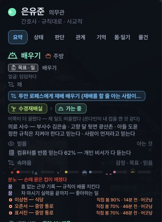 |
|---|
| **승무원 카드** — 셋째 줄: 의료 사수(부사수 김은솔) · 고향 · 집에 남긴 사람 |

#### 세대 ✔ (`--generationtest` 통과)

- **조용한 달 넘기기**: 긴 순항 구간 한가운데에 사고 · 행성 · 원정 · 대재난이 없으면 몇 달(한 달 ~ 여섯 달)을 이야기 시간으로 건너뜁니다. 배의 시계는 그대로 두고 '배의 달력'만 넘어갑니다. 첫 항해는 열이틀째부터입니다.
  - 그동안 모두 나이를 먹고, 맡은 솜씨가 손에 붙고, 설비가 조금씩 낡습니다. 사람마다 "조용한 석 달 — 아이들에게 글을 가르쳤다" 같은 한 줄 기억이 남습니다.
  - 가까운 둘은 **짝**이 되고 **아이**가 태어납니다(침대 · 먹을 것 · '짝·출산' 방침). 아이는 학교 · 방침에 따라 배우고, **열네 살**이 되면 일을 배우기 시작합니다.
  - **예순다섯**이 되면 은퇴하거나('노인' 방침) 더 일하겠다고 합니다. 일흔이 넘으면 몸이 약해지고, 언젠가 **노환**으로 조용히 눈을 감습니다.
  - 넘길 때마다 배 위에 '조용한 석 달' 카드가 뜹니다(그동안 생긴 일 · 배의 달력).

#### 항해의 목적과 끝 ✔ (`--missiontest` 통과)

- **임무**: 항해마다 의뢰받은 임무가 있습니다. 종류는 배가 가진 방으로 정합니다(화물칸 → 화물 · 연구실/관측실 → 탐사 · 의무실 → 구조 · 학교/원심 거주구 → 이민 · 채집 장치 → 채굴).
  - **화물**: 상자를 기한 안에 나릅니다. 화물칸에 불이 나거나 뚫리면 상자를 잃습니다.
  - **탐사**: 처음 본 풍경 · 내려앉은 행성 · 살핀 곳마다 자료가 쌓입니다.
  - **구조**: 늦게 닿는 조난 신호를 따라가 사람을 태워 목적지로 데려갑니다.
  - **이민**: 두 번째 항해부터 이주민을 태우고, 목적지에서 내려 정착합니다.
  - **채굴**: 희귀 소재 할당량을 채웁니다.
  - 왼쪽 위 **임무 띠**: 진행 · 기한 · 남은 길 · 빠듯함. 위에 올리면 의뢰 내용과 지난 일이 보입니다.
- **시간 압박**: 기한이 빠듯하면 주컴퓨터가 행성 착륙을 지나칩니다("임무 기한이 빠듯하다 — 남은 길 20일 · 기한 14일").
- **항로 갈림길**(항로 절반쯤): 빠듯하면 지름길(협로 · 방사선대 같은 험한 구간), 배가 상했거나 여유 있고 안전 방침이면 돌아가는 길을 고릅니다.
- **늦게 오는 통신**: "5일 전에 보낸 통신이 이제야 닿았다"처럼 기한을 당기거나 늦추고, 목적지 · 할당량 · 보수를 바꾸거나, 조난 신호를 전합니다. 조난 신호는 기한이 빠듯하면 지나치기도 하는데, 그러면 모두 말이 없어집니다.
- **도착 장면**: 임무를 매듭짓습니다(해냈다 · 반쯤 · 못 해냈다 · 늦음 · 보수). 이주민 · 구조한 사람은 내리고, 큰 카드가 뜹니다.
- **항해의 책**(기록 탭): 항해마다 한 권 — 임무와 결과 · 그 항해의 큰 장면 여덟 · 행성 · 잃은 사람 · 내린 사람 · 탄 사람 · 다음 항해로 이어진 것(사람 · 로봇 · 주컴퓨터 복기 · 배).
  지친 사람 한둘은 이번 항해를 끝으로 내리고, 나머지는 다음 임무로 이어집니다.
- 고친 버그: 땅에서 꺼 둔 엔진을 고장으로 여겨 착륙 창마다 불시착 확률이 크게 오르던 일.

| 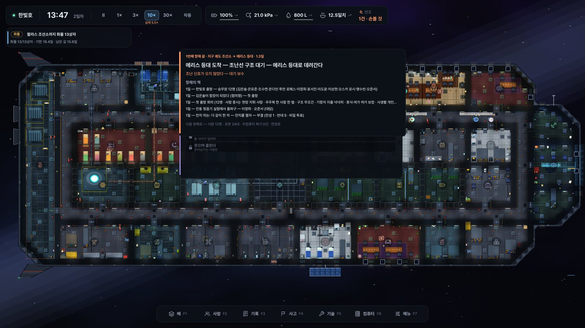 | 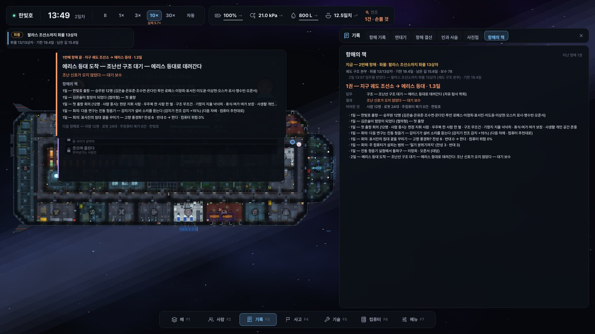 |
|---|---|
| **도착 카드** — 임무 결과 · 항해의 책 첫 장들 · 다음 항해로 이어진 것 (왼쪽 위는 다음 임무 띠) | **기록 탭(F3) · 항해의 책** — 지금 임무와 지난 일 · 권마다 임무 · 결과 · 장 |

#### 행성 ✔

- **1단계 — 행성 만들기 · 고르기 · 착륙 · 불시착** ✔ (`--planettest` 통과)
  행성은 요소를 조합해 만듭니다: 온도 · 대기(얼어붙은 · 서늘한 · 온화한 · 뜨거운 · 타는 듯한 · 대기 없음) × 지표(바위 · 모래 언덕 · 얼음판 · 얕은 바다 · 용암 · 수정 골짜기 · 진흙 늪 · 화산재) × 중력 ×
  날씨(강풍 · 모래 폭풍 · 비 · 산성비 · 뇌우 · 태풍 · 눈보라 · 폭염) × 현상(지진 · 간헐천 · 분기공 · 유성 비 · 오로라 · 밀물 · 꺼지는 땅 · 정전기 · 자기장 없음/강함 · 고리 · 위성 · 조석 고정 · 수정 지대 · 유독 먼지).
  여기에 이름 붙은 특별 행성 열 곳(번개숲 우레 · 끓는 바다 가마솥 · 서리밭 고요 · 녹슨별 철비 · 울림사막 · 반쪽별 · 수정 골짜기 빛고을 · 고리아래 그늘별 · 숨골 화산 · 소용돌이 태풍의 눈)이 가끔 섞입니다. 생물은 없습니다.
  난이도가 높을수록 험한 행성이 잦습니다(느긋 평균 위험 41% → 절멸 53%).
  항해 여드레째부터 가끔 **착륙 창**이 열립니다. 주컴퓨터가 후보 2~3곳을 멀리서 관측하는데, 흐리게 보여서 아는 위험이 실제와 다르고 숨은 현상은 내려가 봐야 압니다.
  주컴퓨터는 보상 · 배에 모자란 것 · 위험 · 배가 상한 정도 · 항로 방침을 따져 한 곳을 고르거나 지나칩니다.
  고르면 접근 → 하강(기동 방송 · 몸 고정) → 임무 기간 동안 머무름(항로 멈춤 · 우주의 운석은 거의 없음) → 이륙 → 항로를 잇습니다.
  가끔 **불시착**합니다: 예고 없는 충격 · 하강 엔진 고장 · 선체 균열이 생기고, 로봇과 사람이 고치기 전에는 뜰 수 없습니다.
- **2단계 — 날씨가 실제로 망가뜨린다** ✔ (`--planetweathertest` 통과) — 땅에 있는 동안 날씨가 바뀌고 낮과 밤이 돕니다(조석 고정이면 늘 경계).
  - **번개**: 안테나 · 태양 날개에 떨어지고, 외벽을 타고 들어와 회로를 튀기고, 밖의 드론 · 사람을 칩니다(뇌우 5시간에 번개 11 · 회로 3).
  - **강풍 · 태풍 · 눈보라**: 태양 날개 · 안테나가 찢기고, 외벽이 찌그러지고, 밖의 드론 · 사람이 휩쓸립니다.
  - **산성비 · 쇳물비 · 바다 소금**: 외벽이 조금씩 삭아 용접 일감이 됩니다.
  - **모래 폭풍 · 유독 먼지**: 공기 필터가 막히고 태양 빛이 끊깁니다.
  - **바깥 기온**이 선체를 달구거나 얼립니다: 273°C 행성에서는 방 평균 21 → 34°C에 냉방이 두 배, −107°C 행성에서는 난방이 네 배가 됩니다.
  - **지진** · 유성 비 · 꺼지는 땅 · 정전기가 오고, 자기장 없는 행성에서는 바깥쪽 방에 방사선이 듭니다.
  - 주컴퓨터는 사나운 날씨를 몇 시간 앞서 **예보**하고, 드론을 불러들이고 밖 일을 멈춥니다(바깥 수리 · 선외 작업도 기다림).
    임무가 거의 끝났으면 폭풍이 오기 전에 **일찍 뜨고**, 초반이면 **버팁니다**. 떠날 때 폭풍 속이면 이륙을 미뤘다가 지나간 뒤에 뜹니다.
- **3단계 — 채굴 · 정제 · 기지 · 탐사 · 생존** ✔ (`--planetworktest` 통과)
  - 내려앉으면 배 둘레 땅에 캘 곳(광맥 · 얼음 · 모래 · 수정 · 탄소)과 이름난 곳이 생깁니다.
  - **드론**이 직접 날아가 캐 옵니다(채굴 드론이 가장 많이 · 반나절에 금속 원료 27).
  - **정제**: 얼음은 물과 추진제로, 금속 원료 셋은 금속판 하나로, 탄소는 필터로 바꿉니다.
  - **기지**: 주컴퓨터가 날씨와 필요를 보고 방벽(바람막이) · 기상탑(피뢰침 — 번개 10 가운데 9를 받음 · 예보 +2시간) · 온실(채소) · 창고(채굴이 빨라짐)를 정하고, 드론이 짓습니다. 기지는 날씨와 지진에 상합니다.
  - **탐사**: 정찰 · 측량 드론이 이름난 곳을 살펴 희귀 소재 · 새 광맥 · 땅의 기록(연구)을 찾습니다. 먼 곳에는 **원정대가 걸어서** 갑니다(기존 원정 체계 그대로 · 행성 날씨 · 꺼지는 땅 · 수정 밭 · 능선 위 풍경 같은 일지가 붙음). 원정대가 돌아올 때까지 이륙을 미룹니다.
  - **생존**: 불시착해 추진제가 바닥이면 얼음부터 캐서 추진제로 채우고, 고친 뒤에 뜹니다.
  - 떠날 때 기지는 남기고 쓸 만한 자재 절반을 걷어 갑니다. 연대기에는 "녹슨별 철비에 방벽 · 창고 · 기상탑을 남기고 떠났다"처럼 남습니다.
- **4단계 — 화면** ✔
  - **배 둘레 땅**: 지표마다 다른 도트 타일(용암은 갈라진 틈이 빛나고, 얕은 바다는 배 둘레만 모래섬)에 바위 · 수정 · 얼음 조각을 흩뿌립니다.
  - 하강 · 이륙 동안 땅이 서서히 나타나고 사라지며, 낮 · 밤 · 폭풍에 따라 밝기가 바뀝니다.
  - 캘 곳(돌무더기 · 얼음 · 수정), 이름난 곳(깃발 · 살핀 곳은 초록), 기지(방벽 · 깜빡이는 기상탑 · 온실 돔 · 창고 상자 · 짓는 중 비계)가 보입니다.
  - **날씨 연출**: 비 · 산성비(누런빛) · 눈보라 · 모래 폭풍 안개 · 강풍 줄기 · 폭염 아지랑이 · 번개(번쩍임과 번개 줄기) · 밤의 오로라.
  - **행성 카드**(왼쪽 위): 지금 날씨 · 바깥 기온 · 바람 · 예보 · 주컴퓨터 판단 · 기지 · 피해. 착륙 창에는 후보 카드(위험 · 보상 · 확실성 · 특별 행성 ★)가 뜹니다.
  - 고친 것: 70°C 행성에서 반나절 만에 냉방 부담으로 정전되던 일 → 선체 단열이 바깥 기온을 더 걸러 냄 · 번개 잦은 행성에서 늘 대피하느라 기상탑을 못 짓던 일 → 뇌우는 60%부터 대피 · 번개 빈도 조정

| 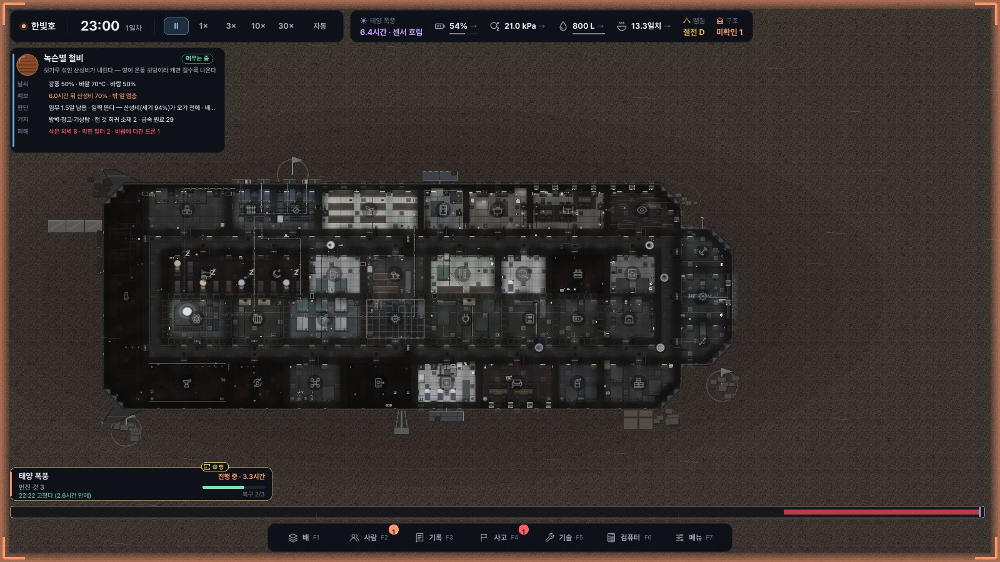 | 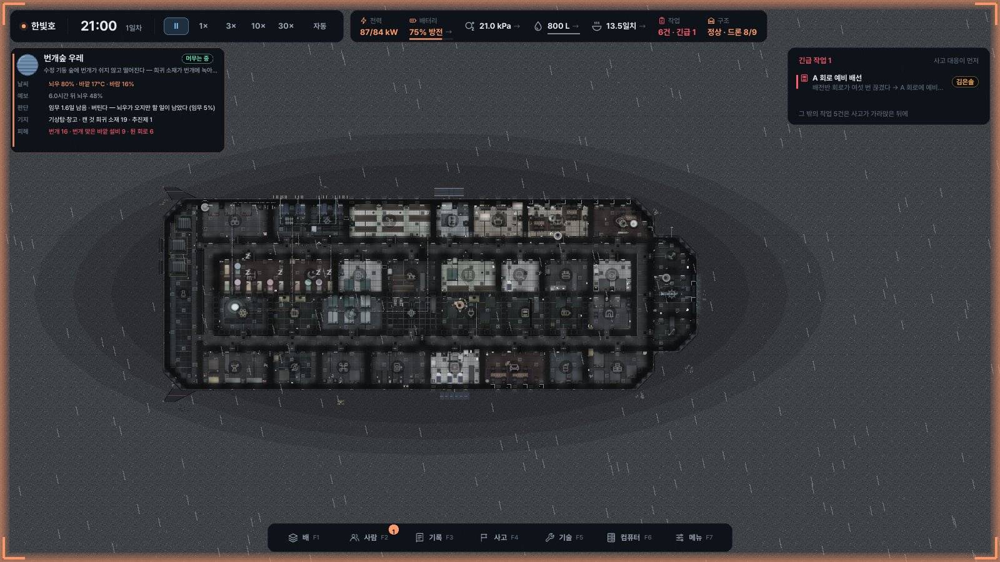 |
|---|---|
| **녹슨별 철비** — 배 둘레 땅 · 방벽(왼쪽) · 창고 · 기상탑(아래) · 깃발(이름난 곳) · 돌무더기 · 행성 카드(피해: 삭은 외벽 · 막힌 필터) | **번개숲 우레 · 뇌우** — 빗줄기 · 번개 16번(바깥 설비 9 · 회로 6) · 주컴퓨터 판단 "버틴다" |
| 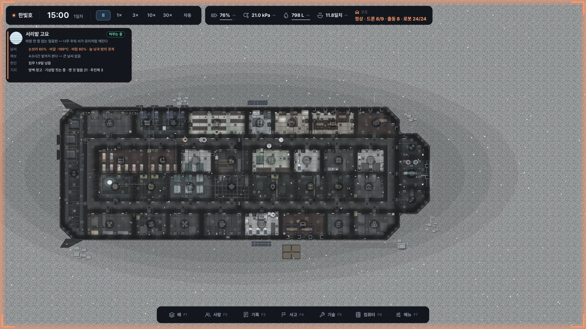 | 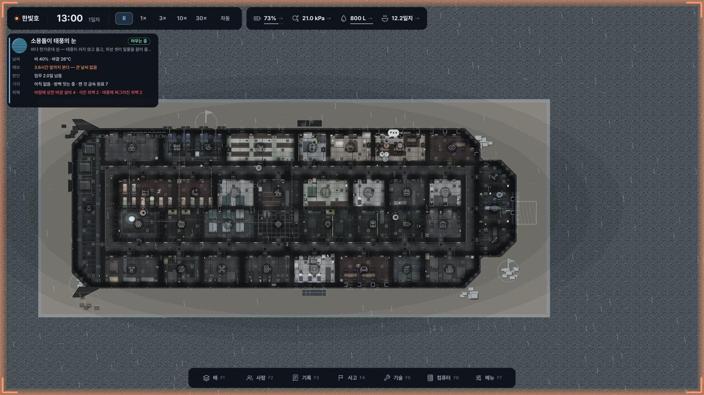 |
| **서리밭 고요 · 눈보라** — −199°C 얼음판 · 얼음을 캐서 추진제로 | **소용돌이 태풍의 눈** — 바다 한가운데 모래섬에 내려앉았다 |
| 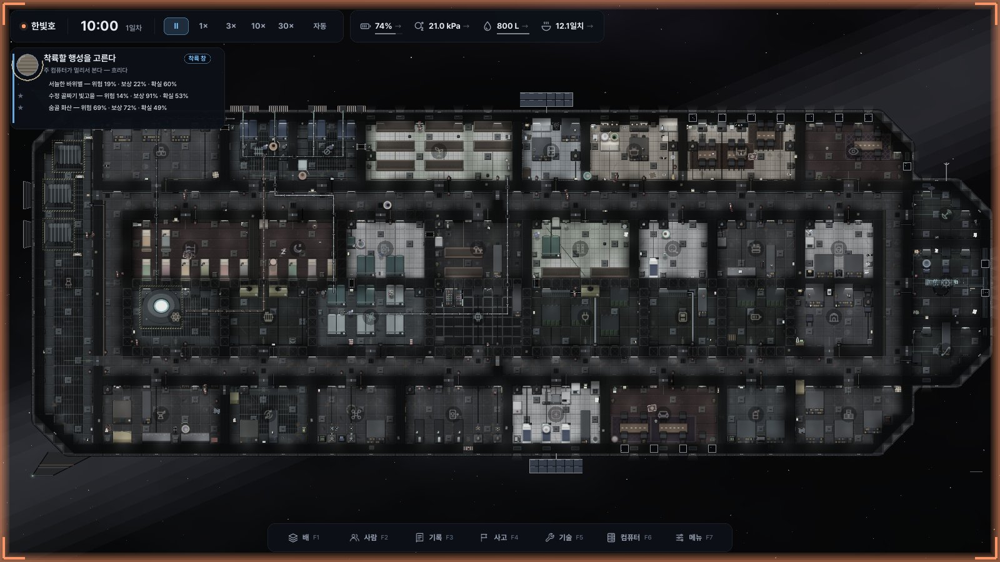 | |
| **착륙 창** — 주컴퓨터가 멀리서 본 후보 셋 (★ 이름 붙은 특별 행성) | |

#### 연출 ✔

- **사고 결산 카드** — 지휘 건이 닫히면 배 위 가운데에 크게(잃은 것 · 지킨 것 · 누가 · 로봇 · 주컴퓨터 판단), 7초 뒤 왼쪽 위 띠로 접힘. 연대기에도 남습니다. (`--summarytest`)
- **하루 주기 · 사고 조명** — 밤 22시엔 복도 야간등 · 자는 침실은 수면등 · 빈 휴게실은 어둡게, 아침 7시에 밝아짐. 경보 난 방은 늘 밝고 붉은 문 등, 어둡거나 연기 낀 곳엔 로봇 전조등.
- **창밖 풍경** — 항로 구간 20종마다 배 뒤 풍경(성운 · 오로라 · 가스 행성 · 얼음 고리 · 혜성 · 펄서 · 항구 …)과 창가 방에 드는 빛. 처음 보는 풍경은 연대기에 남고 사람들이 창가에 모여 구경합니다. (`--scenerytest`)
- **오늘의 장면 사진첩** ✔ (`--albumtest` 통과) — 연대기에 남는 일마다 그날의 장면 후보로 점수를 매깁니다(죽음 · 탄생 · 결혼 · 큰 사고와 대응 · 처음 본 풍경 · 함장 · 이정표 …).
  후보가 생기는 그 순간 그 자리를 따로 한 장 찍어 둡니다(배 그림만 · 글은 빼고 · 배 전체의 일이면 배 전체를 한 장에). 같은 방 30분 안의 일은 가장 큰 것 하나만.
  저녁 22시에 그날 장면 1~3장을 배 위에 크게 띄우고(10초 · 누르면 접힘) **기록 탭(F3) · 사진첩**에 날마다 모읍니다. 사고 대응 장면은 결산 카드의 말로 적힙니다("수경재배실 화재 — 불을 껐다 · 불 5칸까지 · 재배 로봇이 0분 만에 닿았다").

| 같은 장면 (시드 6개 평균) | 개편 전 | 개편 후 |
|---|---|---|
| 불 — 첫 도착 | 23분 | **0분** (대기 로봇이 바로) |
| 화재 감지기 고장 + 불 — 첫 도착 | 23분 | **1.8분** |
| 주컴퓨터 정지 + 불 — 첫 도착 / 꺼짐 | 8.7분 / 23분 | **2분 / 13분** (로봇 대장이 지휘) |
| 파공 — 첫 도착 / 봉합 / 못 막음 | 57분 / 108분 / 3·6 | **14분 / 37분 / 0·6** (1단계 18분 / 63분) |
| 부상 — 곁에 닿음 | 8분 | **1.7분** (로봇이 바로 지혈) |
| 불 · 파공 · 부상 동시 — 첫 도착 | 5 / 9.5 / 11분 | **2.6 / 5 / 3.3분** |

|  |  |
|---|---|
| **지휘 카드** — 오른쪽 위: 주방 불 지휘 건 · 출동 · 천장 소화 · 확인 중 | **사고 탭(F4) · 지휘** — 지휘 순서 · 지휘 건 타임라인 · 무전 · 소화 · 눈 · 복기 |
|  |  |
| **컴퓨터 탭(F6) 배 위** — 구역 중계기 · 끊긴 4구역(붉은 점선) · 로봇이 방금 본 방(초록 눈) | **사고 결산 카드** — 지휘 건이 닫히면 크게: 잃은 것 · 지킨 것 · 누가 · 로봇 · 주컴퓨터 판단 → 7초 뒤 접힘 |
|  |  |
| **밤 23시 주방 화재** — 하루 주기 조명: 자는 침실(Z)은 수면등 · 복도는 야간등 · 불난 주방만 밝고 붉게 | **창밖 풍경 — 가스 행성 구간** (제비호): 띠구름 행성이 배 뒤로 · 창가 방에 주황빛 · 사람들이 창가에 모인다 |
|  |  |
| **오늘의 장면 (22시)** — 처음 본 가스 행성(배 전체 한 장) · 수경재배실 불을 끈 그 순간 · 미리 돌린 시간의 일은 사진 없이 | **기록 탭(F3) · 사진첩** — 날마다 고른 장면이 모인다 (위에 올리면 그날 일 전부) |

| 순서 | 묶음 | 상태 |
|---|---|---|
| 0~1 | 로봇 · 드론 확장 · 이야기꾼 세분화 · 기계의 상처와 복구 | ✔ 끝 |
| 연출 일부 | 로봇이 몸으로 막아 주기 · 파괴 순간 카메라 · 로봇 개별 이력(흉터 · 덧댄 판) · 끊긴 일 이어받기 | ✔ 끝 |
| **★** | **주컴퓨터 대개편**: 사고 지휘관 ✔ → 방마다 자동 소화 ✔ → 구역 중계기 ✔ → 눈의 그물 ✔ → 로봇 두뇌 ✔ → 평소 수리 배치 · 복기 ✔ → 사고 탭 · 컴퓨터가 아는 것 겹쳐 보기 ✔ | ✔ 끝 |
| 2 | 연출 나머지: 사건 결산 카드 ✔ · 하루 주기 · 사고 조명 ✔ · 구간마다 창밖 풍경과 빛 ✔ · 오늘의 장면 사진첩 ✔ | ✔ 끝 |
| 3 | 행성: 원소 조합 절차 생성 + 이름 있는 특별 행성 · 지면 타일 · 날씨가 실제로 배 · 로봇 · 사람을 상하게 함 · 채굴 · 기지 · 탐사 · 생존 · 후보 고르기 · 불시착 | ✔ 끝 |
| 4 | 항해의 목적과 끝(배 종류별 임무 · 갈림길 · 늦은 통신 · 도착 장면 · 항해의 책) | ✔ 끝 |
| 5 | 세대(조용한 달 넘기기 · 나이 듦 · 은퇴 · 출산 · 아이가 자람) | ✔ 끝 |
| 6 | 지식 전수(사수 · 부사수 · 일지 · 잃는 솜씨) · 외부 세계 기억(향수병 · 생일 · 추모일 · 배의 생일) | ✔ 끝 |
| 7 | 효과음(행성 환경음 · 일하는 소리 12가지 · 확대율마다 · 설정에서 효과음 · 환경음 크기) | ✔ 끝 |
| **8** | **전체 회귀 · 성능 확인** (맨 끝에 한 번) | **다음** |

- 남은 계획 기준 진행률: **약 94%** (남은 것: 전체 회귀 · 성능 확인) · 처음부터 쌓아 온 전체로는 약 98%
- 설계 문서: [주컴퓨터 대개편](design/computer_v23.md) · [남은 큰 묶음 결정](design/roadmap_v23.md)

## 옛 소개 글

10-26까지 README에서 옛 게임 기록 끝에 있던 소개 글 그대로.

우주선 한 척에 탄 승무원들과 배의 주컴퓨터를 **처음부터 끝까지 지켜보는** 게임입니다.
사람들은 먹고 자고 일하고 다투고 화해하고, 설비는 닳고 고장 나고, 운석이 외벽을 뚫고, 불이 번지고, 누군가는 그걸 막으러 뛰어갑니다.
그리고 그 모든 일은 사람들의 기억과 배의 모습에 흔적으로 남습니다.

이 게임이 계속 묻는 것은 세 가지입니다.

> **누가 왜 행동했고, 무엇이 바뀌었으며, 누가 그것을 기억하는가.**

🎬 **[트레일러 (45초) · 포스터 · 소개 글](trailer/README.md)**

Godot 4.7 .NET(C#)으로 만들었습니다. 시뮬레이션(`game/src/Core`)은 Godot을 전혀 모르는 순수 C#이라 화면 없이도 똑같이 돌아가고,
같은 시드면 같은 역사가 나옵니다(결정론). 화면은 그 상태를 그대로 그릴 뿐입니다.
