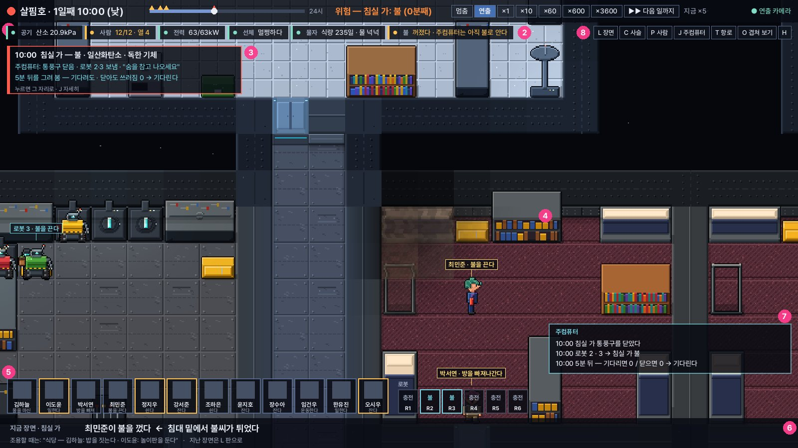

# 검토 · 설계 — 하루 길이 · 화면 · 판단 · 물리 · 버그 (함장 답 기다림)

함장 요청 (화장실 (다)를 마친 뒤): "하루가 너무 긴 문제(리얼타임으로 흘러서 하루가 너무 긺) · UI 문제 · 사람과 로봇 · 주컴퓨터의 판단 문제 · 전체적인 물리 엔진의 깊이와 디테일 · 기타 버그를 검토해 보고 설계해 봐. 질문 환영."

어떻게 봤나: HEAD 53928aa 빌드로 다섯 갈래를 따로 재고 (`Lab --live` · `--judge` · `--fingerprint` · 계측 스크립트 약 40개), 갈래마다 다른 눈이 숫자와 코드를 다시 확인했다. 확인에서 **틀림**으로 나온 말은 지웠고 **부풀림**은 고친 숫자로 적었다. 저장소는 읽기만 했다 — 이 문서에 적은 고침은 하나도 하지 않았다 (모두 함장 답을 기다린다).

빠르기 숫자는 다른 일과 CPU를 나눠 쓰던 4코어 컨테이너에서 쟀다. 함장 PC에서는 더 빠를 수 있다. 하지만 '어디가 묶여 있나'는 같다.

---

## 한눈에

| 갈래 | 가장 큰 것 (잰 값) | 추천 | 세계(지문)가 바뀌나 |
|---|---|---|---|
| ① 하루 길이 | 연출이 조용할 때도 ×144가 끝이라 하루가 **최소 10분** · 큰 배는 조짐이 화면 시간의 86%를 먹어 **34~131분** · 빠른 단추는 브레이크가 없고 위 줄은 실제와 다른 빠르기를 적는다 | **A** '하루 몇 분' 예산형 자동 빠르기 (기본 하루 3분) + 둘째 단계로 '다음 일까지 ▶▶' · 하루 장 카드 | 아니다 (연출 · 화면만) — 소리 누수 고침만 바뀜 |
| ② 화면 | 아래 줄이 몇 시간 지난 하이라이트를 보인다 (디딤 117/120번) · 글이 화면 밖으로 잘린다 · 주컴퓨터 · 로봇의 판단이 거의 안 보인다 · 이름표가 없다 · Esc 한 번에 항해가 사라진다 | **나** 세 겹 화면 '지금 · 누가 · 왜' (다섯 덩이) | 아니다 |
| ③ 판단 | 디딤호 사흘에 **흔들림 3,460번** (최민준이 벽 너머 변기 둘 사이에서 169분) · 손이 차면 계획이 소리 없이 사라지는 곳 9곳 · 일감판에 실패 기억이 없다 · 판정 눈금이 늘 0 | **B** 공통 '판단 감시' (판단 일지 + 까닭 코드 + 감지기 넷 + 막힘 사다리) — 먼저 결함 넷부터 | 그렇다 (판단만) |
| ④ 물리 | 시안화수소 · 염화수소 · 플루오린화수소 · 수소 · 메탄이 **걸러지지 않는다** (불 한 번 뒤 30시간 그대로 · 경보 565번) · 냄비 물이 없는 데서 하루 5L · 소리 기록 누수 | **가** 먼저 고치기 (화장실 (라)보다 먼저) → **나** 일상 물리는 (라)와 함께 | 그렇다 |
| ⑤ 버그 | 소리 누수로 찍기가 하루 약 23MB씩 자라 다시보기 고리가 48시간에 1.5GB · 되살린 세계에서 주컴퓨터가 '물 · 식량 · 산소 0일 치'를 본다 · 시험 시간표가 낡았다 · 옛 시험이 이 가지에서 돈다 | 넷 다 고친 뒤 12일 판정 | 소리 누수만 |

불가능한 상태(NaN · 음수 · 벽 속 사람) · 결정론(1코어 = 4코어 지문) · 저장 왕복 검사는 위의 둘 말고는 모두 깨끗했다.

---

## ① 하루가 너무 길다

### 진단 (잰 값)
1. **×1은 실시간이다.** 단추 눈금 `{0,1,10,60,600,3600}`은 실제 시간 기준이라 ×1이면 하루 24시간 · ×10이면 2.4시간이다 (LiveMain.cs:46). 연출 기본(조용할 때 ×144)보다 느린 단추가 둘이나 있다.
2. **연출의 조용함이 ×144에서 멈춘다** (Director.cs:32 `CalmSpeed = 60`틱/초). 그래서 연출로 보면 하루가 화면 10분 아래로 내려갈 수 없다.
   - 작은 배 (연출 그대로): 디딤 10.6분 · 화살 10.1 · 나름 10.9 · 살핌 11.9 · 쇠돌 12.1분.
3. **큰 배는 조짐이 시간을 먹는다.** 조짐 하나마다 무게와 상관없이 3분 동안 ×19로 늦춘다 (Director.cs:106-107 · 144).
   - 새뜰호 0~6시간: 조짐 사실 71 (소문 59 · 다툼 12) → 하루 33.5분 · 조짐이 화면 시간의 86%. 6~12시간은 조금 덜해 19.8분 (조짐 57%).
   - 한누리호(100명): 처음 2시간에 알아챔 · 외침 410건 → 하루 72~131분.
   - 소문 · 다툼은 대부분 하이라이트(문턱 80)가 되지 않는다. 시간만 늦고 볼 것은 없다.
4. **빠른 단추에는 브레이크가 없다.** 누르면 연출이 다시 맡지 않고 (`SpeedOverride`는 '연출' 단추로만 풀림) 미리 보기도 꺼져, 불이나 죽음도 그 빠르기로 지나간다. 함장 결정 '손대면 잠깐 양보하고 다시 맡는다' (ENGINE.md:36 · 1560)와 어긋난다.
5. **위 줄은 고른 빠르기를 적는다.** 한 장에 50틱까지만 돌리고 밀린 것은 버리므로 (Live.cs:98 · 171-176), 디딤 ×3600은 실제 ×1,548 · 1초 13장, 한누리 ×600은 실제 ×136 · 1.4장이다.
6. **오래 볼수록 느려진다** — 소리 누수 (⑤-1). 찍기 1시간 5.1MB → 24시간 28.4MB → 48시간 50MB, 다시보기 고리는 48시간에 1.5GB · 힙 1.9GB. 이틀째부터 위의 모든 빠르기 숫자가 무너진다.
7. **3교대라 배 전체의 밤이 없다** (Mind.cs:177 `ShiftHour = 번호 % 3 × 8`). 늘 3분의 1이 자고 3분의 1이 일하니 '자는 시간 건너뛰기'가 효과가 없다.
8. **하루 장(이야기 편집)이 게임 화면에 나오지 않는다** (`Director.Chapters`를 읽는 곳이 ShipView · 게임에 0건 — 실험실 `--film`만).

### 설계안
- **A. '하루 몇 분' 예산형 자동 빠르기 (추천 바탕)** — 함장이 하루 목표(1 · 3 · 5 · 10분 · 최대)를 고른다. 연출 규칙 넷:
  1. 결정적 순간은 언제나 느리게 (×1.2 · 3초). 예산에 넣지 않는다.
  2. 조짐 · 위험에 쓰는 느린 시간은 하루 예산(목표의 약 40%)에서 꺼내 쓴다. 다 쓰면 무거운 조짐(다툼 · 탓 · 감지)만 늦춘다.
  3. 조짐은 장면 단위로 센다. 같은 원인 뿌리는 다시 늘리지 않고, 가벼운 알아챔 · 외침은 카메라만 옮긴다.
  4. 조용함의 빠르기 = 남은 조용한 틱 ÷ 남은 화면 시간 (그때그때 셈 · 한 장의 시간 예산을 넘지 않음).
  - 화면 쪽: 묶음 가운데 분위기가 바뀌면 그 틱에서 멈춘다 · 빠를 때도 미리 보기를 다른 코어에서 · 위 줄에 실제 빠르기와 '하루 = n분'. 고정 빠르기는 Shift+숫자로 남긴다.
  - 어림 (이 기계 · 60프레임): 디딤 조용한 하루 최소 약 1.6분 → 목표 3분이면 3분 (지금 10.6분). 새뜰 최소 약 5.6분 → 6~8분 (지금 34~40분). 한누리는 기계 한계로 약 15분 (지금 72~131분).
  - 세계는 한 비트도 바뀌지 않는다 (연출은 읽기만 한다). 바뀌는 시험은 RulesView · RulesStory 두 곳의 기대값.
  - 약점: 사건이 많은 날은 목표를 넘긴다 → '목표'라고 부르고 넘으면 넘었다고 보인다.
- **B. '다음 일까지 ▶▶' + 하루 장 카드** — 누르면 기계가 되는 만큼 돌리고 그림은 1초 5~10장 빨리 감기 ('빨리 감는 중 06:10 → 11:42'). 첫 조짐 · 미리 보기가 본 일 · 정해진 배의 일(아침 방송 · 점화 · 교신 창 · 도착) · 날 바뀜에서 선다. 날이 바뀌면 'n일째 — …' 장 카드 (다시볼 장면 다섯 · 누르면 그 장면으로).
  - 어림: 디딤 조용한 하루 약 80초 · 일이 있는 날 2~2.5분 · 새뜰 약 3.5분. 디딤호 180일을 6~7시간에.
  - 약점: 함장이 만든 일상(끼니 · 취미 · 잡담 · 습관)을 볼 기회가 준다. 하이라이트마다 찍기를 따로 남겨야 한다 (누수를 고친 뒤 하루 약 25MB).
- **C. 시간 자체를 줄이기 (비추천)** — 몸의 하루를 6시간으로 (모든 SI 법칙 · 며칠 치 물자 · 잠 빚 · 상처 · 근육 손실이 어긋나 수십 개 상수를 다시 맞춰야 함) 또는 조용할 때 틱 9.6초 (확산 · 열 셈 안정성 · 한 틱 걸음 10칸 · 모든 시험 · 지문이 깨짐). 같은 이득의 일부는 장 잠재우기(NEXT 5)로 얻는 편이 낫다.

### 추천 차례
1. 소리 누수 고치기 + 법칙 '오래 돌아도 찍기가 자라지 않는다' (⑤-1 · 지문이 바뀌니 승인).
2. 화면 정직하게 (Live.cs · LiveMain.cs · 세계 그대로): 한 장의 틱을 시간 예산으로 · 실제 빠르기와 '하루 = n분' · 분위기가 바뀌면 그 틱에서 멈춤 · 단추 = 조용할 때의 상한 · 눈금 '하루 24 · 10 · 3 · 1분 · 최대' (실시간 ×1은 따로).
3. 연출: 조짐 장면 단위 · 하루 느린 시간 예산 · 기본 하루 3분 · 큰 배는 기계 한계를 화면에 보인다.
4. 하루 장 카드 + 하이라이트별 찍기 보관 → 그 위에 '다음 일까지 ▶▶'.

기대: 디딤 10.6분 → 약 3분 (조용한 날 ▶▶면 1.5~2분) · 새뜰 34~40분 → 6~8분 · 한누리 72~131분 → 약 15분 (더 줄이려면 장 잠재우기와 겹 길찾기).

월드 · 판단 · 자연 사건 수치는 하나도 건드리지 않는다 — '수치는 맨 끝' · '재미 측정은 엔진 뒤'와 겹치지 않는다. 다만 조짐에서 소문을 빼는 일은 ENGINE.md:1552 '다툼 · 소문 · 탓은 조짐'을 바꾸는 것이라 따로 묻는다 (질문 ①-4).

---

## ② 화면 (UI)

시안: 살핌호 10:00 불 순간의 실제 세계 그림 위에 그렸다. ① 위 줄 (실제 빠르기 '지금 ×5' · ▶▶ 다음 일까지 · 연출 카메라 표시) ② 배 상태 띠 — 진실과 주컴퓨터의 앎이 다르면 '꺼졌다 · 주컴퓨터는 아직 불로 안다' ③ 사건 카드 (방마다 한 장 · 주컴퓨터가 한 일 · 5분 뒤를 그려 본 결과) ④ 장면 사람의 이름표 · 하는 일 ⑤ 사람 줄의 하는 일 ⑥ 아래 줄 = 지금 장면의 사슬 (끝부터) · 조용할 때는 방의 일상 ⑦ 주컴퓨터 말 창 (세 줄 · 조용하면 접힘) ⑧ 판 단추 줄 · 오른쪽 아래 로봇 칩 (R1~R6 · 충전 · 불).

### 진단 (잰 값 · 코드)
1. **아래 줄이 지난 하이라이트를 몇 시간씩 보인다** — 불이 난 동안에도 (Live.cs:1044-1058 · Director.cs:333 Caption은 새 하이라이트가 더해질 때만 바뀜). 낡은 글: 디딤 117/120 · 살핌 108/120 · 새뜰 24/60. 아래 줄에 이름이 나온 사람이 화면에 없던 수: 61 · 33 · 20.
2. **글이 잘린다** — 하이라이트 띠는 너비 제한 없이 가운데에 놓여 실제로 뜬 띠 7개가 1,059~2,135px (1600 화면을 넘는다) · L 판 줄은 604px · 카드 '왜' 줄은 402px에서 끝이 잘린다.
3. **사건 띠** — 불 하나가 네 줄 ('침실 둘 · 공기가 나쁘다 / 독한 기체 / 일산화탄소 / 불') · 끝난 줄이 목록 번호 순서라 시각이 뒤섞임 · 위 띠는 화면 10초에 '불 없다'인데 사건 띠는 22초까지 '불' (약 12초 서로 다른 말).
4. **주컴퓨터의 판단이 거의 안 보인다** — `ShipMind.Log` · `Imaginations` · `Director.Subject` · `Chapters` · `ShipPolicy`를 읽는 곳이 화면에 0건. 불 장면 일지 38줄('봉쇄 (사람이 안에 있다)' · '5분 뒤 — 기다리면 0 / 닫으면 0 → 기다린다' · '로봇 3: 일이 막혔다 — 쓸 물건이 없다')이 화면에 한 줄도 안 나왔다. (J 판의 '궁리 · 계획' 줄과 사람 카드의 '궁리'는 있다 — 다만 1~2분짜리 사고 동안 J 판을 제때 열기는 어렵다.)
5. **누가 무엇을 하는지 안 읽힌다** — 이름표가 없다 (고른 이의 고리만) · 하는 일은 '일한다 · 쉰다 · 쉬는 중'이 43 · 52 · 66% (깨어 있을 때 67 · 74 · 69%) · 로봇은 목록조차 없다 (조용할 때 로봇은 96~99.9%가 충전 중).
6. **손을 대면 연출이 돌아오지 않는다** — Pan · Zoom · 사건 띠 누르기가 `Follow = false`로 바꾸고 되돌리는 것은 F 키뿐 · 손 카메라 표시도 없다.
7. **항해를 확인 없이 버리는 키** — 판이 닫혀 있으면 Esc가 곧바로 처음 화면 (LiveMain.cs:723) · N · R은 확인 없이 새 배 · B(다시보기)는 실패해도 말이 없다 · 휠은 판 위에서도 확대 · 범례는 3초 만에 사라진다. 저장이 없다.
8. **글자가 창 크기 · 화면 배율을 따라가지 않는다** — 11~17px 고정 (project.godot에 늘이기 설정 없음). 4K 배율 화면에서는 몸 크기로 절반.
9. **위 줄의 분위기 낱말에 까닭이 없다** — '조짐 · 위험'만 적는다 (새뜰 화면의 86%가 '조짐'). 까닭을 적으려면 연출이 조짐을 일으킨 사실을 남겨야 한다 (지금은 때만 남긴다).
10. **주컴퓨터의 표지가 그림에 없다** — 변기 '사용 금지' 불 (`WashSign`) · 잠근 문 (`Structure.Locked`) · 봉쇄 · 닫힌 통풍구를 그림에서 읽지 않는다.
11. **하이라이트가 커질 때(같은 사슬에서 죽음 등)는 ★ 띠가 뜨지 않는다** (수가 늘 때만 띄움) · 앞으로 감은 뒤 첫 장에 옛 제목이 뜬다 · 하루 장 · 오래된 다시보기는 게임에서 닿지 않는다.
12. **개발 숫자가 보인다** — '(모두의 원망 1.1)' (MindGatherings.cs:310이 점수를 원인 글에 그대로 넣음 · 세 척의 아래 줄 · 띠 · L 판). 이것은 세계의 원인 글이라 고치면 지문이 바뀔 수 있다. (아래 줄의 '[불·화학 → 사람 → 주컴퓨터]' 꼬리표는 개발 말이 아니라 설계서에 정한 연출 기능이다 — 그대로 둔다.)
13. **사람 판에 늘 같은 값이 자리를 차지한다** — 몸 줄이 늘 '산소 95%'로 시작 (같은 값이 '숨' 막대에도) · '앙금 최민준 · 지난 일: 최민준과 묵은 앙금'처럼 겹침 · 정작 체온 · 앓음은 숨는다.

### 설계안
- **가. 고쳐 쓰기만** — 위 결함만 하나씩. 작지만 '누가 · 왜'가 여전히 안 읽힌다.
- **나. 세 겹 화면 '지금 · 누가 · 왜' (추천 · 시안 위)** — 다섯 덩이로 나눠 덩이마다 RulesView 시험을 붙인다:
  1. **고장 고치기** (지금 · 작음 · 세계 그대로): 아래 줄 = 지금 장면 사슬 (끝부터) · 조용할 때 방의 일상 / 띠 · L 판 · 카드는 끝 마디부터 쓰고 넘치면 줄 바꿈 / 사건 띠를 방마다 묶고 주컴퓨터가 한 일을 붙임 · 진실과 앎이 다르면 표시 / 실제 빠르기 / Esc · N · R 확인 / 개발 숫자 지움 / 하이라이트가 커질 때도 띠.
  2. **누가**: 사람 줄 · P 판의 하는 일을 생각 칸(`Thought`)과 맡은 설비로 · 장면 사람 이름표 · 로봇 칩 · 로봇 카드에 막힘 · 다른 길.
  3. **왜**: 주컴퓨터 말 창 (일지에서 판단 · 행동만 고른 세 줄) · 상상 카드 · 위 줄 분위기 자리에 까닭.
  4. **손**: 판 단추 줄 · 판 줄 누르기 · 판 위 휠은 스크롤 · 배 상태 띠 칸 누르면 그 자리로 · 손 카메라 표시 + 8초 뒤 연출 복귀 · '다음 일까지' · UI 배율 · 겹쳐 보기 범례 늘 표시.
  5. **그림 표지** (그래픽 위임 범위): 사용 금지 불 · 잠근 문 · 봉쇄 빗금 · 닫힌 통풍구.
  - 날 띠 · 장 카드 · 작은 창 · 출항 준비 화면 · 머리 위 상태 그림은 엔진 완성 뒤로.
- **다. 방송 중계형** (해설자 · 다중 화면) — 엔진을 다 만든 뒤.

함장 결정과의 선: 이 일들은 재미 점수가 아니라 '기능이 화면까지 닿는가'를 보는 규칙 시험이다. 이름표 · 말 창은 가짜 사건이 아니라 판단 엔진이 이미 아는 것을 적는 글이다. 다만 그림 속 이름표 · 머리 위 표시는 화풍 결정이라 묻는다.

주의: 시안의 '사람 12/12 · 열 4'는 다시 확인해야 한다. 살핌호에서 쉬는 12명 가운데 9명이 병 없이 37.6~39.0℃였다 (옮는 병도 곪은 상처도 아님). 몸의 열 셈이나 열 감시(FeverWatch) 쪽 결함일 수 있다 — '열' 수를 화면에 넣기 전에 생명 엔진을 먼저 살핀다 (확인하지 못한 것 참고).

---

## ③ 판단 — 사람 · 로봇 · 주컴퓨터

### 진단 (잰 값 · 코드)
1. **흔들림 (같은 목표 · 다른 대상)** — 디딤호 사흘에 3,460번 · 약 304인분. 최민준이 벽 너머 변기 둘(84 · 85) 사이에서 2시간 반 가까이 (169분) 오갔다. `PickWash`가 벽을 모르는 맨해튼 거리로 고르고, 고른 대상을 지키지 않는다 (MindWash.cs:125-139). 줄 0 · 꺼림 0 · 안내 없음이었다 — 순수한 판단 결함.
2. **문턱 흔들림** — 회의 · 대피 선택지가 그 방에 들어서는 순간 사라진다 (MindCouncil.cs:47 · MindShelter.cs:53 `RoomOf(here) == 그 방 → return`). 그러면 아무 바깥 선택지가 이겨 문 앞에서 2틱마다 들락거린다 (20분에 200번).
3. **손이 차면 계획이 소리 없이 사라진다 (9곳)** — MindDecide.cs:577 · 608 · 635 · 660 · 679 · 696 · 713, MindRewire.cs:29, MindSupply.cs:48. 화살호 침대 불(00:10 붙음 · 00:12 꺼짐) 2시간 뒤 로봇 1~3 · 김하늘 · 박서연이 소화기를 든 채였고, 보관함 소화기 11 → 5.
4. **떨군 물건은 아무도 줍지 않는다** — 바닥 물건을 읽는 것은 오물 통뿐 · 주컴퓨터의 재고 셈(`TotalOf`)은 손에 든 것까지 센다. (위 불에서 바닥 물건은 1개뿐이었고 보관함이 준 까닭은 대부분 3번이다. 긴 항해에서 쌓이는지는 재지 않았다.)
5. **주컴퓨터가 사람 사건을 '방'에 묶는다** — `Find`와 3분 되살리기가 `x.Room == room`으로 가른다 (ShipMind.cs:323-354). 다친 이가 방을 옮기면 새 사건이 서고 로봇이 바뀐다. 1.5분마다 먼 방으로 옮기는 꾸민 시험에서 20분에 사건 14개 · 다시 맡김 24번 · 끝내 못 덮음. (실제 걸음이면 덜 나쁘지만 뿌리는 같다 — 문 칸을 지날 때 사건이 끝나기 쉬운 것도.)
6. **일감판에 실패 기억이 없다** — 기한(2시간)이 지난 일감은 까닭 없이 내리고 (`Jobs.RemoveAll`) 같은 로봇에게 다시 맡긴다. 방송도 없다. 디딤호: 청소 대상 하나를 24번 다시 올렸다.
7. **'막히면 다른 길'이 거의 없다** — `BuildPlan` 본문의 실패 41곳 (도우미까지 약 55곳)이 모두 까닭을 남기지 않는다. 고르기는 위 넷까지만 해 본다. 더위 믿음은 아무도 읽지 않는다.
8. **판정 눈금이 장님이다** — `Judge`의 '같은 실패'는 `c.Failed >= 5`인데 Failed는 계획마다 0으로 돌아가 1을 넘지 않는다. 그래서 위의 결함이 모두 '되풀이 0 · 같은 실패 0'으로 나온다.
9. **물 배급량이 몸과 맞지 않는다** — 하루 118몰 (139몰 × 0.85)은 실제로 마시는 약 205몰의 57%다. 배급을 열면 모두가 몸의 물 3% 모자람에 붙어 하루의 3분의 1 넘게 몹시 목마르고, 의료 몫(3% 넘게 모자랄 때)이 모두의 정상 길이 된다. 덧붙여 근무 중 체온이 평균 37.34℃ (근무 시간의 92%가 땀 문턱 위)라 땀으로 하루 0.9L를 잃는다 — 생명 엔진에서 확인할 일.
10. **아는 것 밖을 읽는 곳** — 사람: `WashAhead` (남의 계획) · `WashLine` (배 전체 줄) · `Taken` · `KinMeal` (벽 너머 남의 목표) · `SomeoneFree` · `BusiestSeat`. 주컴퓨터: 보관함 개수 · 카메라 없는 방의 곰팡이 · 물. 그리고 미리 돌려 보기가 참 세계를 그대로 복제한다 (못 보는 방의 사람과 그 사람의 다음 판단까지 맞힌다 — ENGINE.md:1364의 '믿음으로 덧씌운 복제'와 어긋남).
11. **로봇이 평시 88~100% 논다** — 디딤 88 · 96 · 99% · 살핌 98~100% · 나름 92~100% · 화살 99%.

### 설계안
- **A. 장면마다 땜질** — 작고 빠르지만 같은 꼴이 새 기능마다 다시 난다 (설계서에 이미 7번). 눈금은 계속 장님.
- **B. 공통 '판단 감시' (추천)** — 사람 · 로봇 · 주컴퓨터 모두:
  1. **판단 일지**: 사람 · 로봇마다 8칸 고리 (틱 · 목표 · 대상 · 방법 · 결과[해냄 / 막힘 / 그만둠 / 세우지 못함] · 까닭). 주컴퓨터는 일감 · 사건마다 (종류 · 대상 · 방법 · 맡은 이 · 결과 · 까닭). 고정 크기 · 저장에 들어감 (결정론).
  2. **까닭 코드**: `BuildPlan` 실패 · `Fail` · 일감 기한 넘김이 모두 까닭을 남긴다 (손이 참 · 물건 없음 · 샘 없음 · 길 없음 · 위험 …).
  3. **감지기 넷** (제 기억만 읽는다 — 아는 것으로만): (가) 흔들림: A→B→A가 3분 안이면 '머무름' (지금 계획을 시작 점수의 반으로 15분 지킴 · 대상 여유 30%). 위기 본능은 예외. (나) 같은 까닭 두 번: 2시간 안에 두 번이면 그 방법을 '막힘 믿음'으로 — 까닭이 풀렸다고 믿을 때 푼다. (다) 세우지 못함: (나)와 같은 길. (라) 진전 없음: 한 단계가 예상의 세 배를 넘으면 '멈춤'.
  4. **막힘 사다리** (engine/data/knowledge.json — 목표마다 3~5칸 · 코드에는 풀이 법칙만): 같은 방법 · 다른 대상 → 다른 방법 → 대체 (물수건 · 용변 봉투 · 맨손 · 담요) → 묻기 · 부탁 · 보고 → 참기 · 피해 줄이기 + 일지. 사람은 생각 깊이 · 성격만큼 칸을 오른다 (공황이면 1칸 — '같은 짓을 되풀이'가 사람다운 결함으로 남는다). 로봇은 1~2칸 뒤 주컴퓨터에 알리고, 주컴퓨터는 다른 로봇 → 사람 부탁 → '막힌 곳' 방송.
  5. **화면**: 사람 판 · 일지에 '1안 → 막힘(까닭) → 2안' (ENGINE.md 판단 엔진 5). 연출은 '궁리 끝에 해냄'을 고를 수 있다.
  6. **재기**: 판정 여섯 눈금 + 법칙 시험 둘 ('같은 까닭 세 번 없음' · '흔들림 없음').
  - 감지는 계획을 세우거나 실패할 때만 돌아 틱 비용이 거의 없다 (100명이라도 고리 800칸). 약점: 중간 크기 일 · 지문과 장면 숫자가 넓게 바뀜 · 사다리를 잘못 고르면 '포기가 빠른 사람' → 칸마다 규칙 시험.
- **C. 점수 체계 다시 짜기** (목숨 > 위기 > 몸 > 맡은 일 > 일상 > 여가의 띠 · 전념 · 실행 감시) — 흔들림 · 순서 뒤집힘의 뿌리를 없애지만 거의 모든 장면 · 지문이 흔들린다. 엔진을 다 만든 뒤.

### 추천 차례 (층 하나 = 설계 → 시험 먼저 → 구현 → 관찰 장면 → 커밋)
1. **눈금** (지문 같음): 판정에 흔들림 분 · 같은 까닭 실패 · 세우지 못함 · 맡고도 안 한 로봇 분 · 기한 넘긴 일감 · 같은 사람 사건 다시 섬.
2. **흔들림 규칙**: 하던 일과 맞는 선택지가 없으면 시작 점수를 줄여 가며 지킴 · '거기 있어라' 선택지(모임 · 대피)는 방 안에서도 남김 · 대상 고르기는 길 거리 + 대상 여유 (변기 · 보관함 · 침대 공통 도우미). 시험 셋: 회의 중 심심한 이 · 대피 중 목마른 이 · 벽 너머 변기 둘.
3. **손**: '손 비우기' 하위 목표 + 불 끈 뒤 돌려놓기 + '손이 참' 까닭. 시험 셋: 소화기를 든 채 막기 · 나르기 · 돌봄. 같은 층에 바닥 물건 줍기 일감.
4. **주컴퓨터**: 사람 사건의 열쇠를 사람으로 (방은 속성으로 · 시험: 움직이는 다친 이) · 일감 결과 기억 → 다른 로봇 → 사람 → '막힌 곳' 방송 · 해 본 방법을 모든 사건으로.
5. **B의 나머지**: 까닭 코드 · 판단 일지 · 감지기 넷 · 사다리 · 사람 판의 생각 사슬.
6. 물 배급을 계량기로 잰 실제 양에 맞춘다 (판단 쪽만).
7. 그다음 12일 판정 (NEXT 3) — 판단 결함 목록이 판정 한 번으로 나온다.
8. 아는 것 밖 걷어내기 ('모르는 것 법칙' 시험 먼저) · 미리 돌려 보기의 믿음 복제 — 사다리가 선 뒤에 (그래야 허탕이 다른 길로 이어진다).
9. 엔진을 다 만든 뒤 C.

모두 판단 엔진 안의 일이다 — 월드 수치 · 자연 사건 수치는 건드리지 않는다.

---

## ④ 월드 · 물리 엔진의 깊이와 디테일

### 진단 — 확인된 결함
1. **독한 기체 · 수소 · 메탄이 배에서 빠지지 않는다.** 정화 목록 `ScrubTrace`가 NH₃ · CO · O₃ 셋뿐이다 (Network.cs:1104-1114). 주컴퓨터는 CO · 독 · 가연성이면 '정화 배기'를 켜지만 (ShipMind.cs:931-936) 시안화수소 · 염화수소 · 플루오린화수소 · 수소 · 메탄을 없애는 길이 없다 (반응표에도 없음). 불 한 번 뒤 30시간 그대로 — 배 평균 시안화수소 11.9ppm · 사건 238 · 경보 565번. 화장실 (라)가 더할 체취 · 퇴비통 메탄도 같은 길로 쌓인다.
2. **음식 향이 쌓인다** — 0.6 → 4.7 (2일 6시) → 13.5ppm (4일). 넣는 곳(MindCook.cs:99)만 있고 없애는 곳이 없다. 영향은 작다: 냄새 문턱 표는 코드가 읽지 않고, 배고픈 이에게 점수 +0.5가 붙는 정도. 다만 판단 코드가 칸 기체를 직접 쓰는 것은 월드 · 판단 나눔과 어긋난다 → 조리대 단계(월드)로 옮긴다.
3. **냄비 물이 없는 데서 하루 5L 생긴다** — `PanWater = max(PanWater, 55.5)`가 탱크에서 빼지 않는다 (MindCook.cs:97). 끓은 김은 제습기를 거쳐 탱크로 들어간다. 사람 탄 배의 물 보존을 재는 법칙이 없어서 못 잡았다.
4. **소리 기록 누수** (⑤-1).
5. **단열 법칙이 비어 있는 방을 잰다** — 10틱 뒤에 재는데 그때는 이미 몰 0이라 바닥 온도 293K가 나온다. 엔진은 단열 냉각을 한다 (틱 2에 51.5K) — 법칙만 고치면 된다.
6. **원자로**: `ReactorScram`은 한번 참이 되면 다시 거짓이 되지 않는다 · 붕괴열 · 노심 손상이 없다. (배 안 방사선원도 없다.)

### 빈 곳 (깊이)
- **미끄러짐 · 배수구 · 쏟음이 없다.** '바닥이 젖었다 → 합선 → 정전' 사슬은 이미 있다 (Network.cs:486) — 쏟음이라는 샘만 없다. 사람 감전은 판단 코드 안에서 부른다 (MindAct.cs:372 — 나눔 위반 · 로봇 감전은 월드에 있다). 사실 '이슬' · '물이 찼다'는 이름만 있고 아무도 내지 않는다.
- **공기 · 몸 상태가 솜씨를 깎지 않는다** — 실수 확률은 솜씨 · 졸림 · 서두름만 본다. 이산화탄소 · 저산소 · 일산화탄소가 들어가지 않는다. 두통 문턱은 1.5kPa (ISS 승무원 자료 0.4~0.7kPa · 평시 최대 0.29kPa).
- **병이 옮는 길이 곁의 공기 하나** — 호흡기 병 하나뿐 · 손 · 겉면 · 음식 · 물이 없다 · 식중독이 없다 (손 씻기 행동은 있는데 이어지는 법칙이 없다).
- **냄새의 깊이** — 원소 황이 없어 썩는 냄새(H₂S) · 체취가 없다 (ENGINE.md:212 · 344와 어긋남).
- **벽 겉면과 공기의 열** — 벽 ↔ 곁 바닥 전도로 이슬은 맺힌다 (260K 벽 1시간에 곁 칸 2.83몰). 빈 곳은 얼음 · 언 관 · 벽 면 대류 셋.
- **먼지 · 보풀이 없다** — 사람이 사는 것만으로 거르개 · 통풍구가 막히는 일이 없다.

### 설계안
- **가. 먼저 고치기 (추천 · 화장실 (라)보다 먼저)** — 미량 기체 정화를 ISS 미량 오염 제거 장치처럼 세 단으로 (활성탄 · 산성 기체 흡착 · 촉매 산화) + 숯 포화 + 갈기 일감 · 음식 향을 월드로 · 소리 누수 · 냄비 물 · 단열 법칙 · 법칙 '긴 하루' (오래 돌려도 쌓이지 않는다).
- **나. 일상 물리 (화장실 (라)(마)와 함께)** — 쏟음 · 미끄러짐 · 배수구 · 몸 상태 → 솜씨 · 손 · 겉면 병균 장 · 배탈 · 그 뒤 H₂S · 체취 · 보풀. 판단은 무엇을 들고 · 어디를 · 얼마나 빨리 가는지만 넘기고 결과는 월드가 셈한다 (NetworkHands 본보기). 빈도 · 크기는 맨 끝.
- **다. 열 장 다듬기** (얼음 · 언 관 · 벽 면 대류) — 60프레임 마무리 · 12일 판정 뒤. 불 시험 숫자를 다시 맞춰야 한다.
- **라. 아무것도 더하지 않음** — 위기 물리만.
- 모든 새 현상은 25~125틱 주기로 돌리고 조용한 칸은 쉬게 한다 (장이 이미 틱의 43% — 빠른 배속의 여유를 깎지 않게).

---

## ⑤ 버그 · 시험 · CI

1. **소리 누수** — Sound.cs:266은 칸 목록이 처음 생길 때만 정리 줄에 올리고, 286-296은 지운 뒤 목록이 남아도 다시 올리지 않는다. 그 칸은 다시 정리되지 않는다. 찍기가 하루 약 23MB씩 자라고 다시보기 고리가 48시간에 1.5GB. 고친 셈으로 재면 찍기 5.4MB에 머물고, 고리 찍기 멈칫이 40~160ms → 3.5~7ms. 읽는 쪽(MindSense · ShipMindEars)은 이미 지난 소리를 거르므로 바뀌는 것은 무게뿐 — 하지만 찍기 바이트가 줄어 `--fingerprint` 지문이 바뀐다.
2. **되살린 세계에서 주컴퓨터가 '물 · 식량 · 산소 0일 치'를 본다** — Work.cs:58의 늦은 잇기 때문에 되살린 직후 재고가 0으로 읽힌다 (되살리는 때가 125틱 주기의 어디냐에 따라 125틱 가운데 25틱에서 갈라짐 — 20% · 갈라지는 엔진은 주컴퓨터 하나). 다시보기 · 미리 보기 · 상상에서 주컴퓨터만 다르게 판단한다. → 늦은 잇기를 `Bind` 단계로 (22곳) + 법칙 '긴 왕복'.
3. **다시보기 고리 찍기 · 미리 보기 복제의 멈칫** — 대부분 누수 몫이다. 고친 뒤에는 미리 보기 시작 때 복제 약 19ms만 드물게 남는다.
4. **규칙 시험 시간표가 낡았다** — tools/rule-times.txt를 새로 재면 가장 늦은 갈래 149 → 116초 (−22%). CLAUDE.md의 '약 30초'는 틀렸다 ('평시 하루' 60초가 한 갈래의 바닥).
5. **옛 게임 시험(tests.yml)이 이 가지에서도 돈다** — `branches-ignore`가 `claude/engine-rewrite` 하나뿐이라 푸시 한 번에 러너 약 62분 (공개 저장소라 돈은 들지 않고 engine이 줄 서지도 않았다). `branches: [main]`으로 바꾸면 나중에 옛 게임 작업 가지까지 끄니, `branches-ignore`에 `claude/**` · `ccr-*`를 더하는 쪽이 안전하다.

불가능한 상태 · 결정론 · 판정 검사에서는 다른 결함이 나오지 않았다. 위 넷을 고치면 12일 판정을 믿을 만한 바닥에서 돌릴 수 있다 (판정은 다시보기 고리를 끄지만 주컴퓨터 상상 복제가 날마다 느려지므로 1번은 꼭 먼저).

---

## 일의 차례 제안 (함장 승인 기다림)

지금 NEXT.md: 1 화장실 (라)(마) → 2 60프레임 · 화면 → 3 12일 판정 → 4 판단 다듬기 → 5 장 잠재우기 → 6 맨 끝.

제안:

| 차례 | 할 일 | 지문 | 크기 |
|---|---|---|---|
| 0 | **바로 (지문 같음)**: 판정 눈금 · 시험 시간표 다시 재기와 문서 숫자 · tests.yml 가지 거르기 · 단열 법칙 틱마다 재기 | 같음 | 작음 |
| 1 | **바닥 고치기 (승인 필요)**: 소리 누수 + '긴 하루' 법칙 · 되살린 세계의 늦은 잇기 → `Bind` + '긴 왕복' 법칙 · 미량 기체 세 단 · 냄비 물 · 음식 향을 월드로 | 바뀜 (소리 누수는 사실 흐름 · 원인 수로 확인) | 작음~중간 |
| 2 | **하루 길이 + 화면 1덩이**: 화면 정직하게 → 연출 '하루 몇 분' (기본 3분) · 조짐 장면 단위 · 느린 시간 예산 · 단추 = 상한 · 손 8초 뒤 복귀 / 아래 줄 · 글 잘림 · 사건 띠 · Esc 확인 | 같음 | 중간 |
| 3 | **판단 결함 넷**: 흔들림 규칙 · 손 비우기 · 돌려놓기 · 줍기 · 사람 사건 열쇠 · 일감 실패 기억 | 바뀜 | 중간 |
| 4 | 화장실 · 샤워실 (라)(마) + 일상 물리 (쏟음 · 미끄러짐 · 배수구 · 손 · 겉면 병균 · 배탈) | 바뀜 | 큼 |
| 5 | 60프레임 마무리 (NEXT 2) + 화면 2~4덩이 (누가 · 왜 · 손) + 그림 표지 | 같음 | 중간 |
| 6 | 12일 판정 (NEXT 3) | — | — |
| 7 | 판단 감시 B 나머지 (까닭 코드 · 일지 · 감지기 · 사다리) · 물 배급 계량기 · 아는 것 밖 걷어내기 · 믿음 복제 · 지루함 (NEXT 4) | 바뀜 | 큼 |
| 8 | 하루 장 카드 · ▶▶ · 장 잠재우기 (NEXT 5) · 열 장 다듬기 | — | 중간 |
| 9 | 맨 끝: 자연 사건 수치 · 옛 장면 시험 · 판단 C · 방송 중계형 화면 | — | — |

까닭: 소리 누수 · 늦은 잇기 · 미량 기체는 이틀 넘게 돌리는 모든 일(12일 판정 · 하루 길이 숫자 · 화장실 (라)의 냄새)을 흐린다. 판단 결함 넷은 이미 실측으로 드러났고, 그대로 판정하면 '못 막은 구멍 · 늦은 돌봄' 같은 죽음 줄로만 보여 까닭을 다시 손으로 쫓아야 한다. 하루 길이는 세계를 바꾸지 않으니 언제 해도 다른 일을 흔들지 않는다 — 함장이 직접 보며 느끼는 일이라 앞으로 당겼다.

---

## 함장에게 묻는 것

갈래마다 보기와 추천 · 까닭. **굵은 것**이 먼저 정해 주시면 좋은 것이다.

### ① 하루 길이
1. **'하루가 너무 길다'고 느끼신 때는 어느 배 · 어떤 빠르기 · 하루 몇 분이었나요?** — (가) 디딤 · 화살을 연출 그대로 (하루 약 10분) (나) 새뜰 · 한누리를 연출 그대로 (34~131분) (다) ×1 · ×10 단추 (24시간 · 2.4시간) (라) 빠른 단추는 그림이 끊기거나 일을 놓쳐 못 썼다. → 까닭마다 고칠 곳이 다르다: 연출 상한 · 조짐 쌓임 · 단추 눈금 · 화면 정직함. 넷 다라면 차례 1~3을 모두.
2. **게임 하루를 화면 몇 분에?** — 1 · 3 · 5 · 10분 · 그때그때. **추천: 기본 3분, 단추로 1 · 3 · 10분 · 최대.** 디딤 조용한 하루의 바닥이 약 1.6분이라 3분이면 조짐 · 위험에 1분 넘게 남는다. 디딤 180일 = 약 9시간.
3. **빠르기 단추를 '조용할 때의 상한'으로 바꾸고 조짐 · 위험 · 결정적 순간엔 늘 브레이크를?** — 추천: 예 (브레이크 없는 고정 빠르기는 Shift+숫자로 남김). 지금은 빠르게 보면 불 · 죽음도 그 빠르기로 지나간다.
4. **큰 배의 조짐을 어떻게?** — (가) 장면 단위로 묶고 하루 느린 시간 예산 (나) 소문은 카메라만 · 다툼 · 탓만 늦춤 (설계서 '소문은 조짐'을 바꿈) (다) 그대로. 추천: (가). 새뜰 6시간 조짐 71건 중 59건이 소문이었다.
5. **'다음 일까지 ▶▶'는 어떻게 켤까요?** — 추천: 처음엔 누를 때만 + 날이 바뀌면 장 카드. 저절로 건너뛰면 일상(끼니 · 취미 · 습관)을 놓친다.
6. **작은 배(12명 이하)를 '한 교대 + 당직 한 명 + 밤엔 주컴퓨터 · 로봇'으로?** — 추천: 빠르기 일과는 떼어 두고, 판단 다듬기 때 작은 배만 초안으로. 배 전체의 밤 8시간이 통째로 조용해져 하루가 더 준다. 다만 일과 · 12일 판정 · 평시 하루 시험이 함께 바뀐다.

### ② 화면
7. **이름표** — (가) 장면 속 · 고른 사람 · 아래 줄에 나온 사람만 (키 하나로 전원 켬 · 끔) (나) 언제나 모두 (다) 키를 누를 때만. 추천 (가) — 아래 줄에 이름이 나온 사람이 화면에 없던 몫이 디딤 52%.
8. **진실(배 상태 띠)과 주컴퓨터의 앎(사건 띠)이 다를 때** — 추천: 둘 다 두고 차이를 적는다 ('꺼졌다 · 주컴퓨터는 아직 불로 안다'). '아는 것으로만 판단한다'가 화면에서 보이고, 관객만 아는 긴장이 생긴다.
9. **주컴퓨터 판단을 얼마나 보일까요?** — 추천: 오른쪽 아래 말 창 세 줄 (조용하면 접힘) + 봉쇄 전 상상은 6~8초 카드.
10. **손댄 뒤 연출이 언제 다시 맡을까요?** — 추천: 손이 8초 쉬면 카메라 복귀 · 빨리 감는 중 조짐 이상이면 연출 빠르기로 내려옴 · '다음 일까지' 단추.
11. 머리 위 작은 상태 그림 (위험 · 불 끄기 · 수리 · 다툼 · 막힘) — 추천: 넣되 설정으로 켬 (기본 끔) · 엔진 완성 뒤 (화풍 결정).
12. Esc · N · R · 저장 — 추천: Esc는 판 → 고른 사람 → 확인 차례로, N · R은 두 번 눌러야 · 저장 · 이어 보기는 엔진 완성 뒤.
13. 글자 크기 — 추천: 자동 (창 높이/900 × 화면 배율) + 설정에서 ± · 가장 작은 글 13px.
14. 아래 줄의 '[불·화학 → 사람 → 주컴퓨터]' 갈래 꼬리표는 설계서에 정한 기능이라 그대로 두려 합니다 — 괜찮으신가요?

### ③ 판단
15. **흔들림을 고칠 때 '사람다운 망설임'을 남길까요?** — (가) 완전히 없앤다 (나) 한두 번만 (다) 성격 · 상태에 따라 (차분하면 바로 · 공황 · 신경성이면 몇 번 더). 추천 (다) — '공황이면 같은 짓을 되풀이'와 맞고, '…'로 보이면 볼거리. 상한은 규칙 시험으로.
16. **쓰다 남은 물건 (반쯤 쓴 소화기 · 구급 상자)** — (가) 가장 가까운 그 보관함에 돌려놓고 반쯤 쓴 것은 '채우기' 일감 (나) 그 자리에 두고 로봇이 정리 (다) 손이 필요할 때만 내려놓기. 추천 (가) — 실제 승무원 절차 · '빈 소화기를 안 채워 다음 불에 없었다' 사슬.
17. **물 배급량** — (가) 지금처럼 상수 (늘 목마른 배) (나) 계량기로 잰 한 사람 실제 양 × 0.85 · 몸이 견디는 바닥 밑으로는 안 줄임 (다) (나) + 생명 엔진의 근무 중 땀 · 콩팥 기준도 확인. 추천 (다).
18. 미리 돌려 보기 — (가) 참 세계 복제 (틀리지 않음) (나) 믿음으로 덧씌운 복제 (틀릴 수 있음) (다) 막힘 사다리가 선 뒤에 (나)로. 추천 (다).
19. **로봇의 평시 일** — (가) 지금처럼 (나) 정리 · 줍기만 (다) 정리 · 줍기 + 순찰 (카메라 없는 방을 돌며 곰팡이 · 바닥 물 · 냄새를 알아챔). 추천 (다) — 주컴퓨터가 카메라 없이 아는 것을 걷어내면 순찰이 '아는 길'이 되고 '순찰 로봇이 찾아냈다' 사슬이 생긴다.
20. **NEXT 차례를 바꿔도 될까요?** (위 '일의 차례 제안') — 추천: 12일 판정 전에 눈금 · 결함 넷 · 바닥 고치기를 먼저.

### ④ 물리
21. **미량 기체 정화** — (가) 정화 목록에 기체만 더함 (버그만) (나) 세 단 + 숯 포화 + 갈기 일감 (다) (나) + 불 뒤 염화수소가 젖은 겉면 · 전기 장비에 내려앉아 며칠 뒤 녹슬어 고장. 추천 (나) 지금 · (다)는 화장실 (라) 뒤.
22. **일상의 작은 사고 (쏟음 · 미끄러짐 · 배수구)를 지금 넣을까요?** (빈도는 맨 끝) — 추천: 넣는다 (기능 확인만). 평시 원인 사슬이 생겨야 지루함을 판단 점수 손질 없이 풀 수 있다.
23. 이산화탄소 두통 문턱을 ISS 값(0.4~0.7kPa)으로 + 공기 · 몸 상태가 실수를 키우게 — 자연 사건 수치가 아니라 몸 법칙의 사실성이라 지금 해도 될지. 추천: 지금 (평시 최대 0.29kPa라 평시엔 아무 일 없고, 제거기가 닳을 때만 '모르는 사이 실수가 는다').
24. 둘째 병 — (가) 화장실 (라)에서 손 · 겉면만 (나) + 배탈 · 식중독 (다) 엔진 뒤. 추천 (나).
25. 벽 얼음 · 언 관 · 벽 면 대류 — 추천: 60프레임 마무리 · 12일 판정 뒤.

### ⑤ 버그 · 작업 과정
26. **소리 누수를 고치면 지문이 바뀝니다 (행동은 그대로).** '속도만 고치면 지문이 같아야' 대신 — 추천: 사실 흐름 (종류 · 순서)과 원인 수가 고치기 전과 같으면 통과. (찍기 형식을 그대로 두고 저장할 때만 거르는 길은 고친 게 아니라 숨긴 것이라 비추천.)
27. 다시보기 고리 (2분마다 30장 = 1시간) — 추천: 그대로 두고 누수를 고친 뒤 다시 재서 정한다.
28. 게임에 '저장하고 이어 하기'를 만들 계획이 있나요? — 추천: 있다 · 엔진 완성 뒤. 있으면 왕복 법칙을 지금부터 늘 돌린다.
29. tests.yml — 추천: `branches-ignore`에 이 세션 가지 꼴(`claude/**` · `ccr-*`)을 더한다 + 손으로 돌리기 단추. (`branches: [main]`은 옛 게임 작업 가지까지 끈다.)
30. 규칙 시험 시간 목표 — 추천: 지금 숫자를 사실대로 (4코어 약 2분 · CI 약 90초) 적고, 30초는 '평시 하루' 묶음을 쪼개는 다음 작업 과정 목표로.

---

## 확인하지 못한 것

- **쉬는 사람의 열** — 살핌호에서 쉬는 12명 가운데 9명이 병 없이 37.6~39.0℃였다 (01:38~12:36 열 알림 9번 · 옮는 병 · 곪은 상처 아님). 근무 중 평균 37.34℃ · 땀 하루 0.9L와 같은 뿌리일 수 있다. 몸의 열 셈이나 열 감시 결함인지 아직 모른다 — 생명 엔진을 따로 살펴야 한다.
- 디딤호 일감판이 청소 대상 하나를 24번 다시 올린 까닭 (주컴퓨터가 방을 보지 않고 참 곰팡이 · 물을 읽는 것과 함께 볼 것).
- 떨군 물건이 긴 항해에서 쌓이는지 · 주컴퓨터가 '넉넉하다'고 여겨 소화기를 덜 만드는지 (원리는 맞지만 숫자로는 보이지 않았다).
- 함장 PC의 빠르기 — 모든 빠르기 숫자는 4코어 컨테이너에서 다른 일과 나눠 쓰며 쟀다.
- 배 상태 띠가 일이 났을 때 1,124px가 된다는 말 (재지 않은 어림).
- 화장실이 들어간 빌드의 12일 판정 (NEXT 3) — 아직 돌리지 않았다.

측정 도구와 출력: 세션 작업 폴더의 review/ 아래 (probe · judge3 · verify · verify-ui · verify-bugs). 저장소에는 넣지 않았다.
