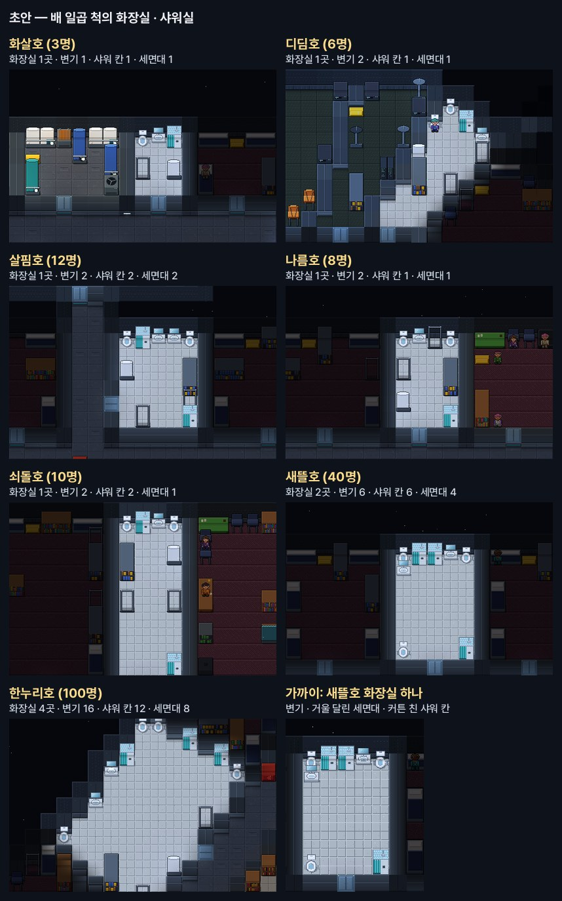

# 화장실 · 샤워실 (함장 요청 — "화장실 샤워실 이런것도 추가")

배 일곱 척에 화장실 · 샤워실을 넣는다. 사람은 마려우면 화장실에 가고 · 더러우면 씻는다.
**월드와 판단을 나눈다**: 몸이 차오르고 · 더러워지고 · 물이 돌고 · 변기가 막히는 것은 월드 법칙이고, 언제 가고 · 기다리고 · 씻고 · 피하는 것은 사람 · 로봇 · 주컴퓨터 각자의 판단이다.

## 배 도면 (함장 승인 — 일곱 척 도면에 들어갔다)
변기는 여섯 명에 하나 · 샤워 칸은 여덟 명에 하나쯤 (국제 우주 정거장: 일곱 명에 변기 둘). 화장실은 침실 곁에. 바닥은 흰 타일.

| 배 | 사람 | 화장실 | 변기 | 샤워 칸 | 세면대 | 자리를 낸 곳 |
|---|---|---|---|---|---|---|
| 화살호 | 3 | 1 (겸 샤워실) | 1 | 1 | 1 | 침실 8 → 5칸 · 생명유지실 7 → 6칸 |
| 디딤호 | 6 | 1 (겸 샤워실) | 2 | 1 | 1 | 통신실 자리를 반으로 (둘레 30° → 15° · 15°) |
| 살핌호 | 12 | 1 | 2 | 2 | 2 | 북쪽 줄 방을 한 칸씩 좁혀 침실 다 곁에 |
| 나름호 | 8 | 1 | 2 | 1 | 1 | 침실 둘 · 휴게실 · 주컴퓨터실을 조금씩 |
| 쇠돌호 | 10 | 1 | 2 | 2 | 1 | 침실 · 휴게실 · 운동실 · 의무실을 조금씩 |
| 새뜰호 | 40 | 2 (침실 넷마다) | 6 | 6 | 4 | 침실 7 → 6칸 · 휴게실 · 추모실 · 배움방을 조금씩 |
| 한누리호 | 100 | 4 (사분면마다) | 16 | 12 | 8 | 침실 17 → 13 (침대 6 → 7~8) |

꾸밈: 화장실마다 옷걸이 · 선반 · 제습기 (김이 차니까).

## (가) 몸 · 설비 — 월드
- **방광** (있다): 마신 물이 소변이 되어 차오른다. 지금은 저절로 비워지던 것을 걷어낸다 — 몸은 차오르기만 하고, 비우는 것은 사람이 변기에서. 한계(0.6L)를 넘으면 참지 못하고 지린다 (바닥에 물 · 옷이 젖음 · 더러움).
- **장**: 먹은 것의 찌꺼기가 쌓인다 (하루 약 0.15kg). 0.5kg를 넘으면 참지 못한다.
- **더러움** (0~1): 날마다 조금 · 땀(더위 · 일 · 운동)에 빨리 · 그을음 · 피 · 행성 흙 · 지림. 더러운 몸은 **사람 냄새**를 칸에 낸다 (장의 냄새 — 맡은 사람만 안다) · 다친 곳이 덧날 확률이 오른다.
- **변기** (진공 변기): 쓰면 흡입 팬이 30초 돈다 (전력 0.3kW). 소변 → 물 재생기로 (오수 → 회수) · 대변 → 변기 아래 오물 통 (30kg). 팬이 고장 나면 내려가지 않는다 — 모르고 쓰면 넘친다 (바닥 물 · 냄새 · 미끄럼). 무중력에 팬이 서면 쓸 수 없다.
- **세면대**: 손 씻기 0.5L (회수) — 손에 묻은 옮는 병을 씻어 낸다.
- **샤워 칸**: 6분 · 물 8L (거르개를 지나 회수) · 데우는 전력 3kW · 칸에 김이 찬다 (습도 · 온도). 습한 방은 곰팡이가 자란다 (생태의 곰팡이). 온수기의 조절기가 상하면 뜨거운 물(데임) 또는 찬물. 인공 중력이 없으면 물이 떠다녀 못 쓴다.

## (나) 사람의 판단
- **마려움**: 방광 · 장이 찰수록 커진다 — 크면 하던 일을 끊고 가장 가까운 빈 변기로. 불 · 구멍 같은 급한 일 중엔 참을 수 있는 만큼 참는다. 변기가 다 차 있으면 줄을 서거나 (짜증이 쌓인다) 다른 화장실로 (막히면 다른 길).
- **씻기**: 더러울수록 · 운동 · 땀 흘린 일 뒤 · 자기 전 — 사람마다 버릇 (성실 · 깔끔함). 물이 배급이면 짧게.
- **손 씻기**: 변기 뒤 · 밥 전 — 성실한 이는 늘 · 아닌 이는 가끔. 안 씻은 손으로 배식기 · 식량 상자를 만지면 병이 더 잘 옮는다.
- **냄새**: 냄새 나는 이 곁을 피하고 · 뒷말이 돌고 · 친한 이는 말해 준다.
- **지림**: 창피 (긴장 · 슬픔) → 씻으러 · 갈아입으러 · 본 이는 성격대로 놀리거나 감싼다.

## (다) 주컴퓨터 · 로봇
- 주컴퓨터: 물 형편을 보고 샤워를 배급한다 ("물이 모자라 샤워는 3분 · 이틀에 한 번") · 아침 줄이 길면 차례를 알린다 · 막힌 변기를 센서로 알아채 쓰지 못하게 표시하고 로봇에게 고치기를 맡긴다 · 오물 통이 차면 비우기 · 곰팡이 닦기 일을 올린다.
- 로봇: 바닥 물 닦기 · 변기 닦기 · 곰팡이 닦기 · 오물 통을 퇴비통 · 압축기로.

### (다) 설계
**월드 (⑦ LifeWash — 변기마다)**: 판단이 하는 일을 받아 셈만 한다.
- **오물 통** (변기마다 30kg): 변기에 비운 대변이 그 변기의 통으로 (용변 봉투는 예전대로 배의 장부). 통에서 꺼낸 것은 비운 곳(퇴비통 · 압축기 · 화물 상자)의 '쌓인 오물'로 — 질량은 어디로도 사라지지 않는다.
- **막힘**: 대변을 내릴 때마다 0.4% · 통이 90% 넘게 찼으면 20% · 가득 차면 반드시 (원인 마디 '변기가 막혔다 ← …'). 흡입 팬이 망가졌거나 전기가 없으면 그 한 번은 내려가지 않는다.
- **넘침**: 막힌 변기를 모르고 쓰면 오줌이 그 칸 바닥으로 (고인 물) · 지린내(암모니아 조금) · 대변은 변기 안에 걸려 있다가 뚫으면 통으로 · 변기가 몹시 더러워진다 (원인 마디 '막힌 변기를 써서 넘쳤다 ← 막힘' · 사실 '넘쳤다').
- **때** (0~1): 한 번 쓸 때마다 조금 (대변이면 더) · 넘치면 1. 더러운 변기에 앉은 이는 몸도 조금 더러워진다.
- **물 내린 수**: 변기의 조절기가 센다 (주컴퓨터가 읽는 센서).

**주컴퓨터 (⑩ ShipMindWash — 1분마다 · 아는 것만)**: 변기 조절기는 전기가 들고 주컴퓨터가 그 방을 볼 때만 보고한다 — 막힘 · 통이 찬 몫 · 물 내린 수 (안을 보는 카메라는 없다: 때는 모른다 · 쓴 수로 닦을 때를 정한다).
- **막힘** → 그 변기에 '사용 금지' 불을 켜고 방송 → 일감 '뚫기' (로봇 먼저 · 사람은 고치는 솜씨가 조금 있으면). 뚫으면 불을 끈다.
- **통 80%** → 일감 '통 비우기' (로봇이 꽉 찬 통을 곁의 빈 통과 바꿔 들고 가장 가까운 퇴비통 · 압축기 · 화물 상자로) · 가득 차면 '사용 금지'.
- **쓴 수 12번** → 일감 '변기 닦기' (바닥에 고인 물도 함께 닦는다).
- **샤워 배급**: 물 배급을 열 때 함께 정한다 — '샤워는 3분 · 이틀에 한 번' (지린 이는 늘 씻을 수 있다) · 배급을 풀면 함께 푼다. 방송에 함께 읽는다.
- **아침 줄**: 화장실에 쓰는 이보다 기다리는 이가 둘 넘게 많으면 (20분에 한 번) — 다른 화장실에 빈 변기 · 샤워 칸이 있으면 "○○ 화장실이 비어 있습니다", 없으면 온 차례를 알린다 ("차례: 가 · 나 · 다").
- 주컴퓨터가 멈추거나 화장실에 전기가 없으면 아무것도 모른다 — 막힌 변기에 불이 켜지지 않아 누가 모르고 쓰고 넘친다 (고인 물은 예전대로 청소 일감에서 — 방을 보면).

**사람 (⑧ MindWash — 판단)**:
- '사용 금지' 불이 켜진 변기 · 몹시 더러운 변기는 고르지 않는다 (몹시 급하면 더러워도 쓴다) · 가 보니 넘쳐 있으면 다른 변기로 (막히면 다른 길).
- 샤워 배급: 성실할수록 지킨다 (3분 · 이틀에 한 번 — 물 4L) · 지키지 않는 이는 6분을 다 쓴다 (센다 — (라)의 불만 씨앗). 3분이면 더러움이 반만 씻긴다.
- 줄에서 "비어 있다"를 들으면 그쪽이 더 빠를 때 옮긴다 · 차례를 들은 이는 덜 애태우고 더 오래 기다린다 (차례가 오는 줄 안다).

**로봇 (⑧ — 일감 '변기 손질' 하나 · 셋 갈래)**: 닦기 5분 (때 · 둘레 고인 물) · 뚫기 10분 (막힘 · 걸린 대변은 통으로) · 통 비우기 (변기에서 통 들기 3분 → 비울 곳에 쏟기 3분). 팔이 상하면 못 한다 (손일).

## (라) 사회 · 관습 · 사고
- 아침 줄 · 새치기 다툼 · 샤워를 오래 하는 이에 대한 불만 → 관습 '샤워는 5분' (회의로 정하기도).
- 사고는 월드 법칙의 확률에서: 변기 막힘 · 넘침 / 온수기 고장 (데임 · 찬물) / 습기 → 곰팡이 → 포자 기침 / 오물 통에서 새는 냄새 · 메탄.

## (마) 그림 · 소리
- 그림: 변기 · 거울 달린 세면대 · 커튼 친 샤워 칸 (초안에 있다) · 쓰는 동안 커튼이 닫히고 김이 오른다 · 바닥 물 · 곰팡이 얼룩 · 더러운 사람은 얼룩진 옷.
- 소리: 진공 변기의 '쉬익' · 샤워 물소리 · 손 씻는 소리.

## 차례
(가) 몸 · 설비 ✔ → (나) 사람의 판단 ✔ → (다) 주컴퓨터 · 로봇 ✔ → (라) 사회 · 관습 · 사고 → (마) 그림 · 소리 (변기 · 세면대 · 샤워 칸 그림 ✔).

## 된 것 — (가) (나)
- 방광이 저절로 비워지던 것을 걷어냈다 — 몸은 차오르기만 하고 (월드) · 비우는 것은 사람의 판단.
- 마려움 0.5부터 가장 가까운 쓸 수 있는 변기로 (줄이 긴 곳 · 팬이 망가지거나 전기가 없는 변기는 고르지 않는다) · 앞선 이가 쓰는 동안 곁에서 줄을 서고 · 15분 넘으면 다른 화장실로 · 다 쓰면 비켜선다.
- 변기 뒤 손 씻기: 성실 0.95면 네 번에 네 번 · 0.05면 0번 (0.35 + 0.6 × 성실).
- 샤워: 더러움 0.35 넘고 빈 시간 · 지렸으면 바로 · 운동 뒤 · 자기 전 — 6분 · 물 8L (물탱크 → 오수 · 1%는 김) · 온수기 3kW를 켰다 끈다 (전기가 없으면 찬물 — 기분이 덜 풀린다).
- 참지 못함 (월드): 방광 0.6L · 장 0.45kg를 넘으면 그 자리 바닥이 젖고 몸이 더러워진다 (원인 마디 '참지 못하고 옷에 지렸다' · 사실 '참지 못했다') → 지린 이는 바로 씻으러 간다.
- 변기 · 샤워 칸이 없는 배 (시험 배): 하던 일을 끊지 않고 용변 봉투 · 물수건.
- 규칙 시험 6 (화장실 묶음) · 고친 시험 빈틈 1 (말림의 한 마디도 그 사람의 판단 행동).

## 된 것 — (다)

관찰 장면 `Lab --scene wash` (새뜰호 40명 · 로봇 10 · 05:30~10:30): 막힌 변기에 바로 '사용 금지' 불 → 로봇이 10분 만에 뚫고 · 85% 찬 오물 통을 퇴비통으로 (25.5kg) · 쓴 수가 차면 두 번 닦았다.

- **변기마다 (월드)**: 오물 통 30kg (비운 대변이 그 변기의 통으로) · 막힘 (대변을 내릴 때 0.4% · 통이 90% 넘게 차면 20% · 가득 차면 반드시 · 흡입 팬이 서면 내려가지 않는다 — 원인 마디 '변기가 막혔다 — 까닭') · 넘침 (막힌 줄 모르고 쓰면 오줌이 바닥으로 · 지린내 · 원인 '넘쳤다' ← '막혔다' · 사실 '변기가 넘쳤다') · 때 (쓸 때마다 · 넘치면 1 — 앉은 이도 조금 더러워진다) · 물 내린 수.
- **샤워 칸 (월드로 옮김)**: 틀어 두면 사람이 있든 없든 물이 흐른다 (6분에 8L · 물탱크 → 오수) · 데운 물의 열은 거의 다 배수구로 (칸에는 15% · 김 1%) — 예전엔 판단 코드가 물을 빼고 · 3kW가 통째로 칸 공기를 데웠다.
- **주컴퓨터 (1분마다 · 조절기가 보고하는 것만)**: 막혔거나 통이 가득 차면 '사용 금지' 불 + 방송 → 일감 '뚫기' · 통 80%면 '비우기' · 닦은 뒤로 물 내린 수 12번이면 '닦기' (안을 보는 카메라는 없다 — 때는 모른다) · 물 배급을 열 때 '샤워는 3분 · 이틀에 한 번'도 · 누가 쓰는 변기 · 샤워 칸 곁에 1분 넘게 서 있는 이가 둘 넘으면 다른 화장실의 빈 곳으로 뒤에 온 이를 보내거나 (없으면) 차례를 알린다 · 물이 흐르는데 2분 넘게 빈 샤워 칸은 잠근다 (틀어 둔 이는 그 일로 조심을 배운다). 주컴퓨터가 없거나 멈추면 아무것도 모른다.
- **로봇 (일감 '변기 손질' — 로봇 먼저)**: 닦기 5분 (때 · 둘레 고인 물 → 오수) · 뚫기 10분 (걸린 대변은 통으로) · 통 비우기 (꽉 찬 통을 곁의 빈 통과 바꿔 들고 가장 가까운 퇴비통 · 압축기 · 없으면 화물 상자에 쏟는다 — 질량 그대로). 팔이 상하면 못 한다.
- **사람 (판단)**: '사용 금지' 불이 켜진 변기는 고르지 않고 · 와 보니 넘쳐 몹시 더러우면 다른 변기로 (몹시 급하면 쓴다) · 안내받은 빈 곳으로 옮긴다 (걸어오는 중이든 줄에 섰든 · 안내 하나에 한 번) · 차례를 들으면 덜 애태우고 두 배 기다린다 · 샤워 배급은 성실할수록 지킨다 (0.2 + 0.8 × 성실 — 3분 · 이틀에 한 번 · 지린 이는 늘 씻는다) · 씻다 말고 나가면 물을 잠근다 — 깜빡하면 (덜 성실 · 급할수록) 원인 마디 '틀어 둔 채 나갔다'.
- **고친 결함 넷**: ① 샤워를 하다 다른 일로 나가면 온수기가 켜진 채 남아 칸이 58~69℃로 달아올랐고, 다음 사람은 '덥다'고 믿어 30분 넘게 화장실과 침대를 오갔다 (디딤호 평시 하루에 샤워 0번 → 5번) ② 지린 이가 8시간 안에 씻었으면 다시 씻지 못했다 ③ 몸 셈보다 먼저 변기를 쓰면 오줌이 오수 장부 밖으로 샜다 (법칙 시험이 찾았다) ④ 주컴퓨터의 '물 며칠 치'가 아침 샤워 몇 번에 '30일 아래'로 떨어져 물 배급을 열었다 — 이제 물탱크 + 되찾을 오수를 한 시간마다 재어 실제로 줄어드는 빠르기로 센다.
- **검토단이 찾아 고친 것**: 일이 끊겨 떨군 오물 통 (내려놓은 이가 그 자리를 알리고 → 다른 로봇이 주워 비운다) · 통이 가득 차 생긴 막힘 (비우기부터) · 물이 안 나온 샤워를 씻은 것으로 치던 것 (그 샤워 칸은 한 시간 피하고 물수건 · 갈아입기) · 샤워 '실수'가 '켜 둔 조리대'로 읽히던 것 · 차례를 들은 이가 3분 뒤 잊던 것 · 넘친 변기를 뚫어도 때가 남아 모두 돌아서던 것 (뚫으며 닦는다) · 안내받은 곳의 갈래(변기 · 샤워 칸) · 든 오물의 질량 (월드가 옮기는 중인 몫을 쥔다) · 오물 통 물건 장부 · 전력 줄이기가 샤워 물까지 멈추던 것 (물 밸브와 온수기를 나눴다 — 물이 흐르지 않으면 흐름 스위치가 온수기를 끈다) · 전력 줄이기가 변기 흡입 팬을 꺼 막히던 것 · 소화기를 든 로봇이 손질을 끝내 못 하던 것.
- 샤워 칸 · 세면대를 배의 물관 그물에 이었다 (관이 끊기면 물이 나오지 않는다 — 일곱 척 관 배치가 조금 바뀌었다).
- 법칙 시험 2 (대변 · 오줌 보존) · 규칙 시험 9 (화장실 일 묶음) · 관찰 장면 `wash` · 저장 판 97.
